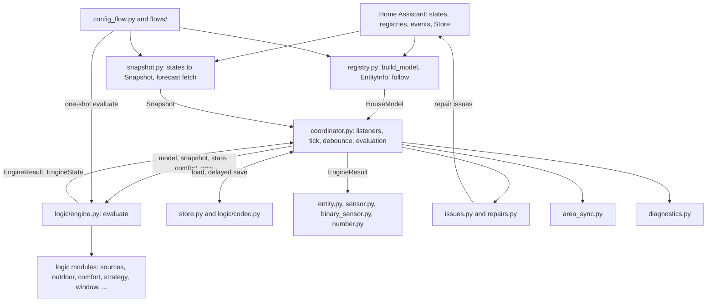
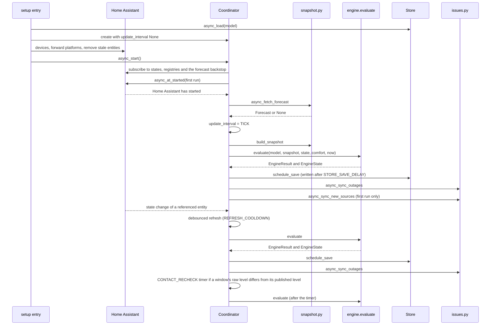

# Integration

This file describes the Home Assistant layer around the pure logic of [logic.md](logic.md): manifest, hub entry with
subentries, engine call, snapshot, coordinator, persistence, devices and entities, flows, repairs, area sync,
translations, diagnostics and tests. It targets Home Assistant 2026.10 (ADR-008). Requirement IDs (R1, W11, ...) refer
to [requirements.md](requirements.md), ADRs to [architecture.md](architecture.md), screens (S1 to S11) to
[ui_mockups.md](ui_mockups.md), logic sections to [logic.md](logic.md).

IDs: `I1` to `I17` are the decisions of the adapter layer. §0 indexes them; each one is stated with its reason in the
section named there, in parentheses next to the rule it explains. A bare `§N` is a section of this file, `logic §N` a
section of logic.md.

Frozen: data keys of the hub options and subentries, unique IDs, issue ID prefixes and Store keys are marked frozen.
They cannot change after a release without a migration, because Home Assistant ties history, entity IDs and user
changes to them (CLAUDE.md rule 1).

## 0. Decision index

| ID | Decision (one line) | Where |
|---|---|---|
| I1 | The data flow of logic §2 is a pure module `logic/engine.py`; the coordinator reads, calls, persists, publishes | §1, §4, §9.1 |
| I2 | Every subentry or options change reloads the hub entry, a burst of changes gives one reload; comfort numbers re-evaluate only | §6.1, §6.3 |
| I3 | House-level settings live in `entry.options`; `entry.data` stays empty | §3.1 |
| I4 | New sources (R14): the Store remembers the entities of an area when its object was last saved | §10.2 |
| I5 | Area sync (R11) clears a field only while it still holds the entity Climate Hub wrote | §11 |
| I6 | A cover added later enables the window's `cover` sensor; removing the cover changes nothing | §8.3, §8.4 |
| I7 | Entities the configuration does not produce are not created and are removed from the entity registry | §8.3, §8.4 |
| I8 | A comfort value that would make minimum >= maximum is rejected with a translated error | §6.3, §8.4 |
| I9 | Milestones | build history, not described |
| I10 | Sun azimuth and elevation come from `sun.sun` | §5 |
| I11 | Forecast: at start, on weather changes at most every 15 min, hourly as a backstop | §5, §6.3 |
| I12 | Source-dependent entities exist only with the source they need | §8.3 |
| I13 | Comfort minimum, maximum and threshold persist in the Store | §6.3, §7 |
| I14 | The first evaluation waits for Home Assistant's start | §6.1 |
| I15 | A device follows its subentry's area only when that area changes | §8.1 |
| I16 | Word lists and preview texts are strings of the `common` translation section, in the instance language | §9.1, §12 |
| I17 | The house-plan reconfigure (S10) previews suggested sources for new or changed outdoor sides | §9.6 |

## 1. Layers and files

The engine is the only place where values and recommendations are decided (I1). The coordinator reads Home Assistant,
calls the engine, persists and publishes; entities display results; flows call the engine once for previews.

Code: [`custom_components/climate_hub/`](../custom_components/climate_hub/). Tests: [`tests/`](../tests/).



```
custom_components/climate_hub/
  __init__.py        setup, unload, remove; coalesced reload (I2); calls device sync and stale-entity cleanup
  manifest.json
  const.py           domain, subentry types, adapter timings, Store version (no text)
  registry.py        EntityInfo/AreaInfo from the registries, follow resolution, build_model()
  snapshot.py        readings with unit conversion, contacts, climate devices, covers, weather, sun, forecast fetch
  coordinator.py     DataUpdateCoordinator: listeners, tick, debounce, contact re-check, Store, registry listener
  store.py           Store wrapper: load, delayed save, prune
  entity.py          base entity, descriptions with existence predicates, device sync, stale cleanup
  sensor.py, binary_sensor.py, number.py
  labels.py          source labels of the readings attributes (R16)
  issues.py          issue sync: outages (H5), new sources (R14), windows without a room (W11)
  repairs.py         fix flows
  area_sync.py       R11
  diagnostics.py
  config_flow.py     hub flow S1-S4, reconfigure S10 (house plan), subentry type registration
  flows/common.py    choice lists, suggestions, selectors, base class of the room and region flows
  flows/hub.py       hub-level parts: first-setup scan, house plan changes, default options, new subentries
  flows/options.py   S9 options flow with the weather check
  flows/preview.py   one-shot engine runs and markdown previews
  flows/room.py, flows/region.py, flows/window.py   subentry flows S6, S7, S8 (window steps as a mixin)
  translations/en.json, translations/de.json
  brand/             icon and logo images (HACS and Home Assistant brand check)
  logic/             pure logic: one module per section of logic.md, plus
    model.py         pure configuration types and parsers (§3.3)
    engine.py        pure evaluation (§4)
    codec.py         pure JSON codec of the engine state (§7)
```

No `icons.json`: no entity defines an icon. No `services.yaml`: the integration registers no actions.

Import structure of the flow modules: `flows/preview.py` imports `labels.py`, `registry.py` and `snapshot.py`.
`flows/common.py` imports `flows/preview.py`; `flows/hub.py` imports `flows/common.py` and `flows/preview.py`.
`flows/room.py`, `flows/region.py`, `flows/window.py` and `flows/options.py` import only these three flow modules
(`flows/window.py` and `flows/options.py` also `flows/hub.py`) and never each other. `config_flow.py`
imports `flows/hub.py`, `flows/options.py`, `flows/preview.py`, `flows/region.py`, `flows/room.py` and
`flows/window.py`. Outside the flows, `issues.py` uses `flows/preview.py` (texts, names) and `repairs.py` uses
`flows/common.py`, `flows/hub.py` and `flows/preview.py`. `coordinator.py` imports `issues.py`, so the issue sync is
reachable from the coordinator without a cycle (the reverse import in `issues.py` is for typing only).

## 2. Manifest

The manifest, `hacs.json` and the config flow version are the packaging facts of the integration. The files are the
source; this section names the keys and what they mean.

Code: [`manifest.json`](../custom_components/climate_hub/manifest.json), [`hacs.json`](../hacs.json),
[`config_flow.py`](../custom_components/climate_hub/config_flow.py).

- `domain` `climate_hub`, `name` `Climate Hub`. The other keys are sorted, as hassfest requires.
- `config_flow` `true`; `single_config_entry` `true`: a second hub entry aborts with `single_instance_allowed`
  (ADR-002).
- `integration_type` `service`, `iot_class` `calculated`: the integration computes from other entities and talks to no
  device.
- `dependencies` `repairs` (the repair issues of §10 need it). `after_dependencies` `recorder` (text-sensor history in
  the window flow, §9.5), `sun` (`sun.sun`, I10) and `weather` (forecast, I11): each is read when present, none is
  required.
- `codeowners`, `documentation`, `issue_tracker`: the GitHub repository.
- `version` is set at each release (CLAUDE.md "Release"); `.github/workflows/release.yml` checks the tag against it.
- `hacs.json` carries `name` and `homeassistant` `2026.10.0` (ADR-008).
- `ConfigFlow.VERSION = 1`, `MINOR_VERSION = 1` (config entry version; no migration exists yet).
- `brand/` holds the icon and logo images; `.github/workflows/` has `ci.yml`, `validate.yml` (hassfest and HACS
  validation) and `release.yml`.

## 3. Configuration model

All configuration is the hub entry's options plus three subentry types. The pure model of §3.3 is built from it.
Field labels and what each field does for the user are in the [reference](reference.md): [hub
options](reference.md#hub-options), [house plan](reference.md#house-plan), [room form](reference.md#room-form),
[outdoor side form](reference.md#outdoor-side-form), [window form](reference.md#window-form). The tables below list
stored keys and types.

Code: [`logic/model.py`](../custom_components/climate_hub/logic/model.py) (keys, types, parsers),
[`registry.py`](../custom_components/climate_hub/registry.py) (`build_model`). Tests:
[`tests/logic/test_model.py`](../tests/logic/test_model.py),
[`tests/integration/test_registry.py`](../tests/integration/test_registry.py).

### 3.1 Entry

`entry.data` is empty; all house-level settings are in `entry.options` (I3). The reason: the options flow (S9) edits
the weather entity, area sync and timings, and an options flow writes options only (ADR-002 amendment); everything
configured at setup stays editable (CLAUDE.md rule 5). The entry title is `Climate Hub`
(`ENTRY_TITLE`). Options keys (frozen; the key names are the `CONF_*` constants of `logic/model.py`):

| Key | Type | Default | Screen |
|---|---|---|---|
| `weather` | entity ID; absent when no weather entity is set | first weather entity with a forecast (`default_weather`) | S1, S9 |
| `area_sync` | bool | `True` | S1, S9 |
| `max_age` | int, minutes | `DEFAULT_MAX_AGE` | S9 |
| `burst_duration` | int, minutes | `DEFAULT_BURST_DURATION` | S9 |
| `humidity_threshold` | float, % | `DEFAULT_HUMIDITY_THRESHOLD` | S9 |
| `repair_delay` | int, hours | `DEFAULT_REPAIR_DELAY` | S9 |

The defaults are the `DEFAULT_*` constants of `logic/const.py`; their values are in
[logic §13](logic.md#13-constants). The first-setup flow writes every key (`default_options`), except `weather` when
none is chosen; `parse_settings` falls back to the `DEFAULT_*` value for an absent key, `area_sync` counts as `True`
when absent. Form sections are UI only: stored data is flat.

### 3.2 Subentries

Types in this order (the order of the add items in the three-dot menu, S5): `room`, `region`, `window`
(`async_get_supported_subentry_types`). Direction values are the logic's `Direction` values (`n`, `e`, `s`, `w`);
the `selector` translations map them to the direction names.

Room (frozen keys). Subentry `unique_id` `room_<area_id>`, updated with the area. Title: the area name.

| Key | Type | Meaning |
|---|---|---|
| `area` | area ID | R1 |
| `side` | `n` / `e` / `s` / `w` / `none` | main side (R9); absent counts as `none` |
| `temperature` | list of entity IDs | ranked sources (R2) |
| `humidity`, `pressure` | list of entity IDs | ranked sources; empty means "follow the temperature devices" (R3) |
| `climate_devices` | list of entity IDs | heating and cooling devices (R15) |
| `max_age` | int minutes, stored only when set | override of the hub value |
| `show_readings` | bool | spread entities (R16); absent counts as `True` |

Region (frozen keys). Subentry `unique_id` `region_<direction>`. Title: the `common` string `region_title`
(`{direction} · {area}`) with the direction name from `direction_n` to `direction_w`.

| Key | Type | Meaning |
|---|---|---|
| `area` | area ID | O1 |
| `direction` | `n` / `e` / `s` / `w` | O1, one region per direction |
| `temperature`, `humidity`, `pressure`, `max_age` | as for rooms | O2 |

Window (frozen keys). No subentry `unique_id` (several per room). Title: the `common` string `window_title`
(`{area} {name}`).

| Key | Type | Meaning |
|---|---|---|
| `area` | area ID | the room's area (W1); the room subentry may be missing (W11) |
| `type` | `single` / `double` / `pass_through` | S8 |
| `name` | string | stored at creation: the user's name, else the `common` string `window_name` (`pass_through_name` for a pass-through), numbered from the second in the room |
| `leaf` | entity ID | single: the sash contact |
| `leaf_left`, `leaf_right` | entity IDs | double |
| `tilt` | entity ID, stored only when set | single and double: tilt discriminator (double: contact between the leaves) |
| `handle` | entity ID, stored only when set | single and double |
| `inner`, `outer` | entity IDs | pass-through |
| `mappings` | `{entity_id: {closed\|ajar\|tilted\|open: [texts]}}`, stored only with text sensors | text sensors (S8d, W2) |
| `cover` | entity ID, stored only when set | SH2 |
| `facing` | `room` / `n` / `e` / `s` / `w` | always stored; `room` means the room's main side |
| `facing_degrees` | float, stored only when set | SH4 |
| `min_level` | `ajar` / `tilted` / `open` | always stored; `tilted` is the form's default (W3) |

Subentry titles are set when the object is saved; a renamed area shows on the integration page after the next save.
Device names do not contain the area (ADR-007), so they are not affected.

### 3.3 Pure model (`logic/model.py`)

Frozen dataclasses with no Home Assistant imports, built by `registry.build_model(hass, entry)`; previews build the
same model from pending data with `build_model_from(hass, options, subentries)`.

`HouseModel` holds the hub options as `Settings`, the weather entity, and a `RoomModel`, `RegionModel` or `WindowModel`
per subentry ID. Compared with the stored data (§3.1, §3.2), the model is resolved: "follow" is expanded into entity
IDs, a room's `max_age` is its override or the hub value, and each window knows its room and its direction.

- `parse_settings`, `parse_room`, `parse_region` and `parse_window` turn plain mappings into these types (pure, table
  tested). `WindowModel.config` is a `FrameConfig` (leaves, tilt, handle) or a `PassThroughConfig` (inner, outer) of
  logic §8; `kinds` is `BINARY` for entity IDs starting with `binary_sensor.`, else `TEXT`.
- `build_house` links each window to the room of its area (`room_id`, `None` without a room, W11), fills
  `RoomModel.window_ids` and resolves `WindowModel.direction` (the window's own `facing`, else the room's `side`; SH4).
  Rooms, regions and windows are sorted by subentry ID, so the model does not depend on the order in which the
  subentries were created (scenario 10).
- Follow resolution (R3) needs the registries and stays in `registry.py`: for an empty humidity or pressure list,
  `followed_sources` calls `prefill.follow_devices` with the current `EntityInfo` list, and `parse_room` or
  `parse_region` use that list in place of the empty one.
- `HouseModel` supports equality. The coordinator compares a rebuilt model with the running one to tell whether a
  registry change altered it (§6.4).

## 4. Engine (`logic/engine.py`)

`evaluate` is one pure call per coordinator update. It runs the modules of logic §2 in the order below, isolates every
object (N2) and takes `now` as a parameter (CLAUDE.md rule 6). The coordinator is its only caller at runtime (I1); the
flows call it for previews (§9.1).

Code: [`logic/engine.py`](../custom_components/climate_hub/logic/engine.py). Tests:
[`tests/logic/test_engine.py`](../tests/logic/test_engine.py).

Signature: `evaluate(model, snap, state, comfort, now)` returns `(EngineResult, EngineState)`.

Survives a restart: the `EngineState` of §4.2, per room, region and window the learned offsets, hysteresis states and
timers, and for the hub the weather offsets, forecast bias, strategy and outage timers (stored by §7).

### 4.1 Inputs

| Input | Source | Meaning |
|---|---|---|
| `Comfort` (`c_min`, `c_max`, `threshold`) | coordinator, from the Store (§6.3) | comfort range and strategy threshold |
| `Snapshot.readings` | `read_reading` | a `Reading` per (entity ID, `Metric`) of every source, status set by the adapter (§5) |
| `Snapshot.contacts` | `read_contact` | `Contact`: `raw` state and `last_changed` per window contact entity |
| `Snapshot.climate` | `read_climate_device` | `ClimateDevice` per heating or cooling entity |
| `Snapshot.covers` | `read_cover` | `CoverPosition` per cover entity that has a state |
| `Snapshot.weather`, `Snapshot.clouds` | `read_weather` | `WeatherReadings` and the attribute `cloud_coverage`; `None` without a weather entity |
| `Snapshot.forecast` | coordinator cache (§6.3) | `Forecast`: `points` and `hourly`; `None` without one |
| `Snapshot.sun_azimuth`, `Snapshot.sun_elevation` | `read_sun` | from `sun.sun` (I10) |

### 4.2 State (persisted, §7)

| Object | Persisted state |
|---|---|
| `RoomState` | `sources` (a `SourceState` per metric), `trend_state`, the previous `position`, `relation`, `dryness` and `trend` (for hysteresis), `goal` (`GoalState`) |
| `RegionState` | `sources` (a `SourceState` per metric) |
| `WindowStore` | `debounced` (`Debounced`), `open_since`, `cover` (`CoverState`) |
| `HubState` | `weather_offsets`, `forecast_bias`, `strategy` (the previous one, for hysteresis), `outages` (`OutageState`) |
| `EngineState` | `rooms`, `regions` and `windows` by subentry ID, and `hub` |

`EngineState.empty()` is the start-up value. An object missing from the state starts fresh.

### 4.3 Steps

The steps are numbered as in `evaluate()`. They follow the modules of logic §2 (sources, outdoor, comfort, strategy,
window, recommendation, cover, house). The code runs 1, 2, 3, 4, 6, 7, then 5 and 8 together per room, then 9 and 10:
the room's recommendation needs the strategy and the windows, and the strategy does not depend on the rooms. The
results are the same as in the numeric order (logic §2).

1. Regions (logic §4, sources). Per region and metric: `sources.resolve` with the region's `max_age` and, for humidity,
   the bounds `HUMIDITY_RANGE` (0 to 100), else no bounds. Result: `RegionOwn`, plus the outage statuses of step 10.
2. Weather offsets (logic §5, outdoor). `learn_weather_offsets(region_own, snap.weather, hub.weather_offsets, now)`,
   before any direction resolves (the contract of logic §14).
3. Directions (logic §5). `resolve_direction` for each of `n`, `e`, `s`, `w` and for `None` (rooms without a side get
   no values and the reason `no_side`). A region's result uses its own direction.
4. House outdoor (logic §5). `house_outdoor(region_own, snap.weather, offsets, now)`.
5. Rooms (logic §4, §3, §6, §16). Per room, in `_evaluate_room`: resolve the three metrics as in step 1; absolute
   humidity and dew point through `psychro` when temperature and humidity both have a value; the outdoor values of the
   room's side; differences outside minus inside for temperature and absolute humidity; `comfort_position`,
   `outside_relation`, `outside_dryness` and `trend` with their previous states; `spread` of temperature and
   humidity candidates and `setpoint_deviation` over the climate devices (R16, R17).
6. Strategy (logic §7). `update_forecast_bias` gets the house outdoor value only when its stage is not `weather`,
   else `None` (logic §14). Then `daily_strategy` with the forecast points, the comfort values, the new bias and the
   previous strategy.
7. Windows (logic §8). Per window, in `_evaluate_window`: `contact_level` per contact, `window_level`,
   `debounce(level, previous, now, min_level)`, then `open_since` with the same `min_level` and a start-up hint. The
   hint is the latest `last_changed` among the contacts whose level is known and above `Level.CLOSED`, so a contact
   that reports closed after a restart does not set an open-since time. `room_windows` aggregates the window states of
   a room inside step 5 and 8; a window without a result counts as unknown (`WindowState(None, None, None)`).
8. Recommendation (logic §9). Per room: `recommend` with a `RoomInput` and the previous goal; `warnings` when the room
   has windows; `open_while_conditioning` when it has windows and climate devices. `has_windows` means the room has at
   least one window (a failed window counts as unknown), `has_side` that it has a main side (without one:
   recommendation `none`, reason `no_side`), `ventilating` is `None` without windows.
9. Cover (logic §10). Per window with a state, in `_evaluate_cover`: the facing is `facing_azimuth(direction,
   facing_degrees)` when the window has a direction, else `facing_degrees`. A window with a room and no facing gets
   `none` with `no_data`; a window without a room goes to `cover()` with `has_room=False` and gets `no_room`. The
   outdoor temperature is that of the window's direction. A failed room is passed as missing data (`no_data`), not as
   a missing room.
10. House (logic §12). `outages(statuses, previous, now, repair_delay)`; the outage key is `"<object id>/<entity id>"`.
    An entity counts as invalid in an object when none of its readings there is `ok`; its status is the first
    non-ok status in the order temperature, humidity, pressure. Timers of failed objects carry over
    (`_carry_over_outages`). `_house_result` forms `indoor_average` over all rooms' temperatures, `any_of` for the two
    warnings over rooms with windows, `any_open_while_conditioning` over rooms with windows and climate devices, and
    `any_cover_to_close` over the window covers.

The new `HubState.strategy` is the previous one when the strategy part failed. A failed object keeps its previous
state (§4.4).

### 4.4 Isolation (N2)

Each region, room, window, window cover and hub part runs inside `_attempt`: an exception is recorded and a
fallback is used. A failed object has no result (its entities become unavailable, §8.4) and keeps its previous
state; dependants see it as missing data, not as a missing object (a window of a failed room gets `no_data`, not
`no_room`). Failures are returned as `failures: Mapping[str, str]`, object ID to `"<ExceptionType>: <message>"`;
the engine does not log.

Failure keys: the subentry ID for a region, room or window; `<window id>/cover`; `hub/weather_offsets`,
`hub/outdoor/<direction or none>`, `hub/outdoor`, `hub/forecast_bias`, `hub/strategy`, `hub/outages`, `hub/house`.
A failed `hub/house` leaves `EngineResult.house` as `None`.

### 4.5 Result

`EngineResult` holds a `RoomResult`, `RegionResult` and `WindowResult` per subentry ID, one `HouseResult` (`None` when
its part failed) and the `failures` (§4.4). Each result carries what the entities of its device show (§8.3) plus the
values the attributes and diagnostics need: the full `Resolution` with every candidate, the outdoor stages, and for a
region both its own resolutions and the values of its direction. The house result also carries the outages for the
repair issues (§10.1).

### 4.6 Tests

Table and scenario tests with hand-built models and snapshots, no `hass`:

- Acceptance scenarios 2 to 7, 9 to 12 of the requirements, run over several evaluations with advancing `now`.
  Scenario 10: two models built in different subentry orders give equal results.
- The contract of logic §14: weather offsets learned before directions resolve; the bias is fed only off the weather
  stage; the same `min_level` reaches `debounce` and `open_since`; outages are built from candidate statuses.
- Isolation: a failing room, region or hub part leaves the rest intact and keeps the failed object's previous state;
  a window of a failed room reports `no_data`; the outage timer of a failed room survives.
- Window without a room: state works, cover `no_room`, no room aggregation. Room without windows: window parts
  `None`.

## 5. Snapshot (`snapshot.py`)

The snapshot module reads `hass.states` into the engine's `Snapshot` for one `HouseModel`. Its single-entity readers
are public because the registry module and the flows use them one by one.

Code: [`snapshot.py`](../custom_components/climate_hub/snapshot.py). Tests:
[`tests/integration/test_snapshot.py`](../tests/integration/test_snapshot.py).

Public readers: `read_reading`, `metric_value`, `read_climate_device`, `read_contact`, `read_cover`, `read_weather`,
`read_sun`, `referenced_entities`, `build_snapshot` and `async_fetch_forecast` (the only coroutine).

### Rules

1. Sensor reading (`read_reading`). A missing state gives status `missing` with no `reported_at`; the states
   `unavailable` and `unknown` give that status with `reported_at = state.last_reported` (R4). Otherwise the value
   is read as a finite number (else `not_numeric`) and converted to the metric's unit: `TemperatureConverter` to °C,
   `PressureConverter` to hPa; humidity needs the unit `%`. A unit that does not convert gives `unit`.
2. Climate reading (R5). For a `climate.` entity the temperature is the attribute `current_temperature` in the
   instance's temperature unit (`hass.config.units`), humidity is `current_humidity` in %, and pressure is always
   `unknown`. A missing attribute is `unknown`. The attribute `temperature` (the setpoint) is never read as a source.
3. Climate device (A12, R17). `ClimateDevice(hvac_action=attributes["hvac_action"], hvac_mode=state.state,
   target=temperature, target_low=target_temp_low, target_high=target_temp_high, current=current_temperature)`; the four
   temperatures are converted from the instance unit to °C, a missing or non-numeric attribute is `None`. A missing
   state gives a device with no action and no mode. The setpoint feeds only R17, never a source value (R5).
4. Contact. `Contact(raw=state.state, last_changed=state.last_changed)`; a missing state gives `Contact(None, None)`.
5. Cover. `cover_position(state.state, current_position)` of logic §10; no state gives `None`, and the entity is left
   out of `Snapshot.covers`.
6. Weather. `WeatherReadings` from the attributes `temperature`, `humidity`, `pressure` with `temperature_unit` and
   `pressure_unit`, `reported_at = last_reported`; clouds from `cloud_coverage`. A weather state of `unavailable` or
   `unknown` gives three readings with that status and no clouds; no state gives `(None, None)`.
7. Sun (I10). `sun.sun` attributes `azimuth` and `elevation`; a missing entity or attribute gives `None`. The reason:
   `sun.sun` is the standard entity of Home Assistant's `sun` integration, so Climate Hub needs no location or
   astronomy code of its own.
8. Forecast. Not read here; the coordinator caches it (§6.3) and passes it to `build_snapshot`.
9. `referenced_entities(model)`: every source of every room and region (including followed ones), the climate
   devices, the contacts, the covers, `sun.sun` and the weather entity. The coordinator subscribes to this set
   (§6.3); `build_snapshot` reads the sources once per entity and metric.
10. Forecast fetch (I11). `async_fetch_forecast` returns `None` without a state. It uses `hourly` when the entity
    supports `WeatherEntityFeature.FORECAST_HOURLY`, else `daily` when it supports `FORECAST_DAILY`, else `None`. It
    calls `weather.get_forecasts` with `blocking=True, return_response=True`. A point needs `datetime` and
    `temperature` (others are skipped); `templow` becomes `temp_low`; temperatures are converted from the entity's
    `temperature_unit`; a naive datetime gets the instance time zone. Any exception is caught and logged at debug
    level, and an empty result is `None`.

Tested: every status, unit conversion (°F source, Pa pressure), `last_reported` on an unchanged value, climate
attributes and units, weather units, the forecast through a registered fake `weather.get_forecasts` service (hourly,
daily only, unit converted, unsupported, empty, failing).

## 6. Coordinator (`coordinator.py`)

`ClimateHubCoordinator` is a `DataUpdateCoordinator[EngineResult]` with `config_entry=entry`. It owns every listener
and timer: state changes, the 60 s tick (N1), the debounced refresh, the contact re-check, the forecast backstop and
the registry listener. Its data is the last `EngineResult`; `entry.runtime_data` holds a `ClimateHubData` with the
coordinator and the store (`type ClimateHubConfigEntry = ConfigEntry[ClimateHubData]`).

Code: [`coordinator.py`](../custom_components/climate_hub/coordinator.py),
[`const.py`](../custom_components/climate_hub/const.py), [`__init__.py`](../custom_components/climate_hub/__init__.py).
Tests: [`tests/integration/test_coordinator.py`](../tests/integration/test_coordinator.py),
[`tests/integration/test_setup.py`](../tests/integration/test_setup.py).

Adapter constants (`const.py`):

| Constant | Value | Use |
|---|---|---|
| `TICK` | 60 s | `update_interval`, set in the first run: freshness, trend samples, timers |
| `REFRESH_COOLDOWN` | 2 s | `Debouncer(immediate=True)` for state-change refreshes |
| `CONTACT_RECHECK` | `CONTACT_DEBOUNCE` + 0.5 s (5.5 s) | extra refresh after a contact change, so the debounced level publishes |
| `FORECAST_MIN_GAP` | 15 min | shortest gap between two forecast fetches triggered by weather changes (I11) |
| `FORECAST_BACKSTOP` | 60 min | interval of the forecast fetch that needs no weather change (I11) |
| `REGISTRY_DEBOUNCE` | 5 s | registry listener |
| `RELOAD_DELAY` | 1 s | coalesced reload (I2) |
| `STORE_SAVE_DELAY` | 60 s | `Store.async_delay_save` |
| `STORE_VERSION` | 1 | Store version (frozen, §7) |
| `STORE_MINOR_VERSION` | 1 | Store minor version (frozen, §7) |

### 6.1 Lifecycle



- `async_setup_entry` runs in this order: create the Store and the model (`build_model`), load the Store (pruned to
  the model, §7), create the coordinator, clean stale issues, record the seen sets (§10.2), sync the
  windows-without-room issues (§10.3), create the devices (§8.1), enable cover entities (§8.4), forward the
  platforms, remove stale entities (§8.4), register the area sync (§11) and the update listener, then
  `coordinator.async_start()`.
- The first run happens when Home Assistant has started (`async_at_started`, I14): it fetches the forecast, sets
  `update_interval` to `TICK`, refreshes and, after a successful refresh, syncs the new-source issues. Until then
  entities are unavailable and no tick runs, because the interval is only scheduled once it is set. The reason: at
  start-up source integrations load after Climate Hub, and an early evaluation would show fake fallbacks, start
  outage timers and flip recommendations. A reload while Home Assistant is running calls the first run at once.
  Area sync (§11) runs after the first successful refresh.
- The coordinator registers a no-op listener, because Home Assistant runs the tick only while someone listens. Tick,
  learning and timers therefore keep running when every entity is disabled.
- Update listener (I2): on the first call it schedules one reload after `RELOAD_DELAY`; further calls before it fires
  are absorbed, so a burst of subentry changes (the house plan, repair fixes) gives one reload. Subentry flows end
  with `async_create_entry` or `async_update_and_abort`; the update listener is the only reload trigger. The options
  flow is a plain `OptionsFlow`; saving it triggers the same listener. The comfort numbers do not reload (§6.3).
- Unload: `async_unload_entry` unloads the platforms. The coordinator's `async_shutdown`, which Home Assistant calls on
  unload, cancels the contact re-check and the registry timer and writes the Store at once.
- `async_remove_entry`: delete the domain's issues, clear the area fields Climate Hub wrote (§11), remove the Store.

### 6.2 Evaluation

`_async_update_data` runs once per refresh:

1. `now = dt_util.now()`; `build_snapshot(hass, model, forecast)`; `evaluate(model, snapshot, state, comfort, now)`.
2. Log failures once per object (warning with the object ID) and recoveries (info).
3. Raise `UpdateFailed(translation_key="evaluation_failed")` if the model has objects and every one of them failed.
   Then entities become unavailable and the previous state is kept.
4. Keep the new state; `store.schedule_save`; schedule `CONTACT_RECHECK` when any window's `debounced.raw` differs from
   `debounced.published` (a previous timer is cancelled); sync the outage issues (§10.1).

`always_update=True`: every refresh notifies the entities, also when the result equals the previous one.

### 6.3 Listeners

- States: one `async_track_state_change_event` over `referenced_entities(model)` (§5 rule 9). A change requests a
  debounced refresh (`REFRESH_COOLDOWN`, immediate first). Nothing is requested before the first run. A weather change
  also refetches the forecast first when the last fetch is at least `FORECAST_MIN_GAP` old (I11).
- Forecast backstop: `async_track_time_interval` every `FORECAST_BACKSTOP` when a weather entity is set, plus one
  fetch before the first evaluation (I11). A failed fetch (`None`) keeps the previous forecast; the strategy reads only
  future points, so a short outage of the weather service does not flip it.
- Comfort numbers (I8, I13): `async_set_comfort(c_min, c_max, threshold)` replaces the given values, raises
  `ServiceValidationError(translation_key="comfort_range_invalid")` when minimum >= maximum (the old values stay),
  saves the Store at once and requests a refresh; it does not reload the entry (I2). The comfort values are in the
  Store, not in a `RestoreNumber`, so the first evaluation after a start already uses them.

### 6.4 Registry listener (N5, R3, R14)

Entity, device and area registry update events restart a `REGISTRY_DEBOUNCE` timer. When it fires, the model is
rebuilt. If it differs from the running one (a followed humidity sensor appeared, a source moved), the coalesced reload
is scheduled. Otherwise, once the first evaluation has data, the R14 issue sync runs (§10.2). The model ignores
entities of this integration (`prefill` skips the own platform), so the entities a reload creates cannot cause another
reload.

Tested (freezer plus `async_fire_time_changed`): first evaluation and tick cadence; a burst of state changes gives at
most two evaluations; a contact change publishes after 5 s; the forecast rules; nothing evaluates before the start and
the tick waits for it; a registry change that alters "follow" reloads once; the state survives a reload; comfort
saves at once and validates; a failure is logged once; the Store is deleted on removal; three subentry updates in one
burst give one reload.

## 7. Persistence (`store.py`, `logic/codec.py`)

One `Store` per entry holds the engine state, the comfort values and the bookkeeping of the adapter. The codec that
turns `EngineState` into JSON is pure and lives in `logic/`; the Store wrapper is the adapter.

Code: [`store.py`](../custom_components/climate_hub/store.py),
[`logic/codec.py`](../custom_components/climate_hub/logic/codec.py). Tests:
[`tests/logic/test_codec.py`](../tests/logic/test_codec.py),
[`tests/integration/test_store.py`](../tests/integration/test_store.py).

Key `climate_hub.<entry_id>` (`store_key`), version `STORE_VERSION`, minor version `STORE_MINOR_VERSION` (frozen).
Content (`_dump`):

```json
{
  "engine": { "rooms": {}, "regions": {}, "windows": {}, "hub": {} },
  "comfort": { "min": "float", "max": "float", "threshold": "float" },
  "seen": { "<subentry_id>": { "fingerprint": "<hash of subentry data>", "entities": ["sensor.x"] } },
  "area_sync": { "<area_id>": { "temperature": "sensor.x", "humidity": "sensor.y" } },
  "device_areas": { "<subentry_id>": "<area_id>" }
}
```

1. Codec formats (`logic/codec.py`). Datetimes are ISO 8601 with offset (a naive datetime is corrupt), timedeltas
   seconds, `StrEnum` by value, `Level` by lower-case name, the tuple keys of `WeatherOffsets` as
   `"<direction>/<metric>"`, outage keys as `"<object id>/<entity id>"` with ISO datetimes.
2. Loading (`ClimateHubStore.async_load`, `load_state`). Only objects the model still has are kept. Each object decodes
   in its own `try`: an object that fails to decode starts fresh (debug log), so one bad record never blocks the others
   (N2). A hub record that fails to decode starts fresh; a file that is not a mapping gives the empty state. Unknown
   fields are ignored. `seen` and `device_areas` are pruned to the subentries of the model; `area_sync` is not pruned,
   because removing the recorded fields needs the records of deleted objects too (§11).
3. Comfort (`load_comfort`). A missing or invalid number gets `DEFAULT_COMFORT_MIN`, `DEFAULT_COMFORT_MAX` or
   `DEFAULT_STRATEGY_THRESHOLD`; a stored range with minimum >= maximum gets both range defaults.
4. Offsets of entities no longer listed are dropped at runtime, not at load (logic §4 rule 7).
5. Saving. `schedule_save` uses `Store.async_delay_save` with `STORE_SAVE_DELAY`; the provider runs when the write is
   due, so the file holds the newest state. It is called after each evaluation, after the area sync and after the
   seen sets change. Saved at once: comfort changes (I13), the new-source fix flow (§10.2) and the coordinator's
   shutdown. The Store's own final write covers a Home Assistant stop.
6. `fingerprint(data)` is the first 16 hex characters of the SHA-256 of the sorted JSON of a subentry's data, so key
   order does not matter.
7. Removal: `async_remove` deletes the file; `async_load_area_sync` reads only the area-sync records when no model
   exists (entry removal).

Tested: a round trip for every state type with non-trivial values; formats; unknown IDs pruned; a corrupt object falls
back to its start-up value while the others load; a naive datetime is corrupt; the delayed save; garbage in the file
starts fresh; the fingerprint is stable and order independent.

## 8. Devices and entities

Devices are created in the setup before the platforms load; entities come from one table of descriptions per platform,
each description with an existence predicate that the platforms and the cleanup share. The user-facing names, units,
device classes, states and attribute meanings are in the [reference](reference.md): [room
entities](reference.md#room-entities), [outdoor side entities](reference.md#outdoor-side-entities), [window
entities](reference.md#window-entities), [hub entities](reference.md#hub-entities), [provenance
attributes](reference.md#provenance-attributes), [readings and setpoint](reference.md#readings-and-setpoint),
[writable numbers](reference.md#writable-numbers).

Code: [`entity.py`](../custom_components/climate_hub/entity.py),
[`sensor.py`](../custom_components/climate_hub/sensor.py),
[`binary_sensor.py`](../custom_components/climate_hub/binary_sensor.py),
[`number.py`](../custom_components/climate_hub/number.py), [`labels.py`](../custom_components/climate_hub/labels.py).
Tests: [`tests/integration/test_entities.py`](../tests/integration/test_entities.py),
[`tests/integration/test_readings.py`](../tests/integration/test_readings.py).

### 8.1 Devices

`async_sync_devices` creates or updates the devices with `device_registry.async_get_or_create` before the platforms
load:

| Device | Identifiers | Subentry | Name (translation key `device.*`) | Area |
|---|---|---|---|---|
| Hub | `(climate_hub, <entry_id>)` | none | `hub` | none, `entry_type=SERVICE` |
| Room | `(climate_hub, <subentry_id>)` | its own | `climate` | the room's area |
| Region | same | its own | `climate` | the region's area |
| Window | same | its own | `name` from the data | the room's area |

ADR-007 fallback: if `er.async_get(hass).settings.entity_id_parts` is set and lacks the area, rooms and regions use
the translation `climate_area` (`{area} climate`) and windows `window_area` (`{area} {name}`), so entity IDs still
carry the area.

Placement (I15): a new device gets its subentry's area. On later setups the device moves only if the subentry's area
differs from `device_areas` in the Store (the area the integration last placed it in). A device the user moved by
hand therefore stays where it is until the subentry's area changes. A window rename updates the device `name` (never
`name_by_user`); entity IDs never change (CLAUDE.md rule 1).

### 8.2 Unique IDs and entity IDs

Unique IDs (frozen): `<subentry_id>_<key>` for room, region and window entities, `<entry_id>_<key>` for hub
entities (`unique_id`). Entities are added with the `config_subentry_id` of their subentry. All entities have
`has_entity_name`, `translation_key = key`, `PARALLEL_UPDATES = 0` and derive from `CoordinatorEntity`. Entity IDs come
from Home Assistant (area, device name and entity name, in the instance language at creation), for example
`sensor.wohnzimmer_climate_temperature_spread` on an English instance with the area "Wohnzimmer".

### 8.3 Entities

Existence predicates and rounding live in the descriptions of `sensor.py`, `binary_sensor.py` and `number.py`.
`present()` drops attributes without a value. `ClimateHubEntity._unrecorded_attributes` is `offset`, `per_region`,
`readings` and `devices`; offsets and statuses of all candidates are in diagnostics (§13), not in attributes.

Rounding: native values are rounded in the description (`rounded`) so differences below the display do not write state
rows; `suggested_display_precision` sets what the UI shows. Attribute values are rounded to 2 decimals, except
`humidity_after_ventilating` (1) and the `readings` of humidity (1). Enum raw states are the logic enum values; window
levels are the lower-case `Level` names `closed` / `ajar` / `tilted` / `open`.

Room device (scope `room`; I7, I12). An entity without its source would stay `unknown` for good, an empty shell
(CLAUDE.md rule 4), so it is not created. "Humidity source" means the room's resolved humidity list is not empty (own
list, or followed devices, R3); "outdoor known" means the model has a region or a weather entity.

| Key | Platform | Decimals / display | Exists when |
|---|---|---|---|
| `temperature` | sensor | 2 / 1 | always |
| `humidity` | sensor | 1 / 0 | humidity source |
| `pressure` | sensor | 1 / 0 | pressure source |
| `absolute_humidity`, `dew_point` | sensor | 2 / 1 | humidity source |
| `outside_temperature` | sensor | 2 / 1 | outdoor known |
| `outside_humidity` | sensor | 1 / 0 | outdoor known |
| `temperature_difference` | sensor | 2 / 1 | outdoor known |
| `humidity_difference` | sensor | 2 / 1 | humidity source and outdoor known |
| `outside` | sensor, enum `Relation` | none | outdoor known |
| `comfort`, `trend`, `recommendation` | sensor, enum | none | always |
| `window`, `window_open_since` | sensor, enum levels / timestamp | none | the room has windows |
| `cooling_down`, `heating_up` | binary_sensor | none | the room has windows |
| `open_while_conditioning` | binary_sensor | none | windows and climate devices |
| `temperature_spread` | sensor | 2 / 1 | `show_readings` and two or more temperature sources |
| `humidity_spread` | sensor | 1 / 0 | `show_readings` and two or more humidity sources (after follow) |
| `setpoint_deviation` | sensor | 2 / 1 | climate devices (R17), independent of `show_readings` |

Region device (scope `region`): `temperature` (2 / 1), `humidity` (1 / 0), `pressure` (1 / 0), `absolute_humidity` (2 /
1) and `dew_point` (2 / 1), always present because the weather can stand in. Values and attributes come from the
direction's `OutdoorValues`, so they show neighbour, opposite and weather stages too; `source` (on `temperature`,
`humidity` and `pressure` only; `absolute_humidity` and `dew_point` never carry it) comes from the region's own
resolution and only while its stage is `primary` or `fallback`.

Window device (scope `window`): `state` (enum levels), `open_since` (timestamp) and `cover` (enum `CoverAdvice`) always
exist. The `cover` sensor is registered with `entity_registry_enabled_default` only for a window with a cover
(I6, SH2); `async_enable_cover_entities` enables an existing registry entry that the integration disabled once a
cover is set (§8.4).

Hub device (scope `hub`):

| Key | Platform | Decimals / display | Exists when |
|---|---|---|---|
| `comfort_min`, `comfort_max`, `threshold` | number | step 0.5, no rounding | always |
| `strategy` | sensor, enum `Strategy` | none | a weather entity is set |
| `indoor_average` | sensor | 2 / 1 | a room exists |
| `outdoor` | sensor | 2 / 1 | outdoor known |
| `any_cooling_down`, `any_heating_up` | binary_sensor | none | a window exists |
| `any_open_while_conditioning` | binary_sensor | none | a room has windows and climate devices |
| `any_cover_to_close` | binary_sensor | none | a window exists |

Attribute rules in code (E6): `_resolution_attrs` writes `reason` only when the stage is not `primary` and `offset`
only on a `fallback` stage. `_derived_attrs` (room `absolute_humidity`, `dew_point`) takes the attributes of the weaker
of temperature and humidity (order `primary`, `fallback`, `none`; a tie goes to humidity) without `offset`, because the
offsets belong to the inputs. `_outdoor_attrs` writes `offset` only on the `weather` stage. `readings` (R16) maps each
source's label to its raw value in rank order, `None` when the status is not `ok`; the label comes from
`labels.source_labels` (friendly name without the area's name and aliases and the metric words, logic §16).
`devices` (R17) maps each climate device's label to `mode`, `setpoint` or `setpoint_low` and `setpoint_high`, and
`current`, leaving out what the device does not report. The `any_cover_to_close` attribute `windows` lists
`{entity_id, reason}` of the `cover` sensors of the windows to close, looked up by unique ID.

### 8.4 Entity lifecycle

- One table of entity descriptions per platform, each with an `exists_fn(model, subject)` predicate. `planned()`
  yields the (description, subject) pairs the model produces; the platforms and the stale cleanup both use it, so
  they cannot disagree (I7).
- An entity is available only while the coordinator has a result for its object: before the first evaluation, and for
  a failed object, it is unavailable. The number entities are available once the coordinator has data.
- Cleanup at setup (`async_remove_stale_entities`): registry entries of this config entry whose unique ID the current
  model does not produce are removed (I7, I12). The cleanup frees the entity ID; an entity that
  returns gets the same ID again, and the recorder keeps history per entity ID, so the history continues.
- Cover entity (I6): `async_enable_cover_entities` sets `disabled_by=None` on the `cover` sensor of a window with a
  cover when the registry entry is `disabled_by=INTEGRATION`. Removing the cover changes nothing. Only
  `disabled_by=INTEGRATION` is enabled, so an entity the user disabled stays disabled (SH2).
- Number entities call `coordinator.async_set_comfort` and so raise `ServiceValidationError(translation_domain=DOMAIN,
  translation_key="comfort_range_invalid")` when minimum >= maximum (I8). The reason: with minimum >= maximum the
  recommendation could only report `comfort_range_invalid`, so the range is refused at the source (H2). The threshold
  needs no check of its own: Home Assistant validates `number.set_value` against the entity's minimum and maximum.

Tested (German instance unless noted): entity IDs and values, attributes per stage, derived sensors carry the weaker
input, unrecorded attributes, entities appear and disappear with sources, windows and climate devices and the registry
is cleaned, the `entity_id_parts` variant without area, unique IDs and subentries, device areas (the move on area
change, not after a manual move), window rename, the cover enable rule, comfort validation, English names on an
English instance.

## 9. Flows

The flows are native Home Assistant config, subentry, options and repair flows (ADR-001): a second step ID per
description variant ("area changed" hint), a real step method for every menu option, sections for collapsed groups,
`suggested_value` instead of `default` for clearable fields, and `include_entities` for the context filters (U6).
The screens are in [ui_mockups.md](ui_mockups.md); what the fields do is in the [reference](reference.md#settings).

Code: [`config_flow.py`](../custom_components/climate_hub/config_flow.py),
[`flows/`](../custom_components/climate_hub/flows/). Tests: [`tests/flows/`](../tests/flows/).

### 9.1 Shared parts (`flows/common.py`, `flows/preview.py`)

- Choice lists from `registry.entity_infos(hass)` (enabled registry entities plus state-only entities): source
  candidates per metric and scope (`prefill.classify` is not `None`), climate devices (not of this integration),
  contacts, candidate areas (S2) and outdoor area candidates (S3).
- Context filter (U6): the area's candidates plus those without an area plus the chosen ones; the area filter is
  lifted when it finds nothing.
- Contacts (`contact_choices`): binary sensors of the `CONTACT_CLASSES` (`window`, `door`, `opening`, `garage_door`)
  plus text sensors, without an entity category and never of this integration. A text sensor is a sensor with no
  device class, no unit and a non-numeric state other than `unknown` or `unavailable`. In the default view its state
  or `options` must also name a window position from the word lists (`words_closed`, `words_ajar`, `words_tilted`,
  `words_open`), because otherwise every text sensor of the house is offered (SSIDs, app versions). "Show all
  contacts" (`show_all`) lifts the word-list condition, not the other conditions.
- Suggestions: `prefill.suggest_sources`, `suggest_metric_list`, `suggest_climate_devices` and `propose_rooms`
  through `suggest` and `resuggest`; after an area change the suggestions are made anew and chosen sources without an
  area stay.
- Form data: sections are UI only; `flatten` and `nest` convert between the form and the flat subentry data (§3.2).
- Previews are one-shot engine runs (I1): the pending change is applied to the model (`build_model_from` on the
  edited data), a snapshot is read, and `engine.evaluate` runs with the coordinator's current state, comfort values and
  forecast when the hub is loaded, or with the empty state, the default comfort values and one fetched forecast during
  the first setup. `flows/preview.py` turns the result into markdown from translated fragments of the `common`
  section in the instance language, because a flow does not know the user's language (I16, §12).

### 9.2 First setup (`config_flow.py`, S1 to S4)

| Step | Screen | Fields / options | Errors |
|---|---|---|---|
| `user` | S1 | `weather` (entity selector, domain weather, optional, suggested: first weather entity with a forecast), `area_sync` (default on); the scan counts as placeholders | - |
| `rooms` | S2 | `rooms`: select, multiple, list mode, labels `{floor} · {area}` (`no_floor` text without a floor), pre-checked by `propose_rooms` | `no_rooms` |
| `plan` | S3 | sections `n`, `e`, `s`, `w`, each `outdoor` (select, optional) and `rooms` (select, multiple) | `room_two_sides`, `outdoor_twice` |
| `preview` | S4 | menu `create`, `add_window`, `rooms`, `plan`; the preview ends with a weather status line (hourly forecast, daily forecast only, no forecast, unavailable, none chosen) | - |

`create` calls `async_create_entry(title="Climate Hub", data={}, options=..., subentries=[...], description="created")`
with the rooms (suggested sources, side from the plan), the regions (suggested sources, scope region) and the windows
added through `add_window` (window mixin, §9.5). The flow keeps its answers when the user goes back to `rooms` or
`plan`; rooms that are no longer rooms leave the plan. A second flow aborts with `single_instance_allowed`.

### 9.3 Room (`flows/room.py`, S6)

`user` (area, add only; errors `already_room`, `is_region`) leads to `room_form` or `room_form_changed` (fields `area`,
`side`, `temperature`; sections `humidity_pressure` (collapsed), `climate` (expanded on add, collapsed on edit) and
`advanced` (collapsed) with `max_age` and the boolean `show_readings`, default on, R16; error `no_temperature`), then
to `room_preview` (menu `room_save`, `room_adjust`). `reconfigure` opens the form directly. Saving calls
`async_create_entry(title, data, unique_id)` or `async_update_and_abort(entry, subentry, title=..., data=...,
unique_id=...)`. When the sources were suggested in this flow, the preview lists what was not taken and why.

### 9.4 Region (`flows/region.py`, S7)

`user` (`direction` from the free directions, `area`) leads to `region_form` or `region_form_changed`, then to
`region_preview`, which names the fallback chain (`outdoor.fallback_chain`). The form has no `climate` section and no
`show_readings`. Errors `direction_taken`, `already_region`, `is_room`, `no_temperature`. When editing, the region's own
direction stays offered.

### 9.5 Window (`flows/window.py`, S8)

`WindowSteps` is a mixin used by the window subentry flow and by the first setup; it reaches the host through a few
hooks (`_window_room_selector`, `_window_room_problem`, `_window_names_in`, `_window_has_room`,
`_async_window_preview_run`, `_async_window_finish`). Its first step is `window_room` (room area, add only; error
`is_region`, and in the subentry flow `no_room_temperature` when saving would create a room without temperature
sources). The subentry flow's `user` delegates to it; the first-setup flow keeps its own `user` and `reconfigure`, and
`add_window` leads to `window_room`.

Then `window_type` (menu `window_single`, `window_double`, `window_pass_through`) leads to the type form (fields per
§3.2; the `show_all` toggle re-opens the form with all contacts, a room change re-opens it with that room's contacts)
and to `window_mapping` once per chosen text sensor: four select fields `closed`, `ajar`, `tilted`, `open` with
`multiple` and `custom_value`. The options are the known texts: the `options` attribute, the recorder history of the
last 14 days (`HISTORY`, only with a recorder) and the current state. The fields are pre-filled by
`window.suggest_text_mapping` with the default words of the instance language and English. Then `window_preview`
(menu `window_save`, `window_adjust`, `window_retype`). If the area has no room yet, the preview says so and saving
also adds the room subentry with suggested sources (U4, `async_add_subentry`). Errors `no_contact`, `same_contact`
(one contact in two roles of one window).

### 9.6 Options and house plan

- Options (S9, `flows/options.py`): a plain `OptionsFlow` without `__init__`: `weather`, `area_sync` and the collapsed
  section `timing` with `max_age` (1 to 1440 min), `burst_duration` (1 to 60 min), `humidity_threshold` (30 to 90 %)
  and `repair_delay` (1 to 72 h); the options are stored flat. If the chosen weather entity is unavailable or has no
  forecast, the step `weather_check` shows the weather status line with the menu `weather_keep` (save anyway) and
  `weather_adjust` (back to the form); a working weather entity, or none chosen, saves directly. The update listener
  reloads (I2).
- House plan (S10): `reconfigure` on the hub entry shows the S3 form filled from the room and region subentries. On
  submit it validates like S3, then computes the changes (`plan_changes`): the rooms' `side`, and regions removed,
  changed (new area) or added. If an outdoor area changed or was added, the step `plan_preview` (menu `plan_save`,
  `plan_adjust`) shows the suggested sources of those sides first (I17). P1 needs the sources visible before saving,
  so S10 gets the regions part of the S4 preview. Applying updates the subentries and ends with
  `async_abort(reason="reconfigure_successful")`; the coalesced reload applies everything once (I2). An unchanged plan
  saves without a reload.

### 9.7 Tests (`tests/flows/`)

Through the flow manager only (CLAUDE.md rule 7), on the fixture house (§14): every step and error of S1 to S4, S6 to
S10; the area-change re-open; the S8d mapping with history; the room created from the window flow; S10 with an added,
a changed and a removed side; the `single_config_entry` abort; the weather lines; preview placeholders contain the
expected values; the saved data match §3 exactly.

## 10. Repairs (`issues.py`, `repairs.py`)

Three kinds of repair issues. `issues.py` creates and deletes them; `repairs.py` holds the fix flows of the two
fixable kinds. The user's view (when each appears, what the fix does) is in the [reference](reference.md#repairs).

Code: [`issues.py`](../custom_components/climate_hub/issues.py),
[`repairs.py`](../custom_components/climate_hub/repairs.py). Tests:
[`tests/integration/test_issues.py`](../tests/integration/test_issues.py),
[`tests/flows/test_repairs.py`](../tests/flows/test_repairs.py).

Issue IDs (frozen prefixes):

| Issue | ID | Fixable | Created / deleted |
|---|---|---|---|
| Source outage (H5) | `outage_<subentry_id>_<entity_id>` | no | from `HouseResult.outages` after each evaluation; deleted when the outage ends |
| New source (R14) | `new_source_<subentry_id>_<entity_id>` | yes | after the first successful refresh and after each settled registry change (I4) |
| Windows without a room (W11) | `windows_without_room_<area_id>` | yes | at setup (subentry changes reload) |

All issues have severity warning and are not persistent: they are re-synced at setup, and Home Assistant keeps the
`dismissed_version` of an ignored issue when it is created again. Titles use the placeholders `title` (the subentry
title) or `area`; the translation keys are `outage`, `outage_fallback`, `outage_none`, `new_source` and
`windows_without_room`. Fixable issues carry their S11 text in the first step of the fix flow (hassfest allows
`description` or `fix_flow`, not both). At setup `async_clean_stale` deletes outage and new-source issues of subentries
that no longer exist; `async_delete_all` deletes every issue when the entry is removed.

### 10.1 Outages (H5)

`async_sync_outages` runs after each evaluation. It does nothing when the house result is missing or `hub/outages`
failed. For each outage of `HouseResult.outages` it finds the metric: the first of temperature, humidity, pressure
whose candidates contain the entity. Placeholders: `title` (object title), `source` (entity name), `hours` (the repair
delay in hours), `active` (name of the source in use) and `offset` (the correction as text, `issue_offset_<metric>`
with the sign flipped, because the fallback reads the offset above the reference and is lowered by it). The translation
key is chosen at each sync: `outage_none` when no source has a value, `outage` when another source is active with an
offset that is not 0 at one decimal, `outage_fallback` otherwise. Issues of a failed object stay until it evaluates
again; all others that are no longer wanted are deleted.

### 10.2 New sources (R14, I4)

- Seen set (`async_update_seen`, at setup): for each room and region whose `fingerprint` differs from the one in the
  Store, `seen` becomes every sensor and climate entity of its area right now (not only today's candidates), without
  the entities of this integration. A saved form therefore counts as reviewed, including sources the user removed on
  purpose. Recording the whole area keeps a start-up race out: setup runs before some integrations write their
  states, and an entity whose device class only its state carries would otherwise look new once the state arrives.
- An issue is raised (`async_sync_new_sources`) for each entity from `prefill.new_sources(area, infos, temperature,
  scope, listed)` that is not in `seen`. "Pre-fillable" includes the R6 last resort: an entity without a device or a
  helper raises the issue only in an area that has nothing better. Dismissing is the issue registry's job: an issue the
  user ignored is created again with its `dismissed_version` and stays ignored; it is never deleted while the entity
  qualifies.
- Fix flow (`NewSourceFlow`): a menu with the S11 text and the options `add` ("Add as a source") and `decline` ("Do not
  add"). A bare confirm would leave no way to say no in the dialog. `decline` ignores the issue like Home
  Assistant's own "Ignore" and ends with the abort `declined` and a note on how to undo it. `add` appends the entity to
  the temperature list; where the humidity or pressure list is explicit (not "follow"), the matching sensors of the
  entity's device are appended there too. The issue disappears with the reload. While the entry is loaded, the flow
  first adds only its entity to `seen` and stores the new fingerprint (saved at once), so other open `new_source_*`
  issues of the same object survive the reload: a fix is not a review of the whole form. It aborts with `gone` when the
  subentry no longer exists or the entity is already a source.

### 10.3 Windows without a room (W11)

`async_sync_windows` creates one issue per area that has windows but no room, with placeholders `area` and `windows`
(the sorted window titles). Fix flow (`WindowsWithoutRoomFlow`): menu `recreate_room` (shows the S6 preview with
suggested sources, then adds the room subentry; ends with the abort `no_room_temperature` and keeps the issue when the
area has no temperature source) and `delete_windows` (a confirm step naming the windows, then removes the window
subentries of that area). Both abort with `gone` when the area has a room again or no window is left. The menu
labels carry no placeholders; the menu text names the area and the windows.

Tested: outage after the delay and its removal, the three outage variants, an outage of a region source, an outage
issue that survives a failed room evaluation; R14 not raised for sources present at setup, for an entity classified
only after setup or for a deliberately removed suggestion, raised for a new entity and for one moved into the area,
not raised again after "ignore"; a changed subentry refreshes `seen`; both fix flows end to end; stale issues deleted at
setup; issues removed with the entry.

## 11. Area sync (`area_sync.py`, R11, I5)

Writes the fused sensors into the Home Assistant areas, so the area card shows them. The user's view is `area_sync` in
the [hub options](reference.md#hub-options).

Code: [`area_sync.py`](../custom_components/climate_hub/area_sync.py). Tests:
[`tests/integration/test_area_sync.py`](../tests/integration/test_area_sync.py).

1. Wanted state. While `area_sync` is on (absent counts as on), for every room and region the area's
   `temperature_entity_id` is the object's `temperature` sensor and `humidity_entity_id` its `humidity` sensor, if
   that exists. The entity IDs come from the entity registry by unique ID. With `area_sync` off nothing is wanted.
2. Timing. The sync runs once after the first successful evaluation (Home Assistant rejects an entity that has no
   state yet or the wrong device class) and so on every setup. A `ValueError` from the area registry is logged at debug
   level and the field is not recorded.
3. Records. Written values are recorded in the Store (`area_sync`, saved with the delayed save).
4. Clearing (I5). A recorded field that is no longer wanted (sync off, object deleted, entity gone) is cleared only if
   it still holds the recorded entity ID, so a value the user set or changed is never removed. `async_remove_entry`
   clears all recorded fields under the same rule. The previous value is not restored, because Climate Hub does not
   store it.
5. User changes. A field the user changed after Climate Hub wrote it (another sensor, or emptied) is left alone from
   then on, so one area can opt out without switching the sync off. A field never written by Climate Hub is taken over
   once (the S1 confirmation covers that).

Tested: written on setup; cleared on sync off, room delete and entry removal; a field the user changed is left alone.

## 12. Translations

`translations/en.json` and `translations/de.json` have the same key set (UTF-8, real umlauts). All user-facing text is
in them (CLAUDE.md rule 3); Python only names keys.

Code: [`translations/`](../custom_components/climate_hub/translations/). Tests:
[`tests/test_translations.py`](../tests/test_translations.py).

- Sections used: `config` (steps, errors, `abort`, `create_entry.created`), `config_subentries` (room, region, window:
  steps, errors, `abort`, menu options), `options`, `selector` (`side`, `direction`, `facing`, `min_level`), `entity`
  (names, enum states, `state_attributes`), `device` (`hub`, `climate`, `climate_area`, `window_area`), `issues`
  (texts and fix flows), `exceptions` (`comfort_range_invalid`, `evaluation_failed`) and `common`.
- Aborts: Home Assistant does not resolve `[%key:common::...]` references for custom integrations, so the abort
  reasons the flows end with have their own strings. `config.abort` holds `reconfigure_successful` and
  `single_instance_allowed`; `config_subentries.{room,region,window}.abort` hold `reconfigure_successful`. The fix
  flows of `issues` have their own `abort` blocks.
- `common` is the only free-form section that hassfest accepts (I16). It holds the word lists (`outside_words`,
  `words_closed`, `words_ajar`, `words_tilted`, `words_open`, as comma-separated strings), the default window names
  (`window_name`, `pass_through_name`), the direction names for titles (`direction_n` to `direction_w`), `no_floor`,
  the issue offset texts (`issue_offset_temperature`, `issue_offset_humidity`, `issue_offset_pressure`) and the preview
  fragments. Python loads the section with
  `translation.async_get_translations(hass, hass.config.language, "common", {DOMAIN})` (`async_texts`); the word
  lists merge the instance language with English (`async_level_words`, `async_outside_words`).
- Tests: both files have the same key set; every `translation_key`, step ID, error, issue and `common` key used in code
  exists; every enum value of the logic that reaches a state or attribute has a translation; every form field has a
  help text.

## 13. Diagnostics (`diagnostics.py`)

`async_get_config_entry_diagnostics` returns the whole decision chain of the entry. The file layout for users is in the
[reference](reference.md#diagnostics).

Code: [`diagnostics.py`](../custom_components/climate_hub/diagnostics.py). Tests:
[`tests/integration/test_diagnostics.py`](../tests/integration/test_diagnostics.py).

Keys: `options`, `subentries` (ID, type, title, data), `model` (the resolved `HouseModel`), `state` (the engine state in
codec form), `comfort`, `results` (`rooms`, `regions`, `windows`, `house` of the last result, including every
candidate with status, raw value and learned offset (E6); `None` before the first evaluation), `failures`, `forecast`
and `store` (`seen`, `area_sync`, `device_areas`). `_plain` converts dataclasses, enums, datetimes and tuple keys to
JSON. Nothing is redacted: the entry holds no secrets.

## 14. Testing

Three layers, one folder each:

| Layer | Folder | Tools |
|---|---|---|
| Pure logic, model, engine, codec | `tests/logic/` | plain pytest, table cases, no `hass`; `test_purity.py` checks that no logic module imports Home Assistant or reads the clock |
| Adapter | `tests/integration/` | `hass` fixture, `MockConfigEntry` with `subentries_data`, freezer, `async_fire_time_changed` |
| Flows and fix flows | `tests/flows/` | flow manager only (CLAUDE.md rule 7) |

- Fixture house ([`tests/house.py`](../tests/house.py) plus a `house` fixture in
  [`tests/conftest.py`](../tests/conftest.py)): floors, areas, devices and entities shaped like the acceptance
  scenarios: a room with climate sensor and thermostat; a kitchen with fridge, printer and contact temperature
  (scenario 1); a room without humidity; two outdoor areas plus one on a floor without a region; binary and text
  contacts, some without an area (scenario 8); a cover; a weather entity with a registered fake
  `weather.get_forecasts`; `sun.sun`. Generic names only (CLAUDE.md rule 13). German instance by default, English
  cases set `hass.config.language = "en"`.
- Docs guards: [`tests/test_docs.py`](../tests/test_docs.py) checks banned words and relative links of the docs.
- Windows: `python -m pytest` loads `win_compat.py`; `tests/conftest.py` replaces the socket block that Windows' event
  loop cannot run under.
- A task is done when its tests and the whole suite have run, and `ruff check .` and `ruff format --check .` are clean
  (CLAUDE.md rule 9).

## 15. Not built

- Actions: the integration registers no actions (no `services.yaml`); automations read the entities. Cover advice
  (`cover`, `any_cover_to_close`) is a recommendation, Climate Hub never moves a cover.
- Entity icons: no `icons.json`.
- A custom panel (ADR-001): management is native Home Assistant UI.
- Deferred requirements A7 to A11, R12, O8 to O10 and SH3: see
  [logic §14](logic.md#14-adapter-contract-and-deferred-requirements). Their inputs fit the existing interfaces, so
  adding them needs no migration.
- Hysteresis as a hub option: margins are constants (D14 in logic §0, values in [logic §13](logic.md#13-constants)).
