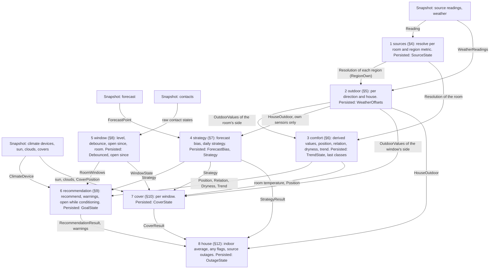
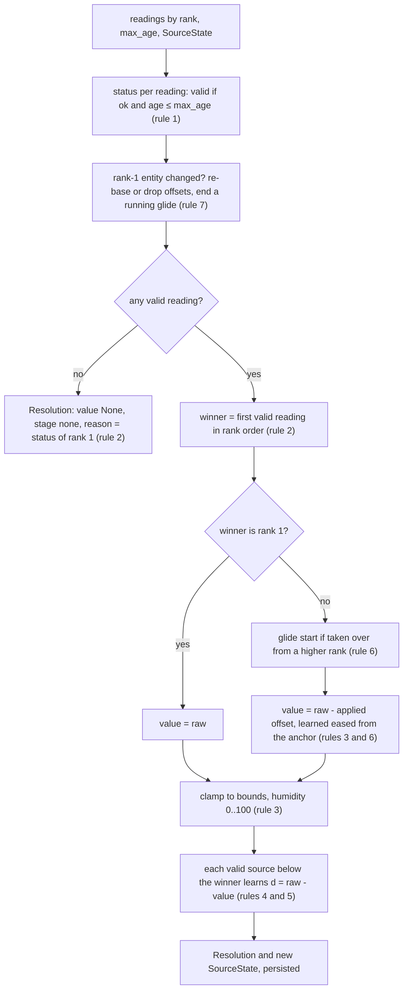
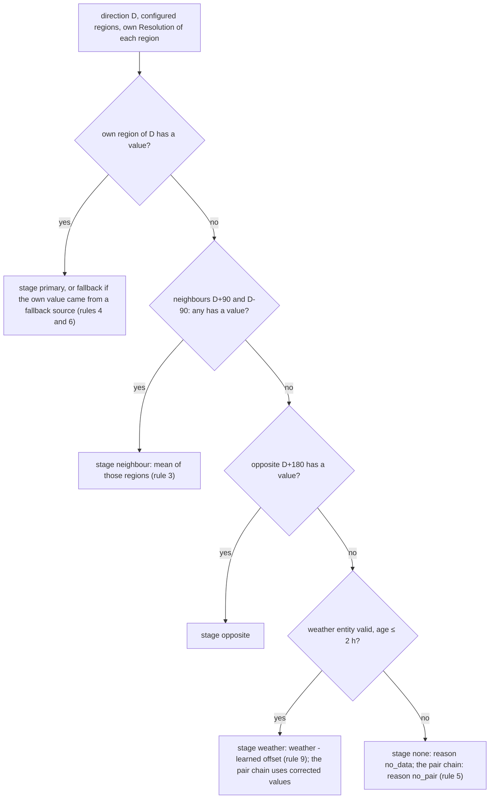
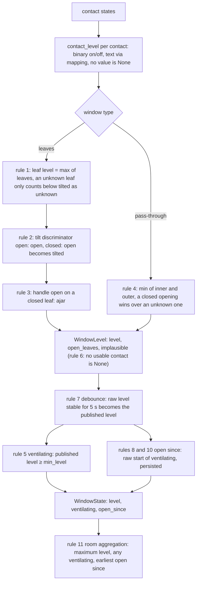
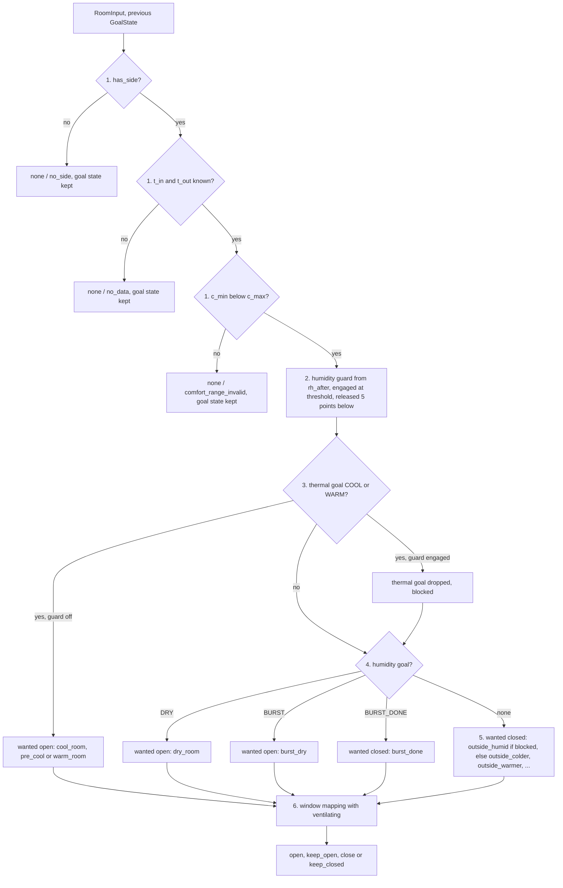
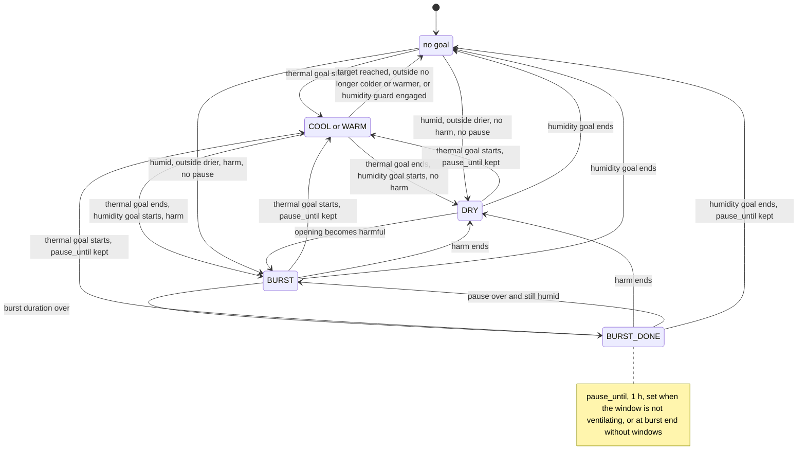
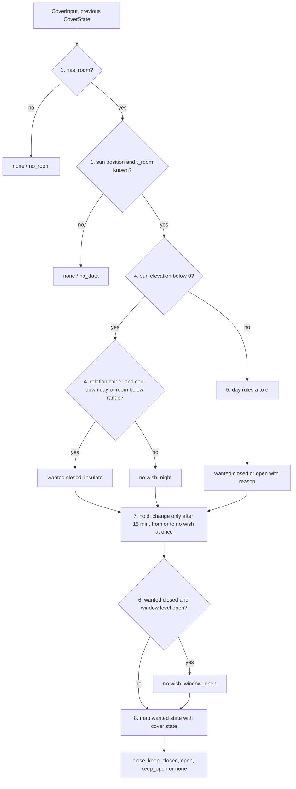
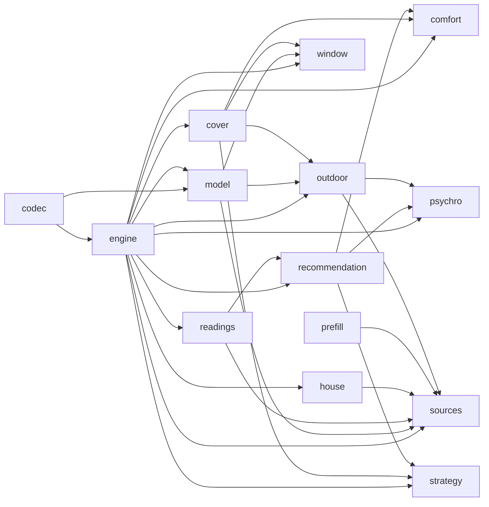

# Logic

This file describes the pure modules in `custom_components/climate_hub/logic/`: what each one computes, by which rule
and with which constant, and why. The modules import nothing from Home Assistant, take `now` as a parameter and have
table tests (CLAUDE.md rule 6). The orchestration of the modules and the Home Assistant layer (engine inputs, state,
coordinator, persistence, entities, flows) are in [integration.md](integration.md). Entity names, states and attributes
are in [reference.md](reference.md).

Requirement IDs (R7, A13, W12) and acceptance scenarios refer to [requirements.md](requirements.md), ADR-00x to
[architecture.md](architecture.md), screens S1–S11 to [ui_mockups.md](ui_mockups.md), and D1–D16 to the decision index
in §0.

Each module section has a short description with links to code and tests, the numbered rules with their
constants and reasons, and examples taken from the tests.

## 0. Decision index

The requirements leave some points open or state them in a way the logic cannot implement literally. Decisions D1–D16
settle them. Each decision sits in the rule that implements it, with its reason; this table only points there.

| ID | Decision (one line) | Where |
|---|---|---|
| D1 | A fallback source's offset starts at the last measured deviation and glides to the learned offset in 60 min | §4 rule 6 |
| D2 | Offsets are relative to the rank-1 source; lower sources learn against the resolved value; a new rank 1 re-bases | §4 rules 4 and 7 |
| D3 | Outdoor absolute humidity and dew point walk their own chain on temperature and humidity of the same regions | §5 rule 5 |
| D4 | The strategy looks at the next 24 h of the hourly forecast; prevent heat-up wins when both thresholds are crossed | §7 rules 1 and 4 |
| D5 | The recommendation is binary: open only for a reason, otherwise closed with a reason | §9 rules 3 and 5 |
| D6 | On prevent heat-up days, pre-cooling ventilates down to the comfort minimum, not below | §9 rule 3 |
| D7 | Humidity ventilation runs continuously when harmless, as a timed burst with a 1 h pause when harmful | §9 rule 4 |
| D8 | No thermal ventilation while the humidity after ventilating would reach the humidity threshold | §9 rule 2 |
| D9 | Unknown opening contacts are never `closed` by assumption; unknown refining contacts are ignored | §8 rules 1 and 2 |
| D10 | "Open since" means ventilating since, and survives restarts | §8 rules 8 and 10 |
| D11 | The humidity after ventilating is an attribute of the outside humidity difference sensor | §3 rule 3 |
| D12 | Both warnings allow the burst duration as grace and never fire while the recommendation says `keep_open` | §9 rule 7 |
| D13 | Unused; replaced by D16 | – |
| D14 | Margins and hysteresis are constants, not hub options | §13 |
| D15 | Local weather bias: a learned forecast bias and a learned weather offset per side | §7 rules 6 and 7, §5 rule 9 |
| D16 | The shading output is a cover recommendation with the window states and a reason | §10 rules 4, 5 and 6 |

## 1. Conventions

- Units. The logic works in °C, % RH, hPa, g/m³ and K/h. The snapshot converts the temperature and the pressure of
  every source with Home Assistant's unit converters to °C and hPa; humidity is accepted only with the unit `%`. A unit
  that does not convert makes the reading invalid (status `unit`, R4). Outputs are in the same units; Home Assistant
  converts them for display.
- No value is `None`. The pure functions do not raise for missing data. They return `None`, with a reason where one
  exists (`Status`, `OutdoorReason`, the recommendation reason). The engine additionally catches an exception per
  object (integration §4.4).
- No rounding in the logic. Comparisons use unrounded values; entities round for display.
- Time. `now` is a timezone-aware `datetime` in local time (the coordinator passes `dt_util.now()`). Durations are
  `timedelta`. A reading is stale when `now - reported_at` is greater than the maximum age, so a reading exactly at the
  maximum age is still fresh. Dates (forecast days) are local dates of `now`.
- Hysteresis is written as an enter and an exit threshold. A state is entered at the enter threshold and kept until
  the exit threshold is crossed. Every hysteresis function takes the previous state; `None` means "no previous state"
  (start-up) and uses the enter thresholds only.
- State. Every stateful function takes its previous state and returns a new immutable state (frozen dataclasses).
  The engine bundles the states in `EngineState` and the coordinator persists them in a `Store` (N4, integration §4.2
  and §7). Nothing in the logic keeps state between calls.
- Three-valued logic. A boolean that depends on unknown inputs is `True`, `False` or `None`. "Any" aggregations are
  `True` if any input is `True`, `False` if all inputs are known and `False`, `None` otherwise; an empty list gives
  `None` (`house.any_of`, §12).
- Constants live in `logic/const.py` and are listed in §13. Each rule names the constant at its first use in a section.

## 2. Data flow

One evaluation per coordinator update: a state change of an entity the configuration references (debounced) or the
60 s tick (N1). Each object (region, room, window) is evaluated on its own; an exception in one object is caught by the
engine, that object keeps its previous state, and the others are unaffected (N2, integration §4.4).



The state a step persists is the one named in its box. `Position`, `Relation`, `Dryness` and `Trend` are persisted as
the previous values of their hysteresis (§1). The full list is `EngineState` in integration §4.2.

`evaluate()` in [`logic/engine.py`](../custom_components/climate_hub/logic/engine.py) runs the steps in this order.
The numbers are those of its comments; integration §4.3 has the engine's own step list.

- Engine step 1, regions: diagram step 1 (`sources`) for each region.
- Engine step 2, weather offsets: `learn_weather_offsets` (§5 rule 9), before any direction resolves.
- Engine step 3, directions: diagram step 2 (`outdoor`) for N, E, S, W and for rooms without a side.
- Engine step 4, house outdoor: `house_outdoor` (§5 rule 8).
- Engine step 6, strategy: `update_forecast_bias` with the house outdoor value (only when it does not come from the
  weather stage), then `daily_strategy` (diagram step 4).
- Engine step 7, windows: diagram step 5 for each window.
- Engine steps 5 and 8, rooms: diagram step 1 for the room's three metrics, diagram step 3 (`comfort`), then diagram
  step 6 (`recommend`, `warnings`, `open_while_conditioning`) with the strategy and the room's windows.
- Engine step 9, covers: diagram step 7 for each window, with the result of its room.
- Engine step 10, house: diagram step 8, including the source outages collected in engine steps 1 and 5.

The engine evaluates the strategy and the windows before the rooms, which the diagram order does not show. The result
is the same because no step reads the result of a later step in the diagram. The strategy depends on the
house outdoor value and the forecast, the windows on contacts only, and the room's recommendation needs both. The room's
sources and comfort values (steps 1 and 3) read neither the strategy nor the windows.

`prefill` (§11) is not part of the evaluation. Flows call it when sources are suggested, and the R14 listener calls it
when a new entity appears.

## 3. Module `psychro` (R10, R13, O6)

Computes absolute humidity and dew point from a temperature and a relative humidity, and the relative humidity that
outside air reaches once it has warmed or cooled to room temperature. Used by the room values (§6), the outdoor pair
chain (§5 rule 5) and the humidity guard of the recommendation (§9 step 2).

Code: [`logic/psychro.py`](../custom_components/climate_hub/logic/psychro.py). Tests:
[`tests/logic/test_psychro.py`](../tests/logic/test_psychro.py).

### Rules

1. Formulas. Saturation vapour pressure follows the Magnus formula over water with the coefficients of Alduchov
   and Eskridge (1996):

   ```
   SVP(T)   [hPa]  = 6.1094 · exp(17.625 · T / (243.04 + T))
   VP       [hPa]  = SVP(T) · RH / 100
   AH       [g/m³] = 216.68 · VP / (273.15 + T)
   DP       [°C]   = 243.04 · γ / (17.625 − γ),   γ = ln(VP / 6.1094)
   RH_after [%]    = 100 · SVP(DP_out) / SVP(T_room)
   ```

   The formula over water also applies below 0 °C, because weather services report relative humidity over water
   (R10). 216.68 g·K/(m³·hPa) is water vapour as an ideal gas (100 Pa/hPa · 1000 g/kg / 461.5 J/(kg·K)).
2. Limits. `rh ≤ 0` gives `None` for both values: without water vapour there is no dew point. `rh` above 100 is
   clamped to 100 (sensor noise), so 104 % gives the values of 100 %.
3. Humidity after ventilating (R13). Outside air keeps its vapour pressure when it warms or cools in the room, and
   its vapour pressure is the saturation pressure at its dew point. The relative humidity it reaches at room
   temperature is therefore `SVP(DP_out) / SVP(T_room)`. The function takes the outside dew point instead of outside
   temperature and humidity, so the value comes from the consistent pair of the outdoor pair chain (§5 rule 5, O6).
   The result is not clamped: above 100 % means that outside air condenses in the room. The room shows it as the
   attribute `humidity_after_ventilating` of the Outside humidity difference sensor (D11); the humidity guard uses it
   (§9 step 2, D8).

### Examples

Scenario 12, step by step: outside 24 °C at 70 %, room 20 °C.

| Step | Value |
|---|---|
| `SVP(24)` | 29.78 hPa |
| `VP_out = 29.78 · 70 / 100` | 20.85 hPa |
| `DP_out` | 18.19 °C |
| `SVP(20)` | 23.33 hPa |
| `RH_after = 100 · 20.85 / 23.33` | 89.3 % |

89.3 % is above the default humidity threshold of 60 %, so the humidity guard engages for this room and ventilating
for temperature stops (§9 step 2).

Reference values. The tests compare with a tolerance of ±0.01 for AH and DP and ±0.1 for RH after ventilating.

| T °C | RH % | AH g/m³ | DP °C |
|---|---|---|---|
| 20 | 50 | 8.62 | 9.26 |
| 20 | 60 | 10.35 | 12.00 |
| 22 | 65 | 12.59 | 15.12 |
| 0 | 80 | 3.88 | −3.04 |
| −10 | 90 | 2.13 | −11.33 |
| 30 | 40 | 12.11 | 14.93 |
| 25 | 100 | 22.98 | 25.00 |
| 25 | 104 | 22.98 | 25.00 (clamped) |
| 20 | 0 | None | None |

| Outside | Room | RH after ventilating | Note |
|---|---|---|---|
| 24 °C, 70 % | 20 °C | 89.3 % | Scenario 12 ("about 89 %") |
| 5 °C, 85 % | 21 °C | 29.8 % | Winter air dries |
| 25 °C, 80 % | 18 °C | 122.8 % | Condensation, not clamped |

## 4. Module `sources` (R2, R4, R5, R7, R8, O2, O5, E6)

Resolves one metric (temperature, humidity or pressure) of one room or one region from its ranked list of readings, and
learns how far the lower-ranked sources deviate from the resolved value. The engine calls it for every room and region
(§2). `outdoor` (§5) takes the region results and the weather readings as inputs; `effective_status` and `learn`
are reused there.

Code: [`logic/sources.py`](../custom_components/climate_hub/logic/sources.py). Tests:
[`tests/logic/test_sources.py`](../tests/logic/test_sources.py).

Survives a restart: per room or region and metric a `SourceState` with the learned offset of each source (`Offset`: the
moving average, the paired time, the time and the value of the last sample), the entity at rank 1, the current winner
and the start time and anchor of a running glide.

### Rules



1. Validity (R4). `effective_status` gives `OK` only for a reading with status `OK` and `now - reported_at` of at most
   `max_age` (default 40 min, `DEFAULT_MAX_AGE`, per room or region). A reading without `reported_at` or older than
   `max_age` is `STALE`; every other status stays as the adapter set it. The weather entity is read the same way with
   its own maximum age of 2 h (`WEATHER_MAX_AGE`, O5, D14).
2. Winner (R2, R8). The first valid reading in rank order wins. A higher-ranked source wins again as soon as it is
   valid. There is no switch hysteresis (ADR-004). Without a valid reading the value is `None`, the stage `NONE` and
   `reason` the status of the rank-1 reading (`None` for an empty list).
3. Value. A rank-1 winner delivers its raw value. A lower-ranked winner delivers `raw - applied_offset` (rule 6;
   0.0 while it has no offset entry); `Resolution.offset` carries the applied offset, `Resolution.reason` the status of
   rank 1. The value is clamped to `bounds` for every winner. The engine passes `HUMIDITY_RANGE` (0–100 %) for humidity
   and no bounds for the other metrics.
4. Learning (D2). On every evaluation that has a winner, each valid source ranked below the winner takes a sample
   `d = raw - value` against the resolved value. The moving average uses `α = 1 - exp(-Δt / 8 h)`
   (`OFFSET_TIME_CONSTANT`) with `Δt` the time since its last sample, capped at 30 min (`OFFSET_SAMPLE_CAP`), so that
   a gap does not let one sample dominate. The first sample sets `learned = d`. The winner, the sources above it and
   invalid sources do not learn. A lower source thus learns against the resolved value whenever a higher-ranked source
   wins, which keeps all offsets on the scale of rank 1. The 8 h time constant gives about 24 h of memory (ADR-004).
5. Learned. `Offset.paired` adds `Δt` per sample up to the time constant. A source counts as learned
   (`Candidate.learned`) once `paired` reaches 1 h (`OFFSET_LEARNED_AFTER`). Before that, the setup preview shows the
   deviation as being learned and the offset is still applied.
6. Glide (D1). When a source ranked below the previous winner takes over and it has an offset entry, `resolve`
   stores `switched_at = now` and `anchor = last_deviation` if that sample is not older than `max_age`, else
   `anchor = learned`. The applied offset is
   `learned + (anchor - learned) · max(0, 1 - (now - switched_at) / 60 min)` (`OFFSET_GLIDE`). The value therefore
   starts at the last measured deviation and does not jump when a fallback takes over (scenario 2). A takeover by a
   higher-ranked source (R8), a rank-1 win, a first evaluation without a previous winner and a source without an offset
   entry start no glide. A running glide ends with every change of the winner and whenever rank 1 wins.
7. Re-base (D2). If the rank-1 entity differs from `state.rank1` and the new rank 1 has a learned offset `o`, every
   other offset shifts by `-o` (`learned` and `last_deviation`), the new rank 1 loses its entry and the old rank 1
   gets `learned = -o`. If the new rank 1 has no offset (a new entity), all offsets are dropped. A running glide ends.
   Moving another source to rank 1 therefore keeps what was learned. On every evaluation, offsets of entities no
   longer in the list are dropped.
8. Every metric uses the same mechanism, each with its own `SourceState` (R7: temperature M, humidity S; pressure
   comes for free and absorbs the difference between sea-level and station pressure).
9. `climate` entities deliver `current_temperature` and `current_humidity` as readings (R5). A missing attribute gives
   status `UNKNOWN`; a `climate` entity gives no pressure (status `UNKNOWN`). Setpoints are never read.

### Examples

Cases from `tests/logic/test_sources.py`.

Resolution (temperature, `max_age` 40 min, now 12:00, offsets learned: #2 +0.3, #3 +1.2, no glide running):

| # | Source 1 | Source 2 | Source 3 | Value | Source | Stage | Reason |
|---|---|---|---|---|---|---|---|
| 1 | 21.4, 11:55 | 21.7, 11:50 | 22.6, 11:58 | 21.4 | #1 | primary | – |
| 2 | 21.4, 11:15 (stale) | 21.7, 11:50 | 22.6 | 21.4 | #2 | fallback (offset 0.3) | stale |
| 3 | 21.4, 11:20:00 (exactly 40 min) | 21.7 | 22.6 | 21.4 | #1 | primary | – |
| 4 | unavailable | unavailable | 22.6 | 21.4 | #3 | fallback (offset 1.2) | unavailable |
| 5 | not numeric | 21.7 | 22.6 | 21.4 | #2 | fallback | not_numeric |
| 6 | unit `lx` | 21.7 | 22.6 | 21.4 | #2 | fallback | unit |
| 7 | all unavailable | | | None | – | none | unavailable |
| 8 | empty list | | | None | – | none | – |

Humidity clamp: rank-2 raw 99.0 % with learned offset -2.0 gives 101.0 and is clamped to 100.0 (the applied offset
stays -2.0).

Learning (`τ` 8 h, cap 30 min):

| Learned before | Sample | Δt since last sample | Learned after |
|---|---|---|---|
| – (first sample) | 1.0 | – | 1.0 |
| 1.0 | 1.2 | 1 min | 1.000416 |
| 1.0 | 2.0 | 10 min | 1.0206 |
| 1.0 | 2.0 | 2 h (capped to 30 min) | 1.0606 |
| 1.0 | constant 2.0 every minute for 1 h / 8 h / 24 h | | 1.118 / 1.632 / 1.950 |

Learning gate: while #1 wins, #2 and #3 learn. While #2 wins, only #3 learns (against the resolved value). An invalid
source never learns.

Glide (#1 goes stale and #2 takes over at 12:00; #2 has learned 1.0, its last deviation 1.6 was measured at 11:59):

| Now | Applied offset |
|---|---|
| 12:00 | 1.6 |
| 12:30 | 1.3 |
| 13:00 | 1.0 |
| 13:30 | 1.0 |
| 12:00, but last deviation from 11:00 (older than max age) | 1.0 |

Re-base (offsets #2 +0.3, #3 +1.2 relative to #1):

| Change | Offsets after |
|---|---|
| #3 moved to rank 1 | old #1: -1.2, old #2: -0.9, #3: none (rank 1) |
| #2 and #3 swapped | unchanged |
| new entity X put at rank 1 | all dropped |
| #3 removed from the list | #3 dropped, #2 unchanged |

## 5. Module `outdoor` (O1–O7, ADR-003, scenarios 3 and 4)

Computes the outdoor values a direction sees (and with it every room facing that direction) from the regions' own
resolved sources, their neighbours, the opposite side and the weather entity, and learns how far the weather deviates
from the house's own sensors. The engine calls it after step 1 of §2. The room values (§6), the recommendation (§9),
the cover (§10) and the forecast bias (§7 rule 7) use the results.

Code: [`logic/outdoor.py`](../custom_components/climate_hub/logic/outdoor.py). Tests:
[`tests/logic/test_outdoor.py`](../tests/logic/test_outdoor.py).

Survives a restart: the hub's `WeatherOffsets`, one learned offset (`Offset`, §4) per region and metric.

### Rules

The diagram shows the chain for one direction D. For temperature, humidity and pressure, "has a value" means the
region's own resolved value. For absolute humidity and dew point (the pair chain, rule 5) it means that the region's
own temperature and humidity are both valid.



1. Chain (ADR-003, O3). For a direction: its own region, the two adjacent directions (90°, one stage), the opposite
   direction (180°), the weather entity, none. A direction without a region is skipped, including D itself; a room
   may face a side that has no region. `fallback_chain` returns the stages that have at least one configured
   direction, followed by the weather stage. There is no configuration (O4).
2. Qualifying. A region takes part at a stage only with a value from its own sources (primary or fallback), because
   `RegionOwn` holds only the region's own resolutions. Values that another region took over from its neighbours never
   feed a chain: there is no recursion and any creation order gives the same result (P3).
3. Several qualifying regions at the same stage: their mean (O3).
4. Each metric walks the chain on its own. At the first stage the stage of the value is the stage of the region's own
   `Resolution` of that metric (`primary` or `fallback`).
5. Pair chain (D3, O6). Absolute humidity and dew point walk the same chain, but a region qualifies only if both its
   temperature and its humidity are valid from its own sources and give a pair (relative humidity above 0, §3 rule 2).
   Each region computes absolute humidity and dew point from its own pair; at a multi-region stage the outputs are the
   means of the regions' values. At the weather stage they come from the weather's corrected temperature and humidity
   (rule 9). They can therefore come from another stage than the displayed temperature, but temperature and humidity
   are never mixed across regions. If no stage has a pair, both are `None` with reason `no_pair`.
6. Stage of the own pair: `fallback` if the region's temperature or humidity came from a fallback source, else
   `primary`.
7. A room without a main side (direction `None`) gets all five outdoor values `None`, stage `none` and reason
   `no_side`. `no_data` is the reason of a metric that no stage can deliver, the weather stage included.
8. House outdoor (O7). The mean temperature of all regions with an own valid value, with minimum, maximum and the
   per-region values. The stage is `fallback` if any of these values came from a fallback source, else `primary`.
   Without such a region the value is the corrected weather temperature (stage `weather`, no minimum, maximum or
   per-region values, mean offset), and without weather `none`. The house value is for display and automations;
   recommendations always use the room's own direction.
9. Weather offsets (D15). While a region's own resolved value of a metric and the weather's value (maximum age 2 h,
   `WEATHER_MAX_AGE`) are both valid, the region learns `d = weather - own` with the offset learner of §4 (rules 4 and
   5; no glide, no re-base). At the weather stage the value is `weather - offset`: the offset of the direction's own
   region and metric if one is learned, else the mean of all regions' learned offsets of that metric, else 0.
   Humidity is clamped to 0–100 % after the correction. Offsets of removed regions are dropped, and a stale or missing
   weather entity teaches nothing. `OutdoorValue.offset` shows the applied offset at the weather stage (E6; 0.0 while
   nothing is learned). A street that runs 2 °C warmer therefore stays 2 °C warmer when the weather stands in, and the
   pressure does not jump by the difference between sea-level and station pressure.

Inter-region offsets (O8) are out of scope: the neighbour and opposite stages use the regions' values unchanged.

### Examples

Cases from `tests/logic/test_outdoor.py`.

Chains (`fallback_chain`):

| Configured | Direction | Chain |
|---|---|---|
| N, W, S | N | own N, neighbour W, opposite S, weather |
| N, W, S | E | neighbours N + S, opposite W, weather |
| N, W, S | S | own S, neighbour W, opposite N, weather |
| N, W, S | W | own W, neighbours N + S, weather (E not configured) |
| N | N | own N, weather (scenario 4) |
| none | S | weather |

Values (N 13.0 °C / 71 %, S 12.5 °C / 76 %, W 14.5 °C / 65 %, weather 11.0 °C / 80 %; configured N, W, S; no weather
offsets learned yet):

| Direction | Failing own sources | Temperature | Stage | AH g/m³ | AH stage |
|---|---|---|---|---|---|
| N | none | 13.0 | primary | 8.04 | primary |
| N | N temperature and humidity | 14.5 (W) | neighbour | 8.07 (W) | neighbour |
| N | N and W | 12.5 (S) | opposite | 8.34 (S) | opposite |
| N | N, W, S | 11.0 | weather | 7.99 | weather |
| N | N, W, S; weather stale | None | none | None | none |
| N | only N humidity | 13.0 (N) | primary | 8.07 (W) | neighbour (D3) |
| E | none | 12.75 (mean N, S) | neighbour | 8.19 (mean) | neighbour |
| E | N temperature | 12.5 (S only) | neighbour | 8.34 (S only, N has no pair) | neighbour |

Dew point at direction E, stage neighbour: 8.12 (mean of 7.86 and 8.38). House outdoor with all three regions: 13.33
(minimum 12.5, maximum 14.5).

Weather offsets (same values; learned temperature offsets weather - own: N -2.0, S -1.5, W -3.5; N humidity +9, N
pressure +18 hPa from a sea-level weather pressure of 1021 hPa against a station pressure of 1003 hPa). All regions'
own sources fail:

| Direction / output | Temperature | Humidity | Pressure | AH g/m³ |
|---|---|---|---|---|
| N | 13.0 (11.0 + 2.0) | 71 (80 - 9) | 1003 | 8.04 |
| E (no region, mean offset -2.33) | 13.33 | 71 (mean of the one humidity offset) | 1003 | – |
| House outdoor (mean offset) | 13.33 | – | – | – |
| N without learned offsets | 11.0 | 80 | 1021 | 7.99 |

## 6. Module `comfort` (R10)

Classifies the room temperature against the comfort range, the outside against the inside (temperature and absolute
humidity) and the room temperature trend. All classes are hysteresis bands (§1). The recommendation (§9) and the
cover (§10) use the results.

Code: [`logic/comfort.py`](../custom_components/climate_hub/logic/comfort.py). Tests:
[`tests/logic/test_comfort.py`](../tests/logic/test_comfort.py).

Survives a restart: per room a `TrendState` with the temperature samples of the last 60 min. The engine also keeps the
last `Position`, `Relation`, `Dryness` and `Trend` of the room as the previous values of their hysteresis.

### Rules

1. Position (R10). Hysteresis `POSITION_HYSTERESIS` = 0.3 °C. `above` when `t > c_max`, kept while
   `t > c_max - 0.3`. `below` when `t < c_min`, kept while `t < c_min + 0.3`. Otherwise `within`. Without a
   temperature, or with an invalid comfort range (`c_min ≥ c_max`): `None`.
2. Relation. `diff = t_out - t_in`; enter 0.5 °C (`RELATION_ENTER`), exit 0.25 °C (`RELATION_EXIT`). `colder` when
   `diff ≤ -0.5`, kept while `diff < -0.25`. `warmer` when `diff ≥ 0.5`, kept while `diff > 0.25`. Otherwise
   `similar`. Without an outside or an inside temperature: `None`.
3. Dryness. `diff = ah_out - ah_in`; enter 1.0 g/m³ (`DRYNESS_ENTER`), exit 0.5 g/m³ (`DRYNESS_EXIT`). Same shape as
   the relation with `drier` for the negative and `more_humid` for the positive side. Without either value: `None`.
4. Trend. Least-squares slope of the room temperature over the samples of the last 60 min (`TREND_WINDOW`). A new
   sample is kept at most once per minute (`TREND_SAMPLE_INTERVAL`); samples older than 60 min are dropped, also when
   the temperature is missing. Less than 30 min between the oldest and the newest sample (`TREND_MIN_SPAN`), fewer than
   two samples or no temperature gives `None`. `rising` when `slope ≥ 0.5 K/h` (`TREND_ENTER`), kept while
   `slope > 0.25 K/h` (`TREND_EXIT`); `falling` mirrored; otherwise `steady`.
5. Room values around these functions (the engine assembles them). Temperature, humidity and pressure come from §4.
   Absolute humidity and dew point come from the room's resolved temperature and humidity (§3), when both exist. Outside
   temperature and humidity come from §5 for the room's direction. The temperature difference is `t_out - t_in`. The
   humidity difference is `ah_out - ah_in` with the absolute humidity of the pair chain. The humidity after ventilating
   comes from the recommendation (§9 step 2, D11).

### Examples

Cases from `tests/logic/test_comfort.py`.

Position (comfort 20–24):

| T | Previous | Position |
|---|---|---|
| 24.0 | within | within |
| 24.1 | within | above |
| 23.8 | above | above |
| 23.7 | above | within |
| 19.9 | within | below |
| 20.2 | below | below |
| 20.3 | below | within |
| 22.0 | None | within |
| 22.0, comfort 24–20 | within | None |

Relation (dryness uses the same table with 1.0 / 0.5 and the labels drier / more_humid):

| diff | Previous | Relation |
|---|---|---|
| -0.4 | similar | similar |
| -0.5 | similar | colder |
| -0.3 | colder | colder |
| -0.25 | colder | similar |
| +0.6 | colder | warmer |
| +0.3 | warmer | warmer |
| +0.2 | warmer | similar |
| any, `t_out` None | any | None |

Trend (samples every 10 min over 60 min):

| Samples | Slope K/h | Previous | Trend |
|---|---|---|---|
| 21.0 to 21.6 in steps of 0.1 | 0.60 | steady | rising |
| 21.0 to 21.3 in steps of 0.05 | 0.30 | rising | rising |
| 21.0 to 21.24 in steps of 0.04 | 0.24 | rising | steady |
| 22.0 to 20.8 in steps of -0.2 | -1.20 | steady | falling |
| 21.0 to 21.3 in steps of 0.05 | 0.30 | None | steady |
| 3 samples over 20 min | – | any | None |

## 7. Module `strategy` (A1, A14, D4, D15)

Derives the daily strategy from the forecast: prevent the room from heating up, prevent it from cooling down, or
neither. It also learns how far the forecast deviates from the house's own outdoor sensors and corrects the forecast by
that bias. The recommendation (§9) and the cover (§10) use the strategy; the engine runs it once per evaluation (§2).

Code: [`logic/strategy.py`](../custom_components/climate_hub/logic/strategy.py). Tests:
[`tests/logic/test_strategy.py`](../tests/logic/test_strategy.py).

Survives a restart: for the hub a `ForecastBias` with the learned maximum and minimum bias, the sample count and the
running day (stored forecast, observed extremes, coverage time and the time of the last evaluation). The engine also
keeps the last `Strategy`.

### Rules

1. Horizon (D4). Hourly points with `now ≤ start < now + 24 h` (`FORECAST_HORIZON`): `f_max` and `f_min` are their
   maximum and minimum temperature. Fewer than 12 points in the horizon (`FORECAST_MIN_POINTS`) count as no
   forecast. Daily points: the entry whose local date is today; `f_max` is its high and `f_min` its low (which may be
   missing). The snapshot fetches the hourly forecast when the weather entity supports it, else the daily one. The
   24 h horizon lets the strategy at 22:00 already see tomorrow's heat (night pre-cooling).
2. `prevent_heat_up` when `f_max > c_max + threshold`, kept while `f_max > c_max + threshold - 0.5`
   (`STRATEGY_HYSTERESIS`). `threshold` is the hub option, default 2.0 °C (`DEFAULT_STRATEGY_THRESHOLD`). `f_max` here
   is the corrected value of rule 6.
3. `prevent_cool_down` when `f_min < c_min - threshold`, kept while `f_min < c_min - threshold + 0.5`. Not evaluated
   when `f_min` is missing.
4. Both true: `prevent_heat_up` (D4); the check runs first. The cool-down risk is covered by the pre-cooling bound
   (D6, §9 step 3).
5. No forecast: strategy `None`. The recommendation then follows the neutral rules and the strategy entity is unknown.
6. Forecast bias (D15, A14). Rules 2 and 3 use `f_max + bias_max` and `f_min + bias_min` once at least 3 samples exist
   (`BIAS_MIN_SAMPLES`); before that the raw forecast. A bias that is still `None` counts as 0. The result carries
   raw and corrected values and both biases.
7. Learning the bias (D15). At the first evaluation of a local date, the forecast for that date is stored (hourly:
   maximum and minimum of the points starting within that date, at least 18 points, `BIAS_MIN_DAY_POINTS`; daily: that
   date's entry). During the day the observed house outdoor temperature (§5 rule 8) is tracked as maximum and minimum,
   but only while it comes from the regions' own sensors, never from the weather stage. Each evaluation with such a
   value adds the time since the previous evaluation (with or without a value) to the coverage, capped at 10 min per
   step (`BIAS_COVERAGE_STEP_CAP`). At the first evaluation of the next date, if the finished day has a coverage of at
   least 18 h (`BIAS_MIN_COVERAGE`), the samples are `observed - forecast` for the maximum and the minimum, each only if
   both its forecast and its observation exist. The first sample sets the bias; later ones move it by a quarter of the
   difference (`bias += 0.25 · (sample - bias)`, `BIAS_WEIGHT`). Biases are clamped to ±5 °C (`BIAS_CLAMP`). The sample
   count rises by one per day with at least one sample. A day without stored forecast or with too little coverage gives
   no sample. The finished day is the stored one; the logic does not check that it is yesterday. Reason (D15, A14): the
   strategy follows the extremes the house's own sensors measure, not those of the forecast station.

### Examples

Cases from `tests/logic/test_strategy.py`.

Strategy (comfort 20–24, threshold 2):

| f_max | f_min | Previous | Strategy |
|---|---|---|---|
| 30 | 19 | neutral | prevent_heat_up |
| 26.0 | 19 | neutral | neutral |
| 25.6 | 19 | prevent_heat_up | prevent_heat_up |
| 25.5 | 19 | prevent_heat_up | neutral |
| 22 | 10 | neutral | prevent_cool_down |
| 22 | 18.4 | prevent_cool_down | prevent_cool_down |
| 22 | 18.5 | prevent_cool_down | neutral |
| 28 | 8 | neutral | prevent_heat_up |
| no forecast | | any | None |
| hourly: 24 within the next 24 h, 31 at exactly now + 24 h | 19 | neutral | neutral |
| hourly: only 8 points in the horizon | | any | None |
| 25.0, bias +2.2 (3 samples) | 19 | neutral | prevent_heat_up (corrected 27.2) |
| 25.0, bias +2.2 (2 samples) | 19 | neutral | neutral (bias not applied yet) |
| 22, bias_min -1.5 (3 samples) | 19.0 | neutral | prevent_cool_down (corrected 17.5) |

Bias learning (daily maximum; the minimum works the same way):

| Day | Forecast max | Observed max | Coverage | Sample | Bias after | Samples |
|---|---|---|---|---|---|---|
| 1 | 28.0 | 30.5 | 23 h | +2.5 | 2.5 | 1 |
| 2 | 26.0 | 27.5 | 24 h | +1.5 | 2.25 | 2 |
| 3 | 30.0 | 32.0 | 24 h | +2.0 | 2.1875 | 3 |
| 4 | 25.0 | 29.0 | 17 h | – | 2.1875 | 3 |
| 5 | no forecast stored (first evaluation at noon: only 12 hourly points left) | 27.0 | ≈ 12 h | – | 2.1875 | 3 |
| 1 (new) | 20.0 | 29.0 | 24 h | +9.0 | 5.0 (clamped) | 1 |

## 8. Module `window` (W2–W12, scenarios 5–8)

Turns the states of a window's contacts into an opening level, debounces it, tracks since when the window ventilates
and aggregates the windows of a room. The recommendation (§9) uses the room's ventilating flag and open since, the
cover (§10) the published level of each window. The engine calls it in step 5 of §2.

Code: [`logic/window.py`](../custom_components/climate_hub/logic/window.py). Tests:
[`tests/logic/test_window.py`](../tests/logic/test_window.py).

Survives a restart: per window a `Debounced` (raw level and since when, published level, raw start of ventilation) and
the open-since time.

### Rules

Contact mapping (W2), `contact_level`, applied to every contact before `window_level`:

- Binary sensors (the adapter offers the device classes window, door, opening and garage door): `on` is `OPEN`, `off`
  is `CLOSED`.
- Text sensors: case-insensitive exact match of the stripped state against the S8d mapping (one set of texts per
  level). A text in no set is `None`.
- `unavailable`, `unknown`, an empty state and a missing state are `None` (W8).
- Default words for S8d are the translations `common.words_closed`, `words_ajar`, `words_tilted` and `words_open`
  of the instance language plus English (English: closed {closed, locked}, ajar {ajar}, tilted {tilted, tilt},
  open {open}). `suggest_text_mapping` pre-assigns the known texts of the sensor that match a default word of a level;
  the rest are offered unassigned. No word is hardcoded in the logic.



Level rules 1–6 apply in this order:

1. Leaves (D9). A single window has one leaf. Levels are ordered closed < ajar < tilted < open. If every leaf is
   known: `leaf = max(leaves)`. If some leaf is unknown:
   the known maximum if it is at least tilted (a moving leaf is certain), else unknown; an opening contact is never
   `closed` by assumption. For a double leaf, `open_leaves` lists the leaves above ajar (`left`, `right`, `both`); with
   no such leaf it is `none` if both leaves are known, else `unknown`; it is `None` for a single window and for an
   unknown level.
2. Tilt discriminator (D9; optional, refiner). Reports open: the window is `open`, whatever the leaves say. If every
   leaf is known and none is above ajar, the state is flagged `implausible` (W12 last row) and `open_leaves` is
   `unknown`; an unknown leaf may be the moved one, so it does not count as implausible. Reports closed: a leaf level
   of `open` becomes `tilted` (the leaf moved but is not turned). Unknown: ignored. An unknown refining contact is
   ignored; a discriminator reporting open proves open.
3. Handle contact (optional, refiner). A leaf level of `closed` with the handle above closed gives `ajar`
   (scenario 6). A leaf level above closed or an unknown handle: ignored.
4. Pass-through (W5). `level = min(inner, outer)`. If one opening is unknown, the level is `closed` when the other is
   closed (no air path), else unknown. A pass-through has no `open_leaves` and is never implausible.
5. Ventilating (W3). `level ≥ min_level`; `min_level` is a per-window setting, default tilted, so ajar does not count
   by default. An unknown level gives `None`.
6. No usable contact: level `None` (W8).

The debounce, the open-since timestamp and the room aggregation follow:

7. Debounce (W10). The published level changes only after the raw level has been unchanged for 5 s
   (`CONTACT_DEBOUNCE`, inclusive: exactly 5 s is enough). A raw level of `None` counts like any other level for this
   timer.
8. Open since (W7, D10). `Debounced.ventilating_since` is the raw time the window started ventilating: set when the raw
   level reaches `min_level` from a level that does not ventilate or is unknown, cleared when the raw level falls below
   `min_level`, kept while the raw level is unknown. While the published level ventilates, `open_since` keeps the
   persisted value (rule 10 for the case without one); it is cleared when the published level does not ventilate and
   kept while the published level is unknown. The value therefore survives level changes while ventilating, a bounce
   shorter than 5 s and unknown contacts. "Open since" means ventilating since: an ajar window has none unless
   `min_level` is ajar (D10).
9. Start-up. The first call (no previous `Debounced`) publishes the raw level at once, without the 5 s wait. The
   table below starts with a window that is already closed.
10. After a restart (D10). `Debounced` and the open-since value are persisted. A persisted open-since value is kept
    while the window still ventilates. Without one, `open_since` takes `ventilating_since` of the debounce state, then
    the start-up hint, then `raw_since` of the debounce state (the last change of the raw level; without a stored
    debounce state, the time of the first evaluation). The engine passes the latest `last_changed` of the
    window's contacts that currently report a non-closed level as the hint (best effort; Home Assistant may reset
    `last_changed` at start-up, which is why the value is persisted).
11. Room aggregation (W9). The level is the maximum of the windows' levels. With an unknown window it is the known
    maximum if some window ventilates, else unknown. Ventilating is the three-valued "any" (§1). Open since is the
    earliest value among the ventilating windows. Without windows the function returns level `None` and ventilating
    `False`; the engine does not call it for a room without windows.

### Examples

Cases from `tests/logic/test_window.py`.

Contact mapping (`contact_level`; the text mapping of the test maps `zu`, `angelehnt`, `gekippt`, `offen`):

| Kind | State | Level |
|---|---|---|
| binary | `on` / `ON` | open |
| binary | `off` | closed |
| binary | `unavailable`, `unknown`, empty, missing | None |
| text | `gekippt`, `  Gekippt ` | tilted |
| text | `OFFEN` | open |
| text | `Spalt` (in no set) | None |
| text | `zu` without a mapping | None |

Single window (M = sash contact, D = tilt discriminator, H = handle; 1 = open, 0 = closed, ? = unknown, – = not
configured):

| M | D | H | Level | Ventilating | Note |
|---|---|---|---|---|---|
| 0 | – | – | closed | no | |
| 1 | – | – | open | yes | |
| 1 | 0 | – | tilted | yes | |
| 1 | 1 | – | open | yes | |
| 0 | 1 | – | open | yes | implausible |
| 0 | – | 1 | ajar | no | scenario 6 |
| 1 | – | 1 | open | yes | handle ignored |
| ? | – | – | None | None | W8 |
| ? | 1 | – | open | yes | discriminator proves open |
| ? | 0 | – | None | None | |
| 1 | ? | – | open | yes | refiner ignored |
| 0 | – | ? | closed | no | refiner ignored |
| text `gekippt` | – | – | tilted | yes | |
| text `offen` | 0 | – | tilted | yes | discriminator caps |
| text `angelehnt` | 1 | – | open | yes | implausible |
| text `Spalt` (unmapped) | – | – | None | None | |

Double leaf (W12 plus unknown contacts; L and R are the leaves, D the shared discriminator):

| L | R | D | Level | Open leaves |
|---|---|---|---|---|
| 0 | 0 | 0 | closed | none |
| 1 | 0 | 0 | tilted | left |
| 0 | 1 | 0 | tilted | right |
| 1 | 1 | 0 | tilted | both |
| 1 | 0 | 1 | open | left |
| 0 | 1 | 1 | open | right |
| 1 | 1 | 1 | open | both |
| 0 | 0 | 1 | open | unknown (implausible) |
| 1 | ? | 0 | tilted | left |
| 0 | ? | 0 | None | – |
| 0 | ? | 1 | open | unknown |
| 1 | 1 | ? | open | both |
| 0 | 0 | ? | closed | none |
| ? | ? | 0 | None | – |

Pass-through (scenario 7): inner 1 / outer 1 gives open; 1 / 0 closed; 0 / 1 closed; 1 / ? None; 0 / ? closed;
? / 0 closed; ? / ? None; text `gekippt` / 1 tilted.

Debounce and open since (rules 7 and 8; the `min_level` is tilted):

| Time | Raw level | Published | Open since |
|---|---|---|---|
| 10:00:00 | closed | closed | – |
| 10:00:02 | tilted | closed | – |
| 10:00:07 | tilted | tilted | 10:00:02 |
| 10:05:00 | open | tilted | 10:00:02 |
| 10:05:05 | open | open | 10:00:02 |
| 10:06:00 | closed | open | 10:00:02 |
| 10:06:03 | open | open | 10:00:02 (bounce) |
| 10:20:00 | None | open | 10:00:02 |
| 10:20:05 | None | None | 10:00:02 (kept) |
| 10:30:00 | closed | None | 10:00:02 |
| 10:30:05 | closed | closed | – |

Open since after a restart (rule 10; published level ventilating unless stated):

| Persisted value | Hint | Result |
|---|---|---|
| 01:00 | 02:00 | 01:00 (persisted value kept) |
| none | 02:00 | 02:00 (best effort from the contacts) |
| none | none | `raw_since` (time of the first evaluation without a stored debounce state) |
| 01:00, published level closed | 02:00 | none |
| 01:00, published level unknown | none | 01:00 |

Room aggregation (rule 11):

| Window A | Window B | Room level | Ventilating | Open since |
|---|---|---|---|---|
| closed | closed | closed | no | – |
| tilted since 10:00 | open since 10:05 | open | yes | 10:00 |
| closed | None | None | None | – |
| tilted since 10:00 | None | tilted | yes | 10:00 |
| ajar | None | None | None | – |
| ajar | closed | ajar | no | – |

## 9. Module `recommendation` (A2–A6, A12, scenarios 9, 11, 12)

Decides per room whether the windows should be open, closed or left alone, and why. It also derives the two warnings
(cooling down, heating up) and the "open while heating or cooling" flag from the same inputs. Uses the comfort
values of §6, the strategy of §7, the humidity after ventilating of §3 and the window state of §8; the house-level
"any room" flags are in §12 and the readings of the heating and cooling devices in §16.

Code: [`logic/recommendation.py`](../custom_components/climate_hub/logic/recommendation.py). Tests:
[`tests/logic/test_recommendation.py`](../tests/logic/test_recommendation.py).

Survives a restart: per room a `GoalState` with the running goal, its start time, the end of a running pause and the
state of the humidity guard.

### Rules

`middle = (c_min + c_max) / 2`. The heating and cooling devices are not part of `RoomInput`; they feed
`open_while_conditioning` and `setpoint_deviation` (§16). `wanted_open` is the wish before the window state is
applied (step 6); the warnings use it.

Rules 1 to 6 are the steps of the evaluation of one room; the first step that decides ends the evaluation. Rules 7 to 9
are the warnings, rules 10 and 11 the flag for windows left open while a device heats or cools.



The goal state moves as follows. A thermal goal can start from every state. COOL and WARM can switch directly into each
other, so the diagram draws them as one state. A thermal goal replaces a humidity goal and keeps `pause_until`. The
humidity goals only start without a thermal goal; when a thermal goal ends in an evaluation in which the humidity
conditions hold, a humidity goal starts in the same evaluation.



1. Data. No main outdoor side (`has_side` false): `none` / `no_side` (A5). Otherwise `t_in` or `t_out` missing:
   `none` / `no_data` (A5; never a silent `keep_closed`). Otherwise `c_min ≥ c_max`: `none` / `comfort_range_invalid`.
   `wanted_open` is `None` and the goal state is returned unchanged in all three cases. The order makes `no_side` win
   over missing values, because nothing is missing in a room that has no outside to compare with.
2. Humidity guard (D8). `rh_after = humidity_after_ventilating(t_in, dew_point_out)` (§3 rule 3). The guard engages at
   `rh_after ≥ threshold` (60 %, `DEFAULT_HUMIDITY_THRESHOLD`) and releases at `rh_after < threshold − 5` (5 points,
   `HUMIDITY_RELEASE`); between the two it keeps its previous value (`GoalState.humid_guard`). An unknown `rh_after`
   (no `dew_point_out`) leaves the guard off. The guard exists so that thermal ventilation never brings the humidity of
   the room to the threshold: it protects cellars and cool rooms from humid summer air (D8, R13).
3. Thermal goal (A2, A6, D5, D6). The cooling target is `middle`, or `c_min` on a *prevent heat-up* day. Evaluated in
   this order:
   - `COOL` continues while `t_in > target` and the relation is `colder`; `WARM` continues while `t_in < middle` and the
     relation is `warmer`.
   - `COOL` starts when the relation is `colder` and either the position is `above`, or the day is *prevent heat-up*
     and `t_in ≥ c_min + 0.5` (0.5 °C, `PRE_COOL_START`). Both alternatives need the relation `colder`.
   - `WARM` starts when the relation is `warmer` and the position is `below`. This also holds on a *prevent heat-up*
     day: a cold room may warm up on a hot day (A2).
   - An engaged guard drops the goal. The room is then `blocked` and step 5 gives it `outside_humid`; the goal state
     records no thermal goal.
   - An active thermal goal wants the window open with reason `warm_room` for `WARM`, `pre_cool` for `COOL` on a
     *prevent heat-up* day, else `cool_room`. `started_at` stays while the goal stays the same, else it is `now`.

   Reasons. The recommendation is binary: a room wants the window open only for a reason (cool, warm, dry) and
   otherwise wants it closed and says why (D5). An overheated room opens to cool even on a *prevent cool-down* day, down
   to the middle of the comfort range (D5). On *prevent heat-up* days it ventilates while outside is cooler down to the
   comfort minimum, never below, to bank coolness (D6).
4. Humidity goal (A3, A6, D7), only without a thermal goal. Needs `rh_in` and `dryness`; without them the humidity
   goal ends and `pause_until` is kept. *Harm* is: relation `colder` and (strategy *prevent cool-down* or position
   `below`), or relation `warmer` and (strategy *prevent heat-up* or position `above`).
   - Start: `rh_in > threshold`, dryness `drier`, no goal running and no pause running (`now < pause_until`). The goal
     is `BURST` with harm, else `DRY`. A new goal starts without a pause timestamp: an expired `pause_until` is cleared,
     so it does not end the goal's own burst early. It continues while `rh_in > threshold − 5` and the dryness is
     `drier`, else it ends.
   - `DRY` wants the window open with reason `dry_room`, until the goal ends. A `DRY` goal that becomes harmful
     turns into `BURST` with `started_at = now`; a `BURST` or `BURST_DONE` goal whose harm ends turns into `DRY`.
   - `BURST` wants the window open with reason `burst_dry`. Its clock is `ventilating_since` with windows (the burst
     starts when the room starts to ventilate; without it the goal stays `BURST`) and `started_at` without windows.
     When the clock has run for the burst duration (10 min, `DEFAULT_BURST_DURATION`), the goal becomes `BURST_DONE`.
   - `BURST_DONE` wants the window closed with reason `burst_done`. With windows the pause (1 h, `BURST_PAUSE`) starts
     as `pause_until = now + 1 h` at the first evaluation in which the room is not ventilating; while it is
     ventilating or unknown the goal waits. Without windows `pause_until = clock + burst duration + 1 h`, the end of
     the burst plus the pause. When `now ≥ pause_until` and the goal still continues, it returns to `BURST` with
     `started_at = now` and `pause_until = None`. A goal that ends during the pause keeps `pause_until`, so no new
     burst starts before it.

   Reasons. Humidity ventilation runs continuously until 5 points below the threshold when opening does no thermal
   harm. When it does harm, a timed burst limits the loss, followed by a pause of 1 h before the next one (D7).
5. Closed, with a reason, when no goal wants the window open: `outside_humid` if the guard blocked a thermal goal;
   `outside_colder` if the relation is `colder` and (strategy *prevent cool-down* or position `below`);
   `outside_warmer` if the relation is `warmer` and (strategy *prevent heat-up* or position `above`); `in_range` if
   the position is `within`; else `no_benefit` (D5).
6. Window mapping: wanted open and ventilating gives `keep_open`; wanted open otherwise `open`; wanted closed and
   `ventilating` false gives `keep_closed`; wanted closed otherwise `close`, which includes `ventilating` unknown
   (`None`). Without windows `ventilating` is `None`, so only `open` or `close` occur (W0).
7. Warnings (A4, D12), common condition. `warnings` returns `(None, None)` when `ventilating` is `None` and
   `(False, False)` when it is false. Otherwise the window counts as unwanted when the room ventilates for at least
   the burst duration (`now − ventilating_since ≥ burst_duration`) and `wanted_open` is not `True` (`None` counts as
   not wanted). The burst duration is the grace period and a window the recommendation wants open never triggers a
   warning (D12).
8. Cooling down: unwanted (rule 7), strategy *prevent cool-down* and relation `colder`.
9. Heating up: unwanted (rule 7), strategy *prevent heat-up* and (relation `warmer` or trend `rising`). The house-level
   variants are the three-valued "any" over the rooms with windows (§12 rule 2, H4).
10. Open while heating or cooling (A12). `open_while_conditioning` is `None` when `ventilating` is `None`. Otherwise it
    is `True` when the room ventilates for at least the burst duration (as in rule 7) and at least one device is
    active. The entity exists only for rooms with windows and with at least one device.
11. Active device (R15). A device with `hvac_action` is active when the action is `heating`, `preheating`, `cooling` or
    `drying`. Without `hvac_action` the `hvac_mode` decides: active in `heat`, `cool`, `heat_cool`, `auto` or `dry`. A
    device with neither value is not active.

### Examples

Reason table. The UI labels are in [reference.md](reference.md#recommendation-reasons).

| Reason | Meaning | Used with |
|---|---|---|
| `cool_room` | Thermal goal `COOL`: outside is colder and the room is above the range, or above the target | open, keep_open |
| `pre_cool` | As `cool_room` on a *prevent heat-up* day | open, keep_open |
| `warm_room` | Thermal goal `WARM`: outside is warmer and the room is below the range | open, keep_open |
| `dry_room` | Humidity goal `DRY`: room too humid, outside drier, no thermal harm | open, keep_open |
| `burst_dry` | Humidity goal `BURST`: as `dry_room`, but opening does thermal harm | open, keep_open |
| `burst_done` | Humidity goal `BURST_DONE`: the burst is over, pause running or waiting | close, keep_closed |
| `outside_colder` | No goal; opening would cool the room too much | close, keep_closed |
| `outside_warmer` | No goal; opening would heat the room too much | close, keep_closed |
| `outside_humid` | A thermal goal was blocked by the humidity guard | close, keep_closed |
| `in_range` | No goal and the room is within the comfort range | close, keep_closed |
| `no_benefit` | No goal and none of the reasons above applies | close, keep_closed |
| `no_side` | The room has no main outdoor side | none |
| `no_data` | `t_in` or `t_out` is missing | none |
| `comfort_range_invalid` | `c_min ≥ c_max` | none |

The cases come from `tests/logic/test_recommendation.py`: `test_scenario_11_neutral_day`,
`test_scenario_11_alternative_continues_from_1040`, `test_scenario_9_bathroom_burst` and the parametrised
`test_other_cases` (ids `case1` to `case14`, `case18`, `caseA2`) plus the single tests
`test_case_14_reports_humidity_after_ventilating`, `test_no_windows_only_open_or_close` (cases 15 and 16),
`test_case_17_no_data_keeps_goal_state`, `test_room_without_side_has_its_own_reason` (case 21) and
`test_case_19_comfort_range_invalid`. Comfort 20–24 (middle 22), humidity threshold 60 %, burst 10 min, pause 1 h, room
humidity 50 % unless stated. Position, relation and dryness follow from the values (§6) with the previous state of the
row above.

Scenario 11, neutral day (outside 19.0 °C):

| Time | T in | Window | Goal before | Recommendation | Reason | Goal after |
|---|---|---|---|---|---|---|
| 10:00 | 24.6 | closed | – | open | cool_room | COOL |
| 10:10 | 24.4 | open (since 10:01) | COOL | keep_open | cool_room | COOL |
| 10:40 | 23.9 | open | COOL | keep_open | cool_room | COOL |
| 11:20 | 22.0 | open | COOL | close | in_range | – |
| 11:30 | 22.3 | closed | – | keep_closed | in_range | – |
| alt. 11:00 (outside 22.9) | 23.0 | open | COOL | close | in_range | – |

Scenario 9, bathroom on a *prevent cool-down* day (21 °C, outside 3 °C / 85 %, absolute humidity 5.05 g/m³ outside
against 12.43 g/m³ inside at 68 %):

| Time | RH in | Window | Recommendation | Reason | Goal after | Cooling-down warning |
|---|---|---|---|---|---|---|
| 07:00 | 68 | closed | open | burst_dry | BURST | off |
| 07:02 | 67 | opens (ventilating since 07:02) | keep_open | burst_dry | BURST | off |
| 07:11 | 63 | open | keep_open | burst_dry | BURST | off |
| 07:12 | 62 | open | close | burst_done | BURST_DONE | on |
| 07:13 | 62 | closed | keep_closed | burst_done | BURST_DONE, pause until 08:13 | off |
| 08:00 | 63 | closed | keep_closed | burst_done | BURST_DONE | off |
| 08:13 | 63 | closed | open | burst_dry | BURST | off |
| 08:40 | 55 | closed | keep_closed | outside_colder | – | off |

Other cases (window closed unless stated):

| # | Strategy | T in | RH in | T out | Outside RH | Before | Recommendation | Reason |
|---|---|---|---|---|---|---|---|---|
| 1 | cool-down | 21.0 | 50 | 5 | 80 | – | keep_closed | outside_colder |
| 2 | cool-down | 25.0 | 50 | 5 | 80 | – | open | cool_room (D5) |
| 3 | heat-up | 22.0 | 50 | 16 | 70 | – | open | pre_cool |
| 4 | heat-up | 20.0, open | 50 | 16 | 70 | COOL | close | in_range (D6) |
| 5 | heat-up | 22.0, open | 50 | 28 | 40 | – | close | outside_warmer |
| 6 | neutral | 19.0 | 50 | 23 | 40 | – | open | warm_room |
| 7 | neutral | 19.0 | 50 | 10 | 70 | – | keep_closed | outside_colder |
| 8 | neutral | 25.0 | 50 | 27 | 40 | – | keep_closed | outside_warmer |
| 9 | neutral | 25.0 | 50 | 24.8 | 50 | – | keep_closed | no_benefit |
| 10 | neutral | 22.0 | 65 | 21.8 | 40 | – | open | dry_room |
| 11 | neutral | 22.0, open | 58 | 21.8 | 40 | DRY | keep_open | dry_room |
| 12 | neutral | 22.0, open | 55 | 21.8 | 40 | DRY | close | in_range |
| 13 | neutral | 20.0 (cellar) | 65 | 24 | 70 | – | keep_closed | in_range (scenario 12) |
| 14 | neutral | 19.9 (cellar) | 65 | 24 | 70 | – | keep_closed | outside_humid (D8, RH after 89.9 %) |
| 15 | neutral, no windows | 24.6 | 50 | 19 | 70 | – | open | cool_room |
| 16 | cool-down, no windows | 21.0 | 50 | 5 | 80 | – | close | outside_colder |
| 17 | any | 22.0 | 50 | None | – | any | none | no_data |
| 18 | none (no forecast) | 24.6 | 50 | 19 | 70 | – | open | cool_room |
| 19 | neutral, comfort 24–20 | 22.0 | 50 | 19 | 70 | – | none | comfort_range_invalid |
| 20 | heat-up | 19.0 (below) | 50 | 23 | 40 | – | open | warm_room (A2) |
| 21 | any, room without a main side | 22.0 | 50 | – | – | any | none | no_side |

Cases 15 and 16 are `test_no_windows_only_open_or_close`, 17 is `test_case_17_no_data_keeps_goal_state`, 19 is
`test_case_19_comfort_range_invalid` and 21 is `test_room_without_side_has_its_own_reason`; the others are rows of
`test_other_cases` (20 is the row `caseA2`). Case 14 also guards cooling: neutral, room 26 °C, outside 20 °C / 70 %
starts `COOL` (RH after 48.7 %); as the room cools, RH after reaches 61.9 % at 22.0 °C and the guard ends the goal
before the middle (closed, `outside_humid`; `test_case_14_guard_ends_cooling_before_the_middle`).

Warnings (`test_warnings`, `test_warnings_without_ventilation`, `test_warnings_wanted_none_counts_as_not_open`):

| Strategy | Relation | Trend | Ventilating for | Wanted | Cooling down | Heating up |
|---|---|---|---|---|---|---|
| cool-down | colder | steady | 12 min | closed | on | off |
| cool-down | colder | steady | 8 min | closed | off | off |
| cool-down | colder | steady | 30 min | open (cool_room) | off | off |
| heat-up | warmer | steady | 15 min | closed | off | on |
| heat-up | colder | rising | 15 min | closed | off | on |
| heat-up | colder | rising | 15 min | open (pre_cool) | off | off |
| neutral | colder | steady | 60 min | closed | off | off |
| cool-down | colder | steady | 60 min | `None` | on | off |
| any | any | any | not ventilating | any | off | off |
| any | any | any | ventilating unknown | any | None | None |

Open while heating or cooling (`test_open_while_conditioning`):

| Device | Ventilating for | Open while conditioning |
|---|---|---|
| action heating | 12 min | on |
| action idle | 12 min | off |
| no action, mode heat | 12 min | on |
| no action, mode off | 12 min | off |
| action heating | 5 min | off |
| no values, plus an idle device | 12 min | off |
| action cooling | not ventilating | off |
| action cooling | ventilating unknown | None |

## 10. Module `cover` (SH1, SH2, SH4, D16)

Recommends what to do with a window's cover: protect against sun and heat by day, keep warmth in at night, let the
sun in when its warmth is welcome. The cover is a thermal barrier in both directions (D16): a closed cover keeps heat
out by day and cold out at night. The module never moves a cover. Automations act on the advice and filter by reason,
for example "sun protection only", so there is no setting for it (P4). Uses the comfort values of §6, the strategy of
§7 and the window level of §8; the house-level flag is `any_cover_to_close` (rule 9).

Code: [`logic/cover.py`](../custom_components/climate_hub/logic/cover.py). Tests:
[`tests/logic/test_cover.py`](../tests/logic/test_cover.py).

Survives a restart: per window a `CoverState` with the wanted state, its reason and start time, the last relation of the
window's outside temperature to the room and the heat-risk flag.

### Rules

`facing_azimuth` returns the exact degrees when given, else the compass side of the direction (N 0°, E 90°, S 180°,
W 270°; SH4). The engine passes no cover input for a window with a room but without a facing (no direction and no
degrees); that window gets `none` / `no_data` and keeps its state (integration §4.3).

The numbers are cited from the code and keep their order below; the hold (rule 7) runs before the open-window guard
(rule 6).



1. No room (`has_room` false): `none` / `no_room`. Otherwise no sun position (azimuth or elevation) or no room
   temperature: `none` / `no_data`. Both give the advice `none`, and the stored wanted state becomes none as for any
   change to no wish (rule 7). The open-window guard (rule 6) does not apply.
2. Relation. The window's outside temperature against the room temperature, with the hysteresis of §6 rule 2
   (0.5 / 0.25 °C, `RELATION_ENTER`, `RELATION_EXIT`). A window can face another direction than its room (W1), so
   the relation is per window and stored in `CoverState.relation`.
3. Gain welcome. Position `below`, or outside temperature below `c_min`. Then the cover is never closed by day (SH1):
   gain welcome turns rule 5a on and rule 5c off, and no other day rule closes without sun or heat risk.
4. Night (D16). Sun elevation below 0° (`NIGHT_ELEVATION`): wanted closed with reason `insulate` when the relation is
   `colder` and (strategy *prevent cool-down* or position `below`), because a closed cover is also a cold barrier.
   Otherwise no wish with reason `night`.
5. Day. The first matching rule decides. Two conditions feed it:
   - Sun on the window (SH1): elevation ≥ 10° (`SUN_MIN_ELEVATION`), angular difference between sun azimuth and
     `facing` ≤ 60° (`SUN_MAX_ANGLE`, with wrap-around at 360°), and cloud coverage ≤ 70 % (`SUN_MAX_CLOUDS`) when
     known.
   - Heat risk: strategy *prevent heat-up*, or room temperature ≥ `c_max − 0.5` (0.5 °C, `HEAT_RISK_ENTER`), kept
     while ≥ `c_max − 1.0` (1.0 °C, `HEAT_RISK_EXIT`) once it was set (`CoverState.heat_risk`).

   | # | Condition | Wanted | Reason |
   |---|---|---|---|
   | a | sun on the window and gain welcome | open | `solar_gain` |
   | b | sun on the window and heat risk | closed | `sun_heat` |
   | c | strategy *prevent heat-up*, relation `warmer`, gain not welcome | closed | `heat_barrier` |
   | d | sun on the window | open | `no_heat_risk` |
   | e | otherwise | open | `no_sun` |

   Rule c is the heat barrier by day on hot days without sun (D16): the cover keeps the heat out as the window does.
   Rule a lets the sun in when its warmth is welcome (D16).
6. Open-window guard (D16). Wanted closed while the window's level is `open` gives no wish with reason `window_open`
   (a closing cover could lock someone out at a door). Tilted, ajar and unknown levels do not block. The guard applies
   after the hold (rule 7), so a held `closed` is blocked too.
7. Hold. The wanted state changes between `closed` and `open` only after the previous one was held for 15 min
   (`COVER_HOLD`); until then the previous wanted state, its reason and its start time stay. The same wanted state
   with a new reason takes the new reason and keeps the start time. A change to or from no wish is immediate. Without
   a previous state the new one starts at once.
8. Cover state (SH2). `cover_position`: closed when `current_position ≤ 50` (`COVER_CLOSED_POSITION`), or state
   `closed` without a position; `opening`, `closing`, `unavailable`, `unknown` and a missing state without a
   position are unknown, whatever the position says. Wanted closed: closed gives `keep_closed`, else `close`. Wanted
   open: not closed gives `keep_open`, else `open`. No cover (`cover` is `None`) or an unknown state gives `close` or
   `open` only. No wish gives `none`.
9. House level. `any_cover_to_close` (a function of this module, not of `house`) is `True` if any window's advice is
   `close` or `keep_closed` (any reason), else `False`; the second value lists the windows and their reasons in the
   order of the mapping.

### Examples

Reason table. The UI labels are in [reference.md](reference.md#cover-reasons).

| Reason | Meaning | Used with |
|---|---|---|
| `sun_heat` | Sun on the window and heat risk (rule 5b) | close, keep_closed |
| `heat_barrier` | Hot day, outside warmer, gain not welcome (rule 5c) | close, keep_closed |
| `insulate` | Night, outside colder, cool-down day or room below range (rule 4) | close, keep_closed |
| `solar_gain` | Sun on the window and its warmth is welcome (rule 5a) | open, keep_open |
| `no_heat_risk` | Sun on the window, no heat risk (rule 5d) | open, keep_open |
| `no_sun` | Daytime and none of the above (rule 5e) | open, keep_open |
| `night` | Night and no reason to close (rule 4) | none |
| `window_open` | The wish was "closed" but the window level is `open` (rule 6) | none |
| `no_data` | No sun position or no room temperature (rule 1) | none |
| `no_room` | The window has no room (rule 1) | none |

The cases come from `tests/logic/test_cover.py`: `test_cover_cases`, `test_hold_keeps_closed_until_fifteen_minutes` and
`test_cover_position`. Window facing south (180°), comfort 20–24, held long enough, window closed and no cover unless
stated; each row sets only the columns that differ from these defaults and neutral strategy, 22.0 °C inside, 25 °C
outside, sun at 180° and 40° elevation with 20 % clouds.

| Azimuth | Elevation | Clouds | Strategy | T room | T out | Window / cover | Advice | Reason |
|---|---|---|---|---|---|---|---|---|
| 180 | 40 | 20 | heat-up | 22.0 | 25 | – | close | sun_heat |
| 180 | 40 | 20 | heat-up | 22.0 | 25 | cover closed | keep_closed | sun_heat |
| 180 | 40 | 20 | heat-up | 22.0 | 25 | cover unknown | close | sun_heat |
| 180 | 40 | 20 | heat-up | 22.0 | 25 | window tilted | close | sun_heat |
| 180 | 40 | 20 | heat-up | 22.0 | 25 | window open (door) | none | window_open |
| 90 | 40 | 0 | heat-up | 22.0 | 25 | – | close | heat_barrier |
| 90 | 40 | 0 | heat-up | 22.0 | 20 | – | open | no_sun |
| 245 | 30 | 20 | neutral | 22.0 | 25 | cover not closed | keep_open | no_sun (65° off) |
| 180 | 8 | 0 | neutral | 22.0 | 25 | – | open | no_sun |
| 180 | 40 | 90 | neutral | 22.0 | 25 | – | open | no_sun |
| 180 | 40 | 20 | neutral | 22.0 | 25 | – | open | no_heat_risk |
| 180 | 40 | 20 | neutral | 23.6 | 25 | – | close | sun_heat |
| 180 | 40 | 20 | heat-up | 19.5 | 25 | – | open | solar_gain |
| 180 | 40 | 20 | neutral | 23.6 | 15 | – | open | solar_gain |
| 350, window facing north | 15 | 0 | heat-up | 22.0 | 25 | – | close | sun_heat (wrap-around) |
| – | −10 | – | cool-down | 21.0 | 5 | – | close | insulate |
| – | −10 | – | cool-down | 21.0 | 5 | cover closed | keep_closed | insulate |
| – | −10 | – | neutral | 19.5 | 10 | – | close | insulate (room below) |
| – | −10 | – | neutral | 22.0 | 15 | – | none | night |
| – | −10 | – | heat-up | 25.0 | 18 | – | none | night |
| no sun position | | | | | | – | none | no_data |
| – | 40 | 20 | neutral | none | 25 | – | none | no_data |
| window without a room | | | | | | – | none | no_room |

Hold (`test_hold_keeps_closed_until_fifteen_minutes`): neutral, room 23.6 °C, outside 25 °C. At 10:00 the sun is on
the window: `close` / `sun_heat`, wanted `closed` since 10:00. The sun elevation then drops to 5°. At 10:10 the
result is still `close` / `sun_heat` (held); at 10:15 it is `open` / `no_sun`.

## 11. Module `prefill` (R3, R6, R14, R15, S2)

Suggests sources for a room or an outdoor side from the Home Assistant registries, decides which humidity and
pressure entities follow the temperature devices, finds sources that appeared later, suggests heating and cooling
devices and proposes the rooms of the first setup. The flows call it when sources are suggested and the new-source
listener calls it when an entity appears (R14). It is not part of the evaluation of §2.

Code: [`logic/prefill.py`](../custom_components/climate_hub/logic/prefill.py). Tests:
[`tests/logic/test_prefill.py`](../tests/logic/test_prefill.py).

### Rules

1. Candidates. A candidate of the temperature metric is a `sensor` with device class `temperature` or a `climate`
   entity. Humidity: a `sensor` with device class `humidity`, or in a room a `climate` entity with
   `has_current_humidity`. Pressure: a `sensor` with device class `atmospheric_pressure` or `pressure`. Entities of
   the platform `climate_hub` are never offered (`None`); neither is anything that is not a candidate.
2. Classification. `classify` applies the first matching rule of the table below. The last column is the English
   preview text of the setup flow (`translations/en.json`, key in backticks).

| # | Rule | Result | Preview text |
|---|---|---|---|
| 1 | Platform is `climate_hub`, or not a candidate | never offered | – |
| 2 | Category diagnostic or config | excluded `diagnostic` | "device temperature" (`exclusion_diagnostic`) |
| 3 | Platform is a helper (`template`, `min_max`, `statistics`, `filter`, `derivative`, `integration`, `trend`, `threshold`, `compensation`, `group`, `thermal_comfort`) | excluded `helper` | "derived value" (`exclusion_helper`) |
| 4 | No device | excluded `no_device` | "no device" (`exclusion_no_device`) |
| 5 | `climate` entity in a room | tier 3; excluded `implausible` if its value is outside the room range | "not a room value" (`exclusion_implausible`) |
| 6 | The device has a binary sensor without category of class `window`, `door`, `opening` or `garage_door` | excluded `contact` | "secondary value of a contact" (`exclusion_contact`) |
| 7 | The device has a binary sensor without category of class `motion`, `occupancy` or `presence` | excluded `motion` | "secondary value of a motion sensor" (`exclusion_motion`) |
| 8 | The device has an entity without category of an actuator domain (`light`, `switch`, `cover`, `climate`, `fan`, `media_player`, `lock`, `vacuum`, `humidifier`, `water_heater`, `valve`, `siren`) | excluded `secondary` | "secondary value of a device" (`exclusion_secondary`) |
| 9 | Temperature only: the device has more than one temperature sensor (not counting entities with a category and helpers) | excluded `several_temperatures` | "several temperatures on the device" (`exclusion_several_temperatures`) |
| 10 | Value known and outside the plausible range (room 8–40 °C, region −40–60 °C; 0–100 % humidity; 800–1100 hPa) | excluded `implausible` | "not a room value" (`exclusion_implausible`) |
| 11 | The device has a sensor without category for the companion metric (humidity for temperature, temperature for humidity and pressure) | tier 1 | – |
| 12 | Otherwise | tier 2 | – |

Notes on rule 2. The ranges are `ROOM_TEMPERATURE_RANGE`, `REGION_TEMPERATURE_RANGE`, `HUMIDITY_RANGE` and
`PRESSURE_RANGE` (R6). A `climate` entity in a region skips rule 5 and ends as `secondary` in rule 8. Humidity and
pressure candidates use rules 1–8 and 10–12; rule 9 applies to temperature only. A `climate` entity with
`current_humidity` is tier 3 for humidity in a room and not a candidate in a region; for pressure it is never a
candidate.

3. Pre-fill (R6). `suggest_sources` offers the entities whose effective area is the object's area, in tier order, then
   by name (case-insensitive), then by entity ID. Entities without an area are offered in the picker (U6) but never
   pre-filled.
4. Last resort (R6). If no candidate of the area reaches a tier, the candidates excluded only as `no_device` or
   `helper` are pre-filled after the plausibility check: device-less ones first, then derived values, and `climate`
   entities last (rooms only). Diagnostic, implausible and secondary values never give way. Without this rule an
   installation whose sensors have no device (MQTT in YAML, REST, mirrors) would have no pre-filled source and could
   not finish the first setup.
5. Regions use the same rules with the region range and without tier 3.
6. Follow (R3). `follow_devices` is empty for the temperature metric. For humidity or pressure, for each temperature
   source in order: a `climate` entity contributes itself if the metric is humidity and it has `current_humidity`; a
   sensor contributes the humidity (or pressure) sensors of its device that are no helper, have no category and are
   not own entities, sorted by entity ID. Unknown sources are skipped and duplicates are dropped. The adapter
   resolves "follow" at runtime when the registries change (N5).
7. Creation (R3). `suggest_metric_list` returns `[]` (follow) when `follow_devices` yields something; otherwise the
   pre-filled sources of the area for that metric.
8. New source (R14). `new_sources` returns the pre-fillable entities of the area (tiers 1 to 3 plus the last resort
   of rule 4) that are not in the object's list, in pre-fill order. Dismissing is not part of the logic: the repair
   issue keeps Home Assistant's own "ignore" (`dismissed_version`, integration §10.2).
9. Heating and cooling devices (R15). `suggest_climate_devices` returns all `climate` entities of the area except own
   entities, sorted by name, then entity ID.
10. Rooms (S2). `propose_rooms` returns the areas with at least one pre-fillable temperature source (tier 1 to 3 or
    the last resort), so a plug whose only temperature is diagnostic does not make a room. Pre-checked: no if the
    floor name contains an outside word (case-insensitive substring; the words come from the translations,
    `outside_words`); otherwise yes if the area has a `climate` entity; otherwise yes if it is on a floor; otherwise
    no. Sorted by floor level (floors without level after the others), then floor name, then area name; areas without
    a floor last.

### Examples

The cases come from `tests/logic/test_prefill.py` (`test_kitchen_temperature`, `test_air_conditioner`,
`test_prefill_order`, `test_follow_devices`, `test_metric_list_prefilled_when_follow_is_empty`,
`test_propose_rooms_precheck_and_order`, `test_last_resort_without_device`). The test builds the entities with
generic names; the situations are the same.

Kitchen (area Kitchen), temperature, room:

| Entity | Situation | Result |
|---|---|---|
| Climate sensor T/H/P | one temperature + humidity + pressure | tier 1 |
| Air meter T/H | one temperature + humidity | tier 1 |
| Probe T only (ESPHome) | one temperature, diagnostic restart button | tier 2 |
| Fridge sensor | value 6.9 °C | `implausible` |
| 3D printer | nozzle, bed and chamber temperature on one device | `several_temperatures` (each) |
| Window contact with temperature | device has a window binary sensor | `contact` |
| Motion sensor with temperature | device has a motion binary sensor | `motion` |
| Plug | temperature is diagnostic | `diagnostic` |
| Heating setpoint template | platform template | `helper` |
| Dew point from thermal_comfort | platform thermal_comfort | `helper` |
| Sensor without device | | `no_device` |
| Thermostat | `climate` entity | tier 3 |
| Air conditioner | climate + outdoor temperature sensor (18 °C) | climate: tier 3; sensor: `secondary` |
| Climate Hub's own temperature | | not offered |
| Climate sensor in no area | | classified tier 1, offered, not pre-filled |

Pre-filled order (scenario 1): Air meter, Climate sensor (tier 1, by name), Probe (tier 2), Thermostat (tier 3).

Follow: temperature [Climate sensor, Air meter, Thermostat with `current_humidity`] gives humidity [Climate sensor
humidity, Air meter humidity, Thermostat] and pressure [Climate sensor pressure]. Temperature [sensor without device]
gives no follow entities, so the humidity list is pre-filled from the area's humidity candidates.

Last resort (`test_last_resort_without_device`):

| Entities of the area | Pre-filled |
|---|---|
| a sensor without device | that sensor |
| climate-grade sensor and a sensor without device | the climate-grade sensor only |
| heating setpoint template and a sensor without device | sensor without device, then the template |
| a sensor without device at 6.0 °C | nothing (implausible) |
| a plug with a diagnostic temperature | nothing |
| a thermostat without device and a sensor without device | the sensor, then the thermostat |

Rooms (S2). Outside words "outside" and "garden". The test uses the same structure with German names:

| Area | Floor | Climate entity | Pre-checked |
|---|---|---|---|
| Living room | Ground floor | yes | yes |
| Bathroom | Ground floor | no | yes |
| Garden | Outside | no | no |
| Terrace | Outside area | no | no |
| Street | – | no | no |
| Workshop | – | yes | yes |

Order: Bathroom, Living room (same floor, by area name), Garden, Terrace (floors without level), Street, Workshop
(areas without a floor).

## 12. Module `house` (H4, H5, O7)

House-level values from the room results: the indoor average, the three-valued "any room" flag and the source
outages behind the repair issues. The house outdoor value (O7) is computed in §5 rule 8, not here.

Code: [`logic/house.py`](../custom_components/climate_hub/logic/house.py). Tests:
[`tests/logic/test_house.py`](../tests/logic/test_house.py).

Survives a restart: the hub's `OutageState`, the time since when each source is invalid, keyed `<object id>/<entity
id>`.

### Rules

1. Indoor average (H4): the mean of the rooms with a value; minimum and maximum are the attributes. No room with a
   value gives `None` for all three.
2. "Any room" flags (H4): `any_of` is the three-valued "any" of §1: `True` if any flag is `True`, `None` if no flag
   is `True` and a flag is `None` or there are no flags, else `False`. The engine applies it to cooling down, heating
   up and open while heating or cooling over the rooms that have windows, the last one only over rooms that also have
   heating or cooling devices.
3. Outages (H5): `statuses` holds every configured source with its status after the staleness check. A source with a
   status other than `OK` gets an "invalid since" timestamp when it is first seen invalid; the timestamp is dropped
   when it is valid again or no longer configured. An outage is reported when `now − invalid_since ≥ delay` (6 h,
   `DEFAULT_REPAIR_DELAY`, hub option `repair_delay`). The adapter groups outages by object and device for the repair
   text and names the active fallback (S11). The state is persisted so that a restart does not restart the 6 hours
   (N4).

### Examples

The cases come from `tests/logic/test_house.py` (`test_indoor_average`, `test_any_of`, `test_outages`).

| Room values | Average | Min | Max |
|---|---|---|---|
| 21.0, 22.0, 23.5 | 22.17 | 21.0 | 23.5 |
| 21.0, None | 21.0 | 21.0 | 21.0 |
| None, None | None | None | None |

| Flags | any_of |
|---|---|
| False, False | False |
| False, True, None | True |
| False, None | None |
| (none) | None |

| Source status timeline | Delay | Outage at the last time |
|---|---|---|
| unavailable at 06:00, evaluated again at 11:59 | 6 h | no |
| unavailable at 06:00, evaluated again at 12:00 | 6 h | yes, invalid since 06:00 |
| stale at 06:00, valid at 10:00, stale at 12:00 | 6 h | no (timer cleared at 10:00, restarts at 12:00) |

## 13. Constants

All constants of `logic/const.py` with their value. `DEFAULT_*` values are the defaults of hub options and number
entities; the logic receives the configured values as parameters. Everything else is fixed. Margins and hysteresis are
constants, not hub options, so the hub options hold only the four expert values of H6 (D14). The last rows are
constants that live in other files.

| Constant | Value | Configurable | Used in | Why |
|---|---|---|---|---|
| `DEFAULT_MAX_AGE` | 40 min | hub option `max_age`, override per room and outdoor side | §4 rule 1 | A reading older than this is stale (R4, Q5) |
| `WEATHER_MAX_AGE` | 2 h | no | §5 | The weather entity updates less often than sensors (O5, D14) |
| `OFFSET_TIME_CONSTANT` | 8 h | no | §4 rule 4; §5 weather offsets | Moving average of about 24 h of memory (R7, D2, ADR-004); the weather offsets use the same learner (O5, D15) |
| `OFFSET_SAMPLE_CAP` | 30 min | no | §4 rule 4; §5 weather offsets | A gap between samples must not let one sample dominate (R7) |
| `OFFSET_LEARNED_AFTER` | 1 h | no | §4 rule 5 | An offset counts as learned after 1 h of paired time (R7) |
| `OFFSET_GLIDE` | 60 min | no | §4 rule 6 | The value must not jump when a fallback takes over (R7, D1) |
| `HUMIDITY_RANGE` | (0.0, 100.0) | no | §4 rule 3 (clamp); §5 (clamp); §11 rule 2 | Range of a relative humidity; plausibility at setup (R6) |
| `PRESSURE_RANGE` | (800.0, 1100.0) | no | §11 rule 2 | Plausible pressure in hPa at setup (R6) |
| `ROOM_TEMPERATURE_RANGE` | (8.0, 40.0) | no | §11 rule 2 | Plausible room temperature in °C at setup (R6) |
| `REGION_TEMPERATURE_RANGE` | (-40.0, 60.0) | no | §11 rule 2 | Plausible outdoor temperature in °C at setup (R6) |
| `DEFAULT_COMFORT_MIN` | 20.0 °C | number entity `comfort_min` | §6 (default of the number entity) | Default comfort minimum (H2, D14) |
| `DEFAULT_COMFORT_MAX` | 24.0 °C | number entity `comfort_max` | §6 (default of the number entity) | Default comfort maximum (H2, D14) |
| `POSITION_HYSTERESIS` | 0.3 °C | no | §6 | Position leaves `above` or `below` only after this margin (R10, D14) |
| `RELATION_ENTER` | 0.5 °C | no | §6 rule 2; §10 rule 2 | Outside is `warmer` or `colder` from this difference (A6, D14) |
| `RELATION_EXIT` | 0.25 °C | no | §6 rule 2; §10 rule 2 | The relation is kept until the difference falls below this (A6, D14) |
| `DRYNESS_ENTER` | 1.0 g/m³ | no | §6 rule 3 | Outside is `drier` from this difference (A3, D14) |
| `DRYNESS_EXIT` | 0.5 g/m³ | no | §6 rule 3 | Dryness is kept until the difference falls below this (A3, D14) |
| `TREND_WINDOW` | 60 min | no | §6 | Samples older than this leave the trend (R10) |
| `TREND_MIN_SPAN` | 30 min | no | §6 | Minimum span of samples for a trend (R10) |
| `TREND_SAMPLE_INTERVAL` | 1 min | no | §6 | Minimum distance between trend samples (R10) |
| `TREND_ENTER` | 0.5 K/h | no | §6 | The trend is `rising` or `falling` from this slope (R10, D14) |
| `TREND_EXIT` | 0.25 K/h | no | §6 | The trend is kept until the slope falls below this (R10, D14) |
| `DEFAULT_STRATEGY_THRESHOLD` | 2.0 °C | number entity `threshold` | §7 | Default distance of the forecast from the comfort range (A1, H2, D14) |
| `STRATEGY_HYSTERESIS` | 0.5 °C | no | §7 | A strategy is kept until the forecast is this far inside (A1, D14) |
| `FORECAST_HORIZON` | 24 h | no | §7 | The strategy looks at the next 24 hours (A1, D4) |
| `FORECAST_MIN_POINTS` | 12 | no | §7 | Fewest hourly points that give a strategy (A1, D4) |
| `BIAS_WEIGHT` | 0.25 | no | §7 | Share of a new daily deviation in the learned bias (A14, D15) |
| `BIAS_MIN_SAMPLES` | 3 | no | §7 | Days of samples before the bias is applied (A14, D15) |
| `BIAS_CLAMP` | 5.0 °C | no | §7 | The bias never exceeds ±5 °C (A14, D15) |
| `BIAS_MIN_COVERAGE` | 18 h | no | §7 | Measured time per day before a day yields a sample (A14, D15) |
| `BIAS_MIN_DAY_POINTS` | 18 | no | §7 | Hourly forecast points a day needs to yield a sample (A14, D15) |
| `BIAS_COVERAGE_STEP_CAP` | 10 min | no | §7 | A gap in evaluations adds at most this to the coverage (A14, D15) |
| `CONTACT_DEBOUNCE` | 5 s | no | §8 | A bouncing contact neither resets "open since" nor triggers automations (W10) |
| `DEFAULT_HUMIDITY_THRESHOLD` | 60.0 % | hub option `humidity_threshold` | §9 rules 2 and 4 | Humidity goal and guard threshold (A3, A6, Q5) |
| `HUMIDITY_RELEASE` | 5.0 points | no | §9 rules 2 and 4 | Humidity goal and guard release below the threshold (A6, D7, D14) |
| `DEFAULT_BURST_DURATION` | 10 min | hub option `burst_duration` | §9 rules 4, 7 and 10 | Length of a burst and grace of the warnings (A3, A4, D12, Q5) |
| `BURST_PAUSE` | 1 h | no | §9 rule 4 | Pause before the next burst (A3, D7) |
| `PRE_COOL_START` | 0.5 °C | no | §9 rule 3 | Pre-cooling starts this far above the comfort minimum (A2, D6, D14) |
| `SUN_MIN_ELEVATION` | 10.0° | no | §10 rule 5 | Lowest sun elevation that counts as sun on the window (SH1) |
| `SUN_MAX_ANGLE` | 60.0° | no | §10 rule 5 | Largest angle between sun and facing (SH1) |
| `SUN_MAX_CLOUDS` | 70.0 % | no | §10 rule 5 | Largest cloud coverage that still counts as sun (SH1) |
| `NIGHT_ELEVATION` | 0.0° | no | §10 rule 4 | Sun elevation below this is night (SH1, D16) |
| `HEAT_RISK_ENTER` | 0.5 °C | no | §10 rule 5 | Heat risk from this far below the comfort maximum (SH1, D14) |
| `HEAT_RISK_EXIT` | 1.0 °C | no | §10 rule 5 | Heat risk is kept until this far below the comfort maximum (SH1, D14) |
| `COVER_HOLD` | 15 min | no | §10 rule 7 | The wanted cover state flips at most every 15 min (SH1) |
| `COVER_CLOSED_POSITION` | 50 | no | §10 rule 8 | A cover at 50 % or lower counts as closed (SH2) |
| `DEFAULT_REPAIR_DELAY` | 6 h | hub option `repair_delay` | §12 rule 3 | A source must be invalid this long before a repair appears (H5, Q5) |
| `TEMPERATURE_WORDS` | `temperature`, `temperatur`, `temp` | no | §16 rule 1 | Metric words dropped from source labels (R16) |
| `HUMIDITY_WORDS` | `humidity`, `luftfeuchtigkeit`, `luftfeuchte`, `feuchtigkeit`, `feuchte`, `rh` | no | §16 rule 1 | Metric words dropped from source labels (R16) |
| `REGULATING_MODES` | `heat`, `cool`, `heat_cool`, `auto` | no | §16 rule 3 | Modes in which a setpoint counts (R17) |
| `LABEL_PREFIX_MIN` | 4 | no | §16 rule 1 | A shorter token only counts as a metric word when it equals one (R16) |
| `_MAGNUS_A`, `_MAGNUS_B`, `_MAGNUS_C` in `logic/psychro.py` | 6.1094 hPa, 17.625, 243.04 °C | no | §3 rule 1 | Magnus coefficients of Alduchov and Eskridge (R10) |
| `_VAPOUR_DENSITY`, `_KELVIN` in `logic/psychro.py` | 216.68 g·K/(m³·hPa), 273.15 | no | §3 rule 1 | Water vapour as an ideal gas; Celsius to Kelvin (R10) |
| `HELPER_PLATFORMS`, `ACTUATOR_DOMAINS` in `logic/prefill.py` | lists in §11 rule 2 | no | §11 rule 2 | Platforms and domains that do not give room values (R6) |
| `CONTACT_CLASSES`, `MOTION_CLASSES` in `logic/prefill.py` | `window`, `door`, `opening`, `garage_door`; `motion`, `occupancy`, `presence` | no | §11 rule 2 | Binary sensor classes that mark a secondary value (R6) |
| `_ACTIVE_ACTIONS`, `_ACTIVE_MODES` in `logic/recommendation.py` | `heating`, `preheating`, `cooling`, `drying`; `heat`, `cool`, `heat_cool`, `auto`, `dry` | no | §9 rule 11 | A device that heats, cools or dries (R15, A12) |
| `_DIRECTION_AZIMUTH` in `logic/cover.py` | N 0°, E 90°, S 180°, W 270° | no | §10 | Compass side to facing (SH4) |
| `outside_words` in `translations/en.json` and `de.json` | list of words per language | translations | §11 rule 10 | Floor names that mark outdoor areas (S2) |

## 14. Adapter contract and deferred requirements

### Contract

The adapter (`docs/integration.md`) evaluates the house with `evaluate` in
[`logic/engine.py`](../custom_components/climate_hub/logic/engine.py), which calls the modules above. The engine's
docstring cites this section. What the modules expect from the adapter and what the engine guarantees:

1. State. The adapter persists the `EngineState` and passes it back with the next call. It holds, per room
   (`RoomState`): the `SourceState` of each metric, the `TrendState`, the previous `position`, `relation`, `dryness`
   and `trend`, and the `GoalState`; per outdoor side (`RegionState`): the `SourceState` of each metric; per window
   (`WindowStore`): `Debounced`, "open since" and the `CoverState`; for the hub (`HubState`): `WeatherOffsets`,
   `ForecastBias`, the previous `Strategy` and the `OutageState`. `EngineState.empty()` is the start-up value; every
   field of it is `None` or empty. How the state is stored is in integration §7.
2. Order. `learn_weather_offsets` runs before `resolve_direction` and `house_outdoor` in the same evaluation. The
   engine evaluates the strategy and the windows before the rooms, because the recommendation of a room needs both,
   and the covers after the rooms (integration §4.3).
3. Forecast bias. `update_forecast_bias` gets the house outdoor value only when its stage is not `weather`, else
   `None`, so the bias is learned from the house's own sensors (A14).
4. Window level. The same `min_level` goes to `debounce`, `open_since` and `ventilating` of a window.
5. Outage statuses. They are built from `Resolution.candidates` (status after the staleness check). The key is
   `"<object id>/<entity id>"`. An entity counts as invalid in an object when none of its readings there is `OK`; its
   status is the one of its first metric in the order temperature, humidity, pressure.
6. Configured values. The `DEFAULT_*` values of `logic/const.py` are the defaults of the hub options and number
   entities (§13); the logic receives the configured values as parameters (`Settings`, `Comfort`).
7. Isolation (N2). An object whose evaluation raises is reported in `EngineResult.failures` under its ID, keeps its
   previous state and counts as missing data for its dependants. The running "invalid since" timers of a failed
   object are carried over, so a failure does not restart the repair delay.

Adapter concerns that are not part of the logic, specified in `docs/integration.md`: unit conversion, reading
`last_reported` and the forecast fetch with `weather.get_forecasts` in integration §5; state listeners, the 60 s
tick and the re-evaluation after a contact change in integration §6; `Store` persistence in integration §7; repair
issues (R14, H5, W11) in integration §10; area sync (R11) in integration §11.

### Deferred requirements

These requirements are deferred in `docs/requirements.md`; no module implements them.

| ID | Deferred requirement |
|---|---|
| A7 | Air-quality rule with an optional air-quality source per room |
| A8 | Forecast extras: overheating risk over the next days, next time outside drops below the comfort maximum |
| A9 | Cross-ventilation hint for rooms on opposite sides |
| A10 | Recommendation names the best window when a room's windows face different sides |
| A11 | Time to close: expected time at which the current ventilation reaches its goal |
| R12 | Mould-risk indicator per room |
| O8 | Learned offsets between outdoor sides |
| O9 | Ventilation preference per outdoor side |
| O10 | Sun-exposure plausibility check for outdoor sensors |
| SH3 | Optional sun-intensity source on the hub |

## 15. Module dependencies

The modules of `custom_components/climate_hub/logic/` import each other as follows (an arrow points to the imported
module). `const` is imported by every module except `psychro`, `house` and `__init__` and is left out of the diagram.
`model`, `engine` and `codec` are described in integration §3.3, §4 and §7.



`codec` also imports `comfort`, `cover`, `house`, `outdoor`, `recommendation`, `sources`, `strategy` and `window`
for the state types it stores; the diagram shows only its edges to `engine` and `model`. There is no import cycle.

Purity (rule 6) is checked by [`tests/logic/test_purity.py`](../tests/logic/test_purity.py), parametrised over every
`*.py` file of the logic directory. For each file it parses the syntax tree and fails when
- any `import` or `from ... import` statement, at any nesting level, has the root module `homeassistant` or `time`;
- any call of an attribute named `now`, `utcnow` or `today` occurs, for example `datetime.now()` or `date.today()`.

`now` is therefore always a parameter. The test does not check other modules from the standard library or the
direction of the imports shown above.

Every table of examples in §3 to §12 and §16 is a subset of the cases of `tests/logic/test_<module>.py`: a row of a
table is a row of a `pytest.mark.parametrize` list, a step of a scenario test or a single named test, and the section
names the test file. The complete cases live in the tests.

## 16. Module `readings` (R16, R17)

Shows what the fused room value hides: the values of the individual sources and how far the room is from its heating
or cooling setpoint. Short labels for the sources, the spread of their raw values and the deviation from the setpoint
of the first regulating device. The labels and values are shown as attributes and entities of the room (R16, R17).

Code: [`logic/readings.py`](../custom_components/climate_hub/logic/readings.py). Tests:
[`tests/logic/test_readings.py`](../tests/logic/test_readings.py).

### Rules

1. Labels. The full name (friendly name, stripped) splits into tokens at runs of whitespace, `_` and `-`. A token is
   dropped when it equals an area word (the adapter passes the case-folded tokens of the area name and of each alias) or
   a metric word (`TEMPERATURE_WORDS`, `HUMIDITY_WORDS`), compared case-folded. A token of 4 or more characters (4,
   `LABEL_PREFIX_MIN`) that is the beginning of a metric word counts as one (`Temp` and `Tempera` for `temperature`, not
   `Tempo`); a shorter token only counts when it equals a metric word (`RH`). The rest is joined with spaces and its
   first letter is made upper case. A label that is empty or that two entities share is built the same way from the
   object part of the entity ID, with the first letter of every word upper case. Many friendly names are only the room
   ("Bathroom"), while the ID tells the sensors apart (`sensor.wetter_badezimmer_temp`). Still empty or shared: the full
   name; a full name that is empty or that two entities share: the entity ID.
2. Spread. The pool is the candidates whose entity ID does not start with `climate.` when there are at least two of
   them, else all candidates. The spread is the highest minus the lowest raw value of the pool members with status
   `ok`; fewer than two such values give `None`. Raw values carry no offset: a difference between zones is real. The
   pool depends on the configured sources, not on which ones are currently valid, so an outage gives `None` instead
   of switching to the thermostat. A radiator thermostat measures at the radiator, not in a zone of the room.
3. Setpoint. The first device in configured order whose `hvac_mode` is in `REGULATING_MODES` (`heat`, `cool`,
   `heat_cool`, `auto`) and that has a setpoint counts: `target` (then `low == high`), else `target_low` and
   `target_high` when both are set (sorted). A regulating device without a setpoint is skipped. Deviation: room
   temperature minus `high` above `high`, minus `low` below `low`, `0` in between; `None` without a room temperature.
   No such device: all fields `None`.

### Examples

The cases come from `tests/logic/test_readings.py` (`test_single_label`, `test_label_collisions`,
`test_labels_from_entity_ids`, `test_spread`, `test_setpoint_deviation`). The names are test data.

| Name | Area | Metric | Label |
|---|---|---|---|
| Wetter Arbeitszimmer Temp | Arbeitszimmer | temperature | Wetter |
| Luftmeter Arbeitszimmer Temperatur | Arbeitszimmer | temperature | Luftmeter |
| schlafzimmer_bett_temp | Schlafzimmer | temperature | Bett |
| Wohnzimmer-Sensor Temperatur | Wohnzimmer | temperature | Sensor |
| Tempo Sensor | Küche | temperature | Tempo Sensor |
| Sensor Tempera | Küche | temperature | Sensor (prefix of a metric word) |
| Wetter Badezimmer Feuchte | Badezimmer | humidity | Wetter |
| Sensor RH | Küche | humidity | Sensor |
| Sensor Rhein | Küche | humidity | Sensor Rhein |
| Arbeitszimmer (`sensor.wetter_arbeitszimmer_temp`) | Arbeitszimmer | temperature | Wetter (from the ID) |
| Arbeitszimmer (`climate.arbeitszimmer`) | Arbeitszimmer | temperature | Arbeitszimmer (nothing left of name and ID) |
| Badezimmer ×3 (`sensor.isttemperatur_badezimmer`, `sensor.wetter_badezimmer_temp`, `climate.badezimmer`) | Badezimmer | temperature | Isttemperatur, Wetter, Badezimmer (shared label: from the IDs) |
| the same three | Bathroom | temperature | Isttemperatur Badezimmer, Wetter Badezimmer, Badezimmer |
| Sensor Küche Temp, Sensor Küche Temperatur (`sensor.sensor_kuche_temp`, `sensor.sensor_kuche_temperatur`) | Küche | temperature | both full names (same label from name and ID) |

| Candidates (status ok unless stated) | Spread |
|---|---|
| sensor 21.0, sensor 22.5 | 1.5 |
| sensor 21.0, climate 23.0 | 2.0 (fewer than two sensors: all count) |
| climate 25.0, sensor 21.0, sensor 22.0 | 1.0 (climate left out) |
| sensor 21.0, sensor `stale` | `None` (one valid value) |
| climate 21.0 only, or no candidate | `None` |

| Devices (mode, setpoint) | Room | Device | Deviation |
|---|---|---|---|
| heat 21.5 | 20.0 | first | −1.5 |
| cool 21.5 | 23.0 | first | 1.5 |
| auto 21.5 | 21.5 | first | 0 |
| off 25.0, heat 22.0 | 20.0 | second | −2.0 |
| dry 25.0 | 20.0 | – | `None` |
| heat_cool 20.0–24.0 | 22.0 | first | 0 |
| heat_cool 20.0–24.0 | 18.0 | first | −2.0 |
| heat_cool 20.0–24.0 | 26.0 | first | 2.0 |
| heat_cool 24.0–20.0 | 26.0 | first | 2.0 (sorted) |
| heat without setpoint, heat 22.0 | 20.0 | second | −2.0 |
| heat 22.0 | `None` | first | `None` |
