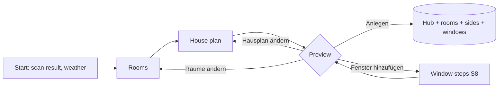
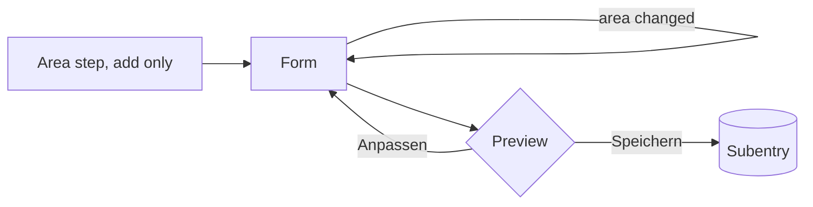
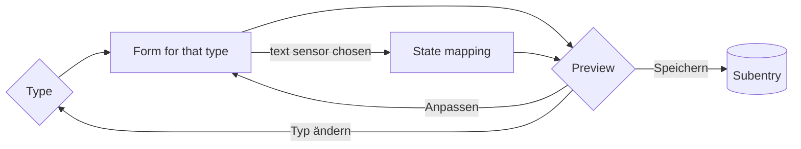

# UI mockups

Status: **approved 2026-10-13** after two prototype reviews. v2 reworked the first draft
for what native flows can render (§2.4). The DEV spike (§7) may still force changes; they come back here for approval.
Screens show the German UI strings, because German is the primary language of the reference installation. The English
strings use the same keys. Requirement IDs refer to `docs/requirements.md`, ADRs to `docs/architecture.md`.

Legend for screens: `[ … ▾ ]` dropdown, `[■]` toggle, `≡` drag handle of a sortable list, `▸` collapsed section,
`▾` expanded section, `>` menu option.

## 1. Where things live

| Surface | Purpose | How the user gets there |
|---|---|---|
| First setup (config flow) | Weather, rooms, house plan, preview, create | Settings → Devices & services → Add integration → Climate Hub |
| Subentries | Rooms, outdoor sides, windows: add, edit, delete one at a time | Integration page → ⋮ on the hub entry → Raum hinzufügen / Außenseite hinzufügen / Fenster hinzufügen; ⋮ on an item → Rekonfigurieren / Löschen |
| Hub reconfigure | House plan: which outdoor area and which rooms belong to each side | Integration page → ⋮ → Rekonfigurieren |
| Hub options | Weather service, area sync, expert defaults | Integration page → Konfigurieren |
| Hub device entities | Comfort range (numbers), house-level values | Device "Hausklima" |
| Repairs | Long sensor outages, new sensors in a room, windows without a room | Settings → Repairs |

## 2. Flows

### 2.1 First setup



Windows are an **add-on** (W0) and are never guessed. They depend on hardware knowledge (leaves, tilt discriminator,
handle, pass-through) that a guess would get wrong. Instead the preview offers „Fenster hinzufügen (optional)": it runs
the window steps (S8) and returns to the preview, as often as needed. Later, windows are added from the hub entry's ⋮
menu. In the prototype review (2026-10-13) that menu took a while to find, so the first setup is the main entry
point and the success dialog points to the menu.

### 2.2 Room and outdoor side (add and edit use the same form)



Adding starts with the area (outdoor side: area and direction), because the source list is filtered by that area and
pre-filled from it. Editing opens the form directly. The form still contains the area. If the area differs from the
one the sources were suggested for, the form opens once more with sources suggested for the new area and a hint.

### 2.3 Window



The preview is a menu step. Its text shows live values at the moment it opens. Its options lead back to the form, so the
user can correct mistakes without starting over.

### 2.4 What native flows can render (design rules)

Checked against Home Assistant core and frontend source on 2026-10-13.

- **Forms are not live.** No field can change another field's options, filter or default before the step is submitted.
  Values that depend on a choice come from the previous step or appear in the preview.
- **Select options are static labels** (`translation_key`). The set of offered values can be computed, but a label cannot
  carry live data such as „Norden · Straße". Live data goes into the step description or the preview.
- **Select options have no description line.** Menu options do (since 2025.10), so choices that need an explanation are
  menu steps (S8).
- **Previews are markdown** in a menu step description, assembled from translated fragments. Column alignment in the
  screens below is illustrative only.
- **Entity pickers cannot filter by area.** Context filters (U6) are precomputed entity lists (`include_entities`).
- **„Hinzufügen" for subentries** sits in the entry's ⋮ menu, ordered as the integration lists the types.

## 3. Screens: first setup

### S1 Start

```
┌─ Climate Hub einrichten ───────────────────────────────────┐
│ Ich habe dein Zuhause durchsucht und gefunden:             │
│  • 7 Bereiche mit Klimasensor oder Thermostat              │
│  • 3 Bereiche mit Temperatursensor, die draußen sein       │
│    könnten                                                 │
│  • 6 Fenster- und Türkontakte                              │
│  • 2 Wetterdienste                                         │
│                                                            │
│ Wetterdienst             [ weather.openweathermap      ▾ ] │
│   Liefert die Vorhersage für die Tagesstrategie und        │
│   Außenwerte, wenn alle Außensensoren ausfallen.           │
│                                                            │
│ Bereiche aktuell halten  [■]                               │
│   Trägt die Raumwerte als Temperatur- und Feuchtesensor    │
│   deiner Bereiche ein. Dann zeigen Bereichskarten den      │
│   zuverlässigen Wert.                                      │
│                                              [ Weiter ]    │
└────────────────────────────────────────────────────────────┘
```

- Weather: entity selector, domain `weather`, pre-filled with the first available entity that supports forecasts. Optional.
- Area sync: R11, default on.

### S2 Räume

```
┌─ Welche Bereiche sind Räume? ──────────────────────────────┐
│ Pro Raum fasse ich die Sensoren zu einem Wert zusammen.    │
│ Vorausgewählt sind Bereiche mit Klimasensor oder           │
│ Thermostat.                                                │
│                                                            │
│ Räume   [ Wohnzimmer ✕ ] [ Küche ✕ ] [ Bad ✕ ]             │
│         [ Schlafzimmer ✕ ] [ Arbeitszimmer ✕ ] [ + ]       │
│                                                            │
│   Welche Sensoren ich pro Raum nehme, siehst du in der     │
│   Vorschau. Die Reihenfolge änderst du später pro Raum.    │
│                                              [ Weiter ]    │
└────────────────────────────────────────────────────────────┘
```

- Area selector, multiple, filtered to areas with a temperature sensor or a `climate` entity.
- Error if empty: „Wähle mindestens einen Raum."

### S3 Hausplan

```
┌─ Hausplan ─────────────────────────────────────────────────┐
│ Ordne jeder Hausseite ihren Außenbereich zu und die        │
│ Räume, deren Fenster dorthin zeigen. Seiten ohne Außen-    │
│ bereich, etwa eine Wand zum Nachbarhaus, bleiben leer.     │
│                                                            │
│ ▾ Norden                                                   │
│     Außenbereich         [ Straße                      ▾ ] │
│     Räume auf der Seite  [ Wohnzimmer ✕ ] [ + ]            │
│ ▾ Osten                                                    │
│     Außenbereich         [                             ▾ ] │
│     Räume auf der Seite  [ + ]                             │
│ ▾ Süden                                                    │
│     Außenbereich         [ Garten                      ▾ ] │
│     Räume auf der Seite  [ Küche ✕ ] [ Schlafzimmer ✕ ]    │
│ ▾ Westen                                                   │
│     Außenbereich         [ Hof                         ▾ ] │
│     Räume auf der Seite  [ Bad ✕ ]                         │
│                                                            │
│   Innenliegende Räume ohne Fenster einfach weglassen.      │
│                                              [ Weiter ]    │
└────────────────────────────────────────────────────────────┘
```

- Four fixed sections, so all keys are translatable. Each section has one area selector (outdoor area, filtered to areas
  with a temperature sensor) and one area selector, multiple (rooms on that side).
- Errors:
  - Room on two sides: „Ein Raum hat eine Hauptseite. Fenster zu anderen Seiten stellst du später am Fenster ein."
  - Same area as outdoor area and room: „{area} kann nicht gleichzeitig Raum und Außenbereich sein."
- A room chosen here that was not ticked in S2 becomes a room as well (P3) and is marked „neu" in the preview.

### S4 Vorschau

```
┌─ Vorschau ─────────────────────────────────────────────────┐
│ **Räume**                                                  │
│ • **Wohnzimmer** 21,4 °C · 48 % aus Klimasensor Wohnzimmer │
│   Ersatz: Thermostat Wohnzimmer. Seite: Norden.            │
│ • **Küche** 20,7 °C · 57 % aus Klimasensor Küche           │
│   Nicht übernommen: Kühlschrank (6,9 °C, kein Raumwert),   │
│   Fensterkontakt Küche (Nebenwert eines Kontakts).         │
│ • **Bad** 19,9 °C · 66 % aus Klimasensor Bad               │
│ • …                                                        │
│ **Außenseiten**                                            │
│ • **Norden · Straße** 13,0 °C · 71 %                       │
│   Fällt sie aus: Westen, dann Süden, dann Wetterdienst.    │
│ • **Süden · Garten** 12,5 °C · 76 %                        │
│ • **Westen · Hof** 14,5 °C · 65 %                          │
│ • Osten: keine Außenseite, Wetterdienst springt ein.       │
│ **Fenster**                                                │
│ • Noch keine. Mit Fenstern weiß ich, was gerade offen ist, │
│   und kann warnen.                                         │
│ Quellen und Reihenfolge änderst du später pro Raum.        │
│                                                            │
│  > Anlegen                                                 │
│  > Fenster hinzufügen (optional)                           │
│  > Räume ändern                                            │
│  > Hausplan ändern                                         │
└────────────────────────────────────────────────────────────┘
```

- Shows what was **not** taken and why (P1, R6), with a short reason per entity: „kein Raumwert" (implausible
  value), „Nebenwert eines Kontakts" / „eines Bewegungsmelders", „Gerätetemperatur" (diagnostic), „abgeleiteter Wert"
  (helper platform), „mehrere Temperaturen am Gerät".
- Shows each side's computed fallback chain (ADR-003).
- **Fenster** lists the windows added so far („Küche Fenster: zu"); without any it says why they help.
- „Fenster hinzufügen (optional)" runs S8 → S8d → window preview; „Speichern" there returns to this preview.
- „Anlegen" creates the hub entry with all room, region and window subentries in one step. The success dialog says:
  „Fertig. Quellen änderst du pro Raum: ⋮ beim Raum → Rekonfigurieren. Weitere Fenster: ⋮ beim Eintrag Hausklima →
  Fenster hinzufügen."

## 4. Screens: objects

### S5 Integration page (native, for orientation)

```
Climate Hub
 └ Hausklima                                   ⚙ Konfigurieren   ⋮
   │   ⋮ > Raum hinzufügen
   │     > Außenseite hinzufügen
   │     > Fenster hinzufügen
   │     > Rekonfigurieren (Hausplan)
   │     > …                                   (HA's own items)
   ├ Räume
   │    Wohnzimmer ⋮   Küche ⋮   Bad ⋮   Schlafzimmer ⋮     ⋮ > Rekonfigurieren · Löschen
   ├ Außenseiten
   │    Norden · Straße ⋮   Süden · Garten ⋮   Westen · Hof ⋮
   └ Fenster
        Küche Fenster ⋮
```

Layout is Home Assistant's. We control the type names, the subentry titles and the order of the add items.
Home Assistant shows nothing for an empty type group and has no room for our own hints on this page. „Löschen"
opens Home Assistant's own confirmation, which we cannot extend. Deleting a room therefore keeps its windows and
raises a repair (W11, S11).

### S6 Raum

**Step 1, add only: Bereich**

```
┌─ Raum hinzufügen ──────────────────────────────────────────┐
│ Welcher Bereich ist der Raum? Danach schlage ich die       │
│ Quellen aus diesem Bereich vor.                            │
│                                                            │
│ Bereich         [ Wohnzimmer                           ▾ ] │
│   Gezeigt werden Bereiche mit Temperatursensor oder        │
│   Thermostat.                                              │
│                                              [ Weiter ]    │
└────────────────────────────────────────────────────────────┘
```

- Area selector, same filter as S2.
- Error: „{area} ist schon ein Raum." · „{area} ist eine Außenseite."

**Step 2: form (add and edit)**

```
┌─ Raum: Wohnzimmer ─────────────────────────────────────────┐
│ Vorgeschlagen aus Wohnzimmer. Prüfe die Reihenfolge.       │
│ Außenseiten: Norden Straße · Süden Garten · Westen Hof ·   │
│ Osten keine (dort hilft der Wetterdienst aus).             │
│                                                            │
│ Bereich         [ Wohnzimmer                           ▾ ] │
│ Hauptseite      [ Norden                               ▾ ] │
│   Von dieser Seite kommt die Außenluft, wenn du hier       │
│   lüftest. Innenliegende Räume: Keine.                     │
│                                                            │
│ Temperaturquellen, wichtigste oben                         │
│   ≡ Klimasensor Wohnzimmer Temperatur               ✕      │
│   ≡ Luftmesser Wohnzimmer Temperatur                ✕      │
│   ≡ Thermostat Wohnzimmer                           ✕      │
│   [ + Quelle ]                                             │
│   Fällt die oberste Quelle aus, übernimmt die nächste.     │
│   Ihre typische Abweichung gleiche ich aus.                │
│                                                            │
│ ▸ Feuchte und Luftdruck                                    │
│ ▸ Heizen und Kühlen                                        │
│ ▸ Erweitert                                                │
│                                              [ Weiter ]    │
└────────────────────────────────────────────────────────────┘
```

- Description: the first line only when sources were just suggested (add, or after an area change); the side
  assignment always.
- Main side: select with the static options Norden, Osten, Süden, Westen, Keine. All four directions are always offered
  (ADR-003, agreed 2026-10-13). Which direction has an outdoor side is in the description, not in the labels (§2.4).
- Temperature sources: entity selector, `multiple` + `reorder`, limited to temperature sensors and `climate` entities
  of the room's area plus entities without an area (U6). Pre-filled when the sources were suggested (R6).
- Area: changing it re-opens this form with sources suggested for the new area. Chosen sources without an area stay.
  Hint in the description: „Bereich geändert: Ich habe die Quellen für {area} neu vorgeschlagen."
- Thermostats and air conditioners also deliver humidity when they report it (R5), so they can appear in the
  humidity order too.
- ▸ Feuchte und Luftdruck: „Feuchtequellen" and „Luftdruckquellen", sortable. Empty means "same devices as
  temperature" (R3), which the description says.
- ▸ Heizen und Kühlen: „Heiz- und Klimageräte" (`climate` entities, multiple), pre-filled with the area's `climate`
  entities (R15). Description: „Ich steuere sie nicht. Läuft eines, während ein Fenster länger als zum Stoßlüften
  offen ist, warne ich." Open while adding, collapsed when editing.
- ▸ Erweitert: „Höchstalter einer Messung" (minutes; empty = hub default).
- Errors: area already a room or an outdoor side (as in step 1), no temperature source („Wähle mindestens eine
  Temperaturquelle.").
- When the sources were just suggested, the preview also lists what was not taken and why (as in S4).

**Preview**

```
┌─ Vorschau: Wohnzimmer ─────────────────────────────────────┐
│ Jetzt **21,4 °C** aus Klimasensor Wohnzimmer (Quelle 1).   │
│ Ersatz bereit:                                             │
│ 2. Luftmesser Wohnzimmer: 21,7 °C, Abweichung +0,3 °C      │
│ 3. Thermostat Wohnzimmer: 22,6 °C, Abweichung wird gelernt │
│ Feuchte 48 % · Luftdruck 1012 hPa, aus denselben Geräten.  │
│ Außen (Norden, Straße): 13,0 °C, also 8,4 °C kälter.       │
│                                                            │
│  > Speichern                                               │
│  > Anpassen                                                │
└────────────────────────────────────────────────────────────┘
```

### S7 Außenseite

**Step 1, add only**

```
┌─ Außenseite hinzufügen ────────────────────────────────────┐
│ Himmelsrichtung   [ Osten                              ▾ ] │
│   Nur Richtungen, die noch frei sind.                      │
│ Außenbereich      [ Terrasse                           ▾ ] │
│   Gezeigt werden Bereiche mit Temperatursensor.            │
│                                              [ Weiter ]    │
└────────────────────────────────────────────────────────────┘
```

**Step 2: form (add and edit)**

```
┌─ Außenseite: Osten ────────────────────────────────────────┐
│ Himmelsrichtung   [ Osten                              ▾ ] │
│ Außenbereich      [ Terrasse                           ▾ ] │
│ Temperaturquellen, wichtigste oben                         │
│   ≡ Klimasensor Terrasse Temperatur                 ✕      │
│   [ + Quelle ]                                             │
│ ▸ Feuchte und Luftdruck                                    │
│ ▸ Erweitert                                                │
│                                              [ Weiter ]    │
└────────────────────────────────────────────────────────────┘
```

- Direction: static labels, but only free directions are offered (when editing: the free ones plus its own). The error
  stays as a safeguard: „Für Norden gibt es schon eine Außenseite: Straße."
- Area: same re-open rule as S6.
- Preview names the computed fallback chain: „Fällt Osten aus, nehme ich Norden (Straße) und Süden (Garten), dann
  Westen (Hof), dann den Wetterdienst."

### S8 Fenster: Typ

Adding a window starts with its type (variant B, agreed 2026-10-12). The type only decides which contact fields the
next form shows; tilt discriminator, handle contact and cover are optional in every type, so mixed setups such as
"double leaf with tilt discriminator" need no extra type. The explanation under each option needs menu option
descriptions (Home Assistant 2025.10).

```
┌─ Fenster hinzufügen ───────────────────────────────────────┐
│ Was für ein Fenster ist es?                                │
│                                                            │
│  > Einfaches Fenster oder Tür                              │
│      Ein Flügel, ein Kontakt meldet offen oder zu.         │
│  > Doppelflügel                                            │
│      Zwei Flügel in einem Rahmen, je ein Kontakt.          │
│  > Durchgang                                               │
│      Lüften geht nur, wenn zwei Öffnungen hintereinander   │
│      offen sind, z. B. Tür zum Wintergarten und            │
│      Wintergartenfenster.                                  │
└────────────────────────────────────────────────────────────┘
```

### S8a Einfaches Fenster oder Tür

```
┌─ Einfaches Fenster ────────────────────────────────────────┐
│ Raum            [ Küche                                ▾ ] │
│ Kontakt         [ Fensterkontakt Küche                 ▾ ] │
│ Name            [                                        ] │
│   Leer lassen: Ich nenne es nach dem Raum: Küche Fenster.  │
│ ▸ Zusatzkontakte                                           │
│ ▸ Rollladen                                                │
│ ▸ Erweitert                                                │
│                                              [ Weiter ]    │
└────────────────────────────────────────────────────────────┘
```

### S8b Doppelflügel

```
┌─ Doppelflügel ─────────────────────────────────────────────┐
│ Raum            [ Wohnzimmer                           ▾ ] │
│ Linker Flügel   [ Fensterflügel links                  ▾ ] │
│ Rechter Flügel  [ Fensterflügel rechts                 ▾ ] │
│ Kontakt zwischen den Flügeln (optional)                    │
│                 [ Kontakt unten Wohnzimmer             ▾ ] │
│   Sitzt meist unten zwischen den Flügeln und meldet nur    │
│   „offen", wenn ein Flügel ganz aufgedreht ist. Damit      │
│   unterscheide ich gekippt und offen.                      │
│ Name            [                                        ] │
│   Leer lassen: Ich nenne es nach dem Raum.                 │
│ ▸ Zusatzkontakte                                           │
│ ▸ Rollladen                                                │
│ ▸ Erweitert                                                │
│                                              [ Weiter ]    │
└────────────────────────────────────────────────────────────┘
```

### S8c Durchgang

```
┌─ Durchgang ────────────────────────────────────────────────┐
│ Raum            [ Arbeitszimmer                        ▾ ] │
│ Innere Öffnung  [ Tür zum Wintergarten                 ▾ ] │
│   Die Öffnung in diesem Raum.                              │
│ Äußere Öffnung  [ Wintergartenfenster                  ▾ ] │
│   Die Öffnung nach draußen, oft in einem anderen Bereich.  │
│   Ein Kontakt darf auch zu einem anderen Fenster gehören.  │
│ Name            [ Durchgang Wintergarten                 ] │
│ ▸ Rollladen                                                │
│ ▸ Erweitert                                                │
│                                              [ Weiter ]    │
└────────────────────────────────────────────────────────────┘
```

Shared sections (all types):

- **▸ Zusatzkontakte**: single leaf: tilt discriminator („Kipp-Erkennung", helper: „Zweiter Kontakt am Flügel, meist
  unten. Er meldet nur „offen", wenn der Flügel ganz aufgedreht ist.") and handle contact (W4). Double leaf: handle
  contact only, because its tilt discriminator is a main field („Kontakt zwischen den Flügeln", S8b, W12). Users
  look for the contact by where it sits, not by its role (prototype review 2026-10-13).
- **▸ Rollladen**: „Rollladen" (cover entity, optional, SH2). Description: „Dann empfehle ich, wann du beschatten
  solltest. Bewegen tut ihn deine Automation."
- **▸ Erweitert**: „Ausrichtung" (static options „Wie der Raum", Norden, Osten, Süden, Westen; default „Wie der Raum";
  the preview names the resulting direction), „Genaue Ausrichtung in Grad" (optional, SH4), „Lüftet ab" (default
  gekippt, W3).

Field rules:

- Room: area selector, any indoor area. If the area is not a room yet, the preview says „Raum {area} wird mit
  angelegt" and lists its suggested sources (U4, P1). Error: „{area} ist eine Außenseite."
- Contacts: entity selectors limited by contact type only, not by area (agreed 2026-10-13, exception to U6): binary
  sensors with device class window, door, opening or garage door, plus sensors with a text state. Reason:
  pass-through openings lie in other areas (W5), the room is chosen in the same form (§2.4), and a house has few
  contacts.
- Name: optional. Empty means a name from the room: „{area} Fenster" (pass-through: „{area} Durchgang"), numbered
  from the second one in the same room („Küche Fenster 2"). The preview shows it, and saving stores it, so it stays
  stable and editable. Agreed 2026-10-13: room-based names give predictable entity IDs (P7,
  `sensor.kuche_fenster_zustand`); compounds like „Küchenfenster" cannot be derived reliably.

### S8d Zustände zuordnen (only for text sensors)

```
┌─ Zustände zuordnen ────────────────────────────────────────┐
│ Fenstergriff Bad meldet Text. Ordne jedem Wert eine        │
│ Stellung zu. Vorbelegt ist, was ich erkannt habe.          │
│                                                            │
│ closed          [ zu                                   ▾ ] │
│ tilted          [ gekippt                              ▾ ] │
│ open            [ offen                                ▾ ] │
│                                              [ Weiter ]    │
└────────────────────────────────────────────────────────────┘
```

- Added on 2026-10-13: W2 requires a configurable mapping for text sensors, and no screen offered one.
- Appears after the form only if a chosen contact is a text sensor; one step per such sensor, in add and edit.
- One select per raw value, options zu / angelehnt / gekippt / offen. Empty means unknown, which is ignored (W8).
- Raw values come from the sensor's `options` attribute (enum sensors), otherwise from its current state. A value
  that appears later and is not mapped counts as unknown.
- The field labels are the raw values themselves (data, not UI text). Pre-filled from common names
  (closed/geschlossen → zu, tilted/gekippt → gekippt, open/offen → offen).

**Preview**

```
┌─ Vorschau: Wohnzimmer Fenster ─────────────────────────────┐
│ Ausrichtung: Norden, wie der Raum.                         │
│ Gerade **gekippt** (linker Flügel), seit 12 min.           │
│ Raum Wohnzimmer: **geschlossen lassen**. Draußen ist es    │
│ 8,4 °C kälter, Tagesstrategie: Auskühlen verhindern.       │
│ Rollladen: **offen lassen**, auf die Nordseite scheint     │
│ keine Sonne.                                               │
│                                                            │
│  > Speichern                                               │
│  > Anpassen                                                │
│  > Typ ändern                                              │
└────────────────────────────────────────────────────────────┘
```

- Name left empty: the first line reads „Name: Küche Fenster, nach dem Raum benannt."
- Room not yet a room: a line „Raum Küche wird mit angelegt, Quellen: Klimasensor Küche, Thermostat Küche."

Editing an existing window opens its type form directly; „Typ ändern" in the preview goes back to the type menu.
Started from the first-setup preview (S4), the room field offers the rooms of that setup, and „Speichern" returns to S4.

Example for W12 (double leaf with a shared tilt discriminator at the bottom between the leaves): left and right
leaf contact at the top of each leaf, the bottom contact as „Kontakt zwischen den Flügeln". Left open at the top and
bottom open means the left leaf is turned open; bottom closed means it is tilted.

## 5. Screens: hub

### S9 Optionen

```
┌─ Climate Hub – Optionen ───────────────────────────────────┐
│ Wetterdienst             [ weather.openweathermap      ▾ ] │
│ Bereiche aktuell halten  [■]                               │
│ ▸ Zeiten und Schwellen                                     │
│     Höchstalter einer Messung   [ 40 ] min                 │
│     Dauer Stoßlüften            [ 10 ] min                 │
│     Lüften wegen Feuchte ab     [ 60 ] %                   │
│     Ausfall melden nach         [  6 ] h                   │
│                                              [ Absenden ]  │
└────────────────────────────────────────────────────────────┘
```

The comfort range is not here. It lives on the device „Hausklima" as number entities (ADR-006).

### S10 Rekonfigurieren: Hausplan

Same screen as S3, filled with the current state. Saving updates the affected rooms and sides. The house plan is a
second view on data that lives in the room and region subentries, so editing it in either place gives the same result.

### S11 Reparatur

```
Climate Hub: Sensor im Bad meldet sich nicht
Klimasensor Bad liefert seit 6 Stunden keine Werte. Ich nutze gerade
„Thermostat Bad", korrigiert um −0,8 °C. Prüfe Batterie oder Verbindung.
Die Meldung verschwindet von selbst, sobald der Sensor wieder Werte liefert.
```

**New sensor (R14)**, fixable, one issue per entity. Home Assistant's own „Ignorieren" dismisses it for good.

```
Climate Hub: Neuer Sensor in der Küche
Klimasensor Küche 2 misst Temperatur und Feuchte im Bereich Küche.
Soll ich ihn als Quelle für den Raum Küche nehmen?
                                                        [ Reparieren ]
  → Fix flow: „Ich nehme Klimasensor Küche 2 als letzte Quelle auf.
    Die Reihenfolge änderst du am Raum."            [ Absenden ]
```

Only climate-grade sources (R6) raise it; contacts, motion sensors and helpers never do.

**Windows without a room (W11)**, fixable, one issue per area.

```
Climate Hub: Fenster in der Küche haben keinen Raum mehr
Der Raum Küche wurde gelöscht. Küche Fenster meldet weiter, ob es offen
ist, aber ohne Raum gibt es keine Empfehlung.
                                                        [ Reparieren ]
  → Fix flow, menu:  > Raum Küche wieder anlegen
                     > Fenster löschen (Küche Fenster)
```

„Raum wieder anlegen" shows the room preview with suggested sources (S6) before saving. Both options resolve the issue.

## 6. Entities (what dashboards and automations see)

German names on a German instance; entity IDs are generated once from them (ADR-005).

| Device | Entity | Type | Example entity ID |
|---|---|---|---|
| Wohnzimmer Klima | Temperatur | sensor, °C | `sensor.wohnzimmer_klima_temperatur` |
| | Luftfeuchtigkeit | sensor, % | `sensor.wohnzimmer_klima_luftfeuchtigkeit` |
| | Luftdruck | sensor, hPa | |
| | Absolute Feuchte | sensor, g/m³ | |
| | Taupunkt | sensor, °C | |
| | Außentemperatur | sensor, °C (room's side) | |
| | Außenfeuchte | sensor, % | |
| | Temperaturdifferenz außen | sensor, °C (outside − inside) | |
| | Feuchtedifferenz außen | sensor, g/m³ | |
| | Außen | enum: wärmer / kälter / gleich | |
| | Wunschbereich | enum: darunter / im Bereich / darüber | |
| | Trend | enum: steigend / stabil / fallend | |
| | Empfehlung | enum: öffnen / offen lassen / schließen / geschlossen lassen / keine (+ reason attribute) | `sensor.wohnzimmer_klima_empfehlung` |
| | Auskühlen | binary_sensor (only with windows) | |
| | Aufheizen | binary_sensor (only with windows) | |
| | Offen bei Heizen/Kühlen | binary_sensor (only with windows and heating/cooling devices, A12) | |
| | Fenster | enum: zu / angelehnt / gekippt / offen, most open window of the room (only with windows, W9) | `sensor.wohnzimmer_klima_fenster` |
| | Fenster offen seit | sensor, timestamp, earliest open window (only with windows) | |
| Wohnzimmer Fenster | Zustand | enum: zu / angelehnt / gekippt / offen (+ open leaves attribute) | `sensor.wohnzimmer_fenster_zustand` |
| | Offen seit | sensor, timestamp | |
| | Beschattung | enum: beschatten / beschattet lassen / öffnen / offen lassen / keine (+ reason); enabled by default only with a cover (SH1, SH2) | `sensor.wohnzimmer_fenster_beschattung` |
| Straße Klima | Temperatur, Luftfeuchtigkeit, Luftdruck, Absolute Feuchte, Taupunkt | sensors (+ stage attribute) | `sensor.strasse_klima_temperatur` |
| Hausklima | Wunschtemperatur min / max, Schwelle | number | `number.hausklima_wunschtemperatur_max` |
| | Tagesstrategie | enum: Aufheizen verhindern / Auskühlen verhindern / neutral | |
| | Innen Durchschnitt, Außen | sensors (+ min/max attributes) | |
| | Irgendwo Auskühlen, Irgendwo Aufheizen, Irgendwo offen bei Heizen/Kühlen | binary_sensor | |
| | Irgendwo beschatten | binary_sensor (SH1) | |

Every measurement carries `source`, `stage`, `reason` and, for fallbacks, `offset` as attributes (E6).

Entity IDs: Home Assistant 2026.10 builds them from area, device name and entity name (default `entity_id_parts`,
`helpers/entity_registry.py`). The area is not stripped from a device name, so a device „Küche Klima" in the area
Küche gives `sensor.kuche_kuche_klima_temperatur` (seen on DEV). Device names therefore must not contain the area;
see §7 item 6 and the pending naming decision.

## 7. To verify on DEV before building (spike)

Supported according to core and frontend source (2026-10-13), no spike needed: sections, menus and reconfigure in
subentry flows; menu option descriptions (2025.10); `include_entities` on entity selectors; area temperature and
humidity fields (2025.2); creating and updating other subentries from a flow. Not supported: live forms, select option
descriptions, entity selectors filtered by area (§2.4).

Spike results (2026-10-13, HA 2026.10.1, branch `spike/native-ui`, never merged; flows driven through the REST/WS flow
API on DEV and checked in core and frontend source). „Eyes" means the mechanism works and Felix still judges the look
in the UI.

| # | Check | Result |
|---|---|---|
| 1 | Sortable entity selector in a subentry form and in a section | Works (API, frontend source); drag-sorting: eyes |
| 2 | S3: four sections with two area selectors, on a phone | Serialises (`expandable`, expanded); phone layout: eyes |
| 3 | Markdown preview from a placeholder | Works: menu descriptions render GFM markdown incl. tables; look: eyes |
| 4 | Area selector with a list of entity filters | Works: the frontend combines the list with „or" |
| 5 | Hub entry with all subentries in one step, success text | Works: `async_create_entry(subentries=..., description=<translation key>)`; dialog: eyes |
| 6 | Device name with `{area}` and the generated entity IDs | **Fails as designed**: the area doubles (`sensor.kuche_kuche_klima_temperatur`). A device „Fenster" in the area gives `sensor.kuche_fenster_zustand` |
| 7 | Window flow creating a room subentry | Works (`async_add_subentry`); page refresh without F5: eyes |
| 8 | Order of the ⋮ add items | Works: frontend follows the order of `async_get_supported_subentry_types` |
| 9 | Re-open a form with replaced suggestions after an area change | Works (second step id for the hint text) |
| 10 | Entity picker shows each contact's area | Search by area works (source); display: eyes |
| 11 | S8d raw values as field labels | Works: untranslated field keys show as labels; look: eyes |
| 12 | Repair fix flows (update, recreate room, delete windows) | Works, both menu paths |

Further findings for the real build: a room's device area must follow the room's area (`suggested_area` only places a
new device); the new-sensor repair (R14) needs a registry listener, not only a check at setup. Implementation
pitfalls are in the project skill `ha-integration-dev`.

The minimum Home Assistant version is at least 2025.10 (menu option descriptions); the spike ran on 2026.10.1 only.

## 8. Open points for review

1. ~~First setup without windows~~: agreed 2026-10-12, windows are an add-on (W0).
2. ~~Window form vs. type menu~~: agreed 2026-10-12, type menu first (variant B, S8).
3. ~~Main side options~~: agreed 2026-10-13, all four directions plus „Keine", assignment in the description (S6).
4. ~~Entity list (§6)~~: agreed 2026-10-13, complete as listed.
5. ~~Shutters per window~~: agreed 2026-10-12, shading recommendation only, optional cover per window (SH1–SH4).
6. ~~Defaults (requirements Q5)~~: agreed 2026-10-13, as shown in S9.
7. ~~State mapping for text sensors (S8d)~~: agreed 2026-10-13.
8. ~~„Hinzufügen" only in the ⋮ menu~~: prototype review 2026-10-13, hard to find. Agreed 2026-10-13: optional windows
   step in the first setup (S4) plus the ⋮ menu.
9. ~~„Heizen und Kühlen"~~: agreed 2026-10-13, room section (R15) and warning entity (A12).
10. ~~Repairs~~: agreed 2026-10-13, new sensors (R14) and windows without a room (W11), S11.
