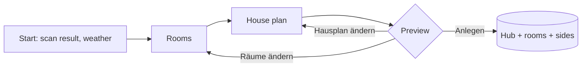
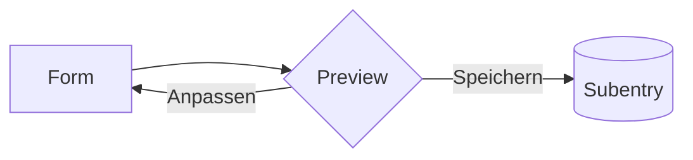
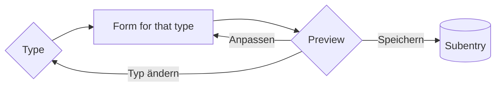

# UI mockups

Status: **draft for review**, 2026-10-12. Nothing here is built until it is approved (rule 8).
Screens show the German UI strings, because German is the primary language of the reference installation. The English
strings use the same keys. Requirement IDs refer to `docs/requirements.md`, ADRs to `docs/architecture.md`.

Legend for screens: `[ … ▾ ]` dropdown, `[■]` toggle, `≡` drag handle of a sortable list, `▸` collapsed section,
`▾` expanded section, `>` menu option.

## 1. Where things live

| Surface | Purpose | How the user gets there |
|---|---|---|
| First setup (config flow) | Weather, rooms, house plan, preview, create | Settings → Devices & services → Add integration → Climate Hub |
| Subentries | Rooms, outdoor sides, windows: add, edit, delete one at a time | Integration page → "+ Raum hinzufügen" / "+ Außenseite hinzufügen" / "+ Fenster hinzufügen"; ⋮ on an item → Rekonfigurieren / Löschen |
| Hub reconfigure | House plan: which outdoor area and which rooms belong to each side | Integration page → ⋮ → Rekonfigurieren |
| Hub options | Weather service, area sync, expert defaults | Integration page → Konfigurieren |
| Hub device entities | Comfort range (numbers), house-level values | Device "Hausklima" |
| Repairs | Long sensor outages | Settings → Repairs |

## 2. Flows

### 2.1 First setup



Windows are an **add-on** (W0) and are not created during the first setup. They depend on hardware knowledge (leaves,
tilt discriminator, handle, pass-through) that a guess would get wrong. After creation, the integration page offers
"+ Fenster hinzufügen" for each window, at any time.

### 2.2 Room and outdoor side (add and edit use the same form)



### 2.3 Window



The preview is a menu step. Its text shows live values at the moment it opens. Its options lead back to the form, so the
user can correct mistakes without starting over.

## 3. Screens: first setup

### S1 Start

```
┌─ Climate Hub einrichten ───────────────────────────────────┐
│ Ich habe dein Zuhause durchsucht und gefunden:             │
│  • 7 Bereiche mit Klimasensor oder Thermostat              │
│  • 3 Bereiche mit Temperatursensor, die draußen sein       │
│    könnten                                                 │
│  • 6 Fenster- und Türkontakte                              │
│  • 2 Wetterdienste                                         │
│                                                            │
│ Wetterdienst             [ weather.openweathermap      ▾ ] │
│   Liefert die Vorhersage für die Tagesstrategie und        │
│   Außenwerte, wenn alle Außensensoren ausfallen.           │
│                                                            │
│ Bereiche aktuell halten  [■]                               │
│   Trägt die Raumwerte als Temperatur- und Feuchtesensor    │
│   deiner Bereiche ein. Dann zeigen Bereichskarten den      │
│   zuverlässigen Wert.                                      │
│                                              [ Weiter ]    │
└────────────────────────────────────────────────────────────┘
```

- Weather: entity selector, domain `weather`, pre-filled with the first available entity that supports forecasts. Optional.
- Area sync: R11, default on.

### S2 Räume

```
┌─ Welche Bereiche sind Räume? ──────────────────────────────┐
│ Pro Raum fasse ich die Sensoren zu einem Wert zusammen.    │
│ Vorausgewählt sind Bereiche mit Klimasensor oder           │
│ Thermostat.                                                │
│                                                            │
│ Räume   [ Wohnzimmer ✕ ] [ Küche ✕ ] [ Bad ✕ ]             │
│         [ Schlafzimmer ✕ ] [ Arbeitszimmer ✕ ] [ + ]       │
│                                                            │
│   Welche Sensoren ich pro Raum nehme, siehst du in der     │
│   Vorschau. Die Reihenfolge änderst du später pro Raum.    │
│                                              [ Weiter ]    │
└────────────────────────────────────────────────────────────┘
```

- Area selector, multiple, filtered to areas with a temperature sensor or a `climate` entity.
- Error if empty: „Wähle mindestens einen Raum."

### S3 Hausplan

```
┌─ Hausplan ─────────────────────────────────────────────────┐
│ Ordne jeder Hausseite ihren Außenbereich zu und die        │
│ Räume, deren Fenster dorthin zeigen. Seiten ohne Außen-    │
│ bereich, etwa eine Wand zum Nachbarhaus, bleiben leer.     │
│                                                            │
│ ▾ Norden                                                   │
│     Außenbereich         [ Straße                      ▾ ] │
│     Räume auf der Seite  [ Wohnzimmer ✕ ] [ + ]            │
│ ▾ Osten                                                    │
│     Außenbereich         [                             ▾ ] │
│     Räume auf der Seite  [ + ]                             │
│ ▾ Süden                                                    │
│     Außenbereich         [ Garten                      ▾ ] │
│     Räume auf der Seite  [ Küche ✕ ] [ Schlafzimmer ✕ ]    │
│ ▾ Westen                                                   │
│     Außenbereich         [ Hof                         ▾ ] │
│     Räume auf der Seite  [ Bad ✕ ]                         │
│                                                            │
│   Innenliegende Räume ohne Fenster einfach weglassen.      │
│                                              [ Weiter ]    │
└────────────────────────────────────────────────────────────┘
```

- Four fixed sections, so all keys are translatable. Each section has one area selector (outdoor area, filtered to areas
  with a temperature sensor) and one area selector, multiple (rooms on that side).
- Errors:
  - Room on two sides: „Ein Raum hat eine Hauptseite. Fenster zu anderen Seiten stellst du später am Fenster ein."
  - Same area as outdoor area and room: „{area} kann nicht gleichzeitig Raum und Außenbereich sein."
- A room chosen here that was not ticked in S2 becomes a room as well (P3) and is marked „neu" in the preview.

### S4 Vorschau

```
┌─ Vorschau ─────────────────────────────────────────────────┐
│ Räume                                                      │
│  Wohnzimmer  21,4 °C · 48 %   aus Klimasensor Wohnzimmer   │
│              Ersatz: Thermostat Wohnzimmer · Seite Norden  │
│  Küche       20,7 °C · 57 %   aus Klimasensor Küche        │
│              Nicht übernommen: Kühlschrank (6,9 °C)        │
│  Bad         19,9 °C · 66 %   aus Klimasensor Bad          │
│  …                                                         │
│ Außenseiten                                                │
│  Norden · Straße  13,0 °C · 71 %                           │
│     fällt aus → Westen → Süden → Wetterdienst              │
│  Süden · Garten   12,5 °C · 76 %                           │
│  Westen · Hof     14,5 °C · 65 %                           │
│                                                            │
│  > Anlegen                                                 │
│  > Räume ändern                                            │
│  > Hausplan ändern                                         │
└────────────────────────────────────────────────────────────┘
```

- Shows what was **not** taken and why (P1, R6).
- Shows each side's computed fallback chain (ADR-003).
- „Anlegen" creates the hub entry with all room and region subentries in one step.

## 4. Screens: objects

### S5 Integration page (native, for orientation)

```
Climate Hub
 ├ Hausklima                                   ⋮ Konfigurieren · Rekonfigurieren
 ├ Räume                                       [ + Raum hinzufügen ]
 │    Wohnzimmer ⋮   Küche ⋮   Bad ⋮   Schlafzimmer ⋮
 ├ Außenseiten                                 [ + Außenseite hinzufügen ]
 │    Norden · Straße ⋮   Süden · Garten ⋮   Westen · Hof ⋮
 └ Fenster                                     [ + Fenster hinzufügen ]
```

Layout is Home Assistant's. We control the type names, the titles and the order of types.

### S6 Raum

```
┌─ Raum ─────────────────────────────────────────────────────┐
│ Bereich         [ Wohnzimmer                           ▾ ] │
│ Hauptseite      [ Norden · Straße                      ▾ ] │
│   Von dieser Seite kommt die Außenluft, wenn du hier       │
│   lüftest. Innenliegende Räume: Keine.                     │
│                                                            │
│ Temperaturquellen, wichtigste oben                         │
│   ≡ Klimasensor Wohnzimmer Temperatur               ✕      │
│   ≡ Luftmesser Wohnzimmer Temperatur                ✕      │
│   ≡ Thermostat Wohnzimmer                           ✕      │
│   [ + Quelle ]                                             │
│   Fällt die oberste Quelle aus, übernimmt die nächste.     │
│   Ihre typische Abweichung gleiche ich aus.                │
│                                                            │
│ ▸ Feuchte und Luftdruck                                    │
│ ▸ Erweitert                                                │
│                                              [ Weiter ]    │
└────────────────────────────────────────────────────────────┘
```

- Main side: select with options Norden, Osten, Süden, Westen, Keine. All four directions are always offered (ADR-003).
  If a direction has no outdoor side yet, the description says the weather service is used until one exists.
- Temperature sources: entity selector, `multiple` + `reorder`, filtered to temperature sensors and `climate` entities
  of the room's area plus entities without an area (U6). Pre-filled when adding (R6).
- ▸ Feuchte und Luftdruck: „Feuchtequellen" and „Luftdruckquellen", sortable. Empty means "same devices as
  temperature" (R3), which the description says.
- ▸ Erweitert: „Höchstalter einer Messung" (minutes; empty = hub default).
- Errors: area already a room („{area} ist schon ein Raum."), no temperature source („Wähle mindestens eine Temperaturquelle.").

**Preview**

```
┌─ Vorschau: Wohnzimmer ─────────────────────────────────────┐
│ Jetzt: 21,4 °C aus Klimasensor Wohnzimmer (Quelle 1)       │
│ Ersatz bereit:                                             │
│   2  Luftmesser Wohnzimmer    21,7 °C  Abweichung +0,3 °C  │
│   3  Thermostat Wohnzimmer    22,6 °C  Abweichung wird     │
│                                        gelernt             │
│ Feuchte: 48 % · Luftdruck: 1012 hPa (wie Temperatur)       │
│ Außen (Norden · Straße): 13,0 °C, 8,4 °C kälter            │
│                                                            │
│  > Speichern                                               │
│  > Anpassen                                                │
└────────────────────────────────────────────────────────────┘
```

### S7 Außenseite

```
┌─ Außenseite ───────────────────────────────────────────────┐
│ Himmelsrichtung   [ Norden                             ▾ ] │
│ Außenbereich      [ Straße                             ▾ ] │
│ Temperaturquellen, wichtigste oben                         │
│   ≡ Klimasensor Straße Temperatur                   ✕      │
│   [ + Quelle ]                                             │
│ ▸ Feuchte und Luftdruck                                    │
│ ▸ Erweitert                                                │
│                                              [ Weiter ]    │
└────────────────────────────────────────────────────────────┘
```

- Error: direction already used („Für Norden gibt es schon eine Außenseite: Straße.").
- Preview names the computed fallback chain: „Fällt Norden aus, nehme ich Westen (Hof), dann Süden (Garten),
  dann den Wetterdienst."

### S8 Fenster: Typ

Adding a window starts with its type (variant B, agreed 2026-10-12). The type only decides which contact fields the
next form shows; tilt discriminator, handle contact and cover are optional in every type, so mixed setups such as
"double leaf with tilt discriminator" need no extra type.

```
┌─ Fenster hinzufügen ───────────────────────────────────────┐
│ Was für ein Fenster ist es?                                │
│                                                            │
│  > Einfaches Fenster oder Tür                              │
│      Ein Flügel, ein Kontakt meldet offen oder zu.         │
│  > Doppelflügel                                            │
│      Zwei Flügel in einem Rahmen, je ein Kontakt.          │
│  > Durchgang                                               │
│      Lüften geht nur, wenn zwei Öffnungen hintereinander   │
│      offen sind, z. B. Tür zum Wintergarten und            │
│      Wintergartenfenster.                                  │
└────────────────────────────────────────────────────────────┘
```

### S8a Einfaches Fenster oder Tür

```
┌─ Einfaches Fenster ────────────────────────────────────────┐
│ Name            [ Küchenfenster                          ] │
│ Raum            [ Küche                                ▾ ] │
│ Kontakt         [ Fensterkontakt Küche                 ▾ ] │
│   Gezeigt werden Kontakte aus dem Raum und Kontakte ohne   │
│   Bereich.                                                 │
│ ▸ Zusatzkontakte                                           │
│ ▸ Rollladen                                                │
│ ▸ Erweitert                                                │
│                                              [ Weiter ]    │
└────────────────────────────────────────────────────────────┘
```

### S8b Doppelflügel

```
┌─ Doppelflügel ─────────────────────────────────────────────┐
│ Name            [ Wohnzimmerfenster                      ] │
│ Raum            [ Wohnzimmer                           ▾ ] │
│ Linker Flügel   [ Fensterflügel links                  ▾ ] │
│ Rechter Flügel  [ Fensterflügel rechts                 ▾ ] │
│ ▾ Zusatzkontakte                                           │
│     Kipp-Erkennung   [ Drehkontakt Wohnzimmerfenster   ▾ ] │
│       Ein Kontakt, der nur bei ganz aufgedrehtem Flügel    │
│       „offen" meldet. Damit unterscheide ich gekippt und   │
│       offen.                                               │
│     Griffkontakt     [                                 ▾ ] │
│       Griff gedreht, Flügel noch zu: angelehnt.            │
│ ▸ Rollladen                                                │
│ ▸ Erweitert                                                │
│                                              [ Weiter ]    │
└────────────────────────────────────────────────────────────┘
```

### S8c Durchgang

```
┌─ Durchgang ────────────────────────────────────────────────┐
│ Name            [ Durchgang Wintergarten                 ] │
│ Raum            [ Arbeitszimmer                        ▾ ] │
│ Innere Öffnung  [ Tür zum Wintergarten                 ▾ ] │
│   Die Öffnung in diesem Raum.                              │
│ Äußere Öffnung  [ Wintergartenfenster                  ▾ ] │
│   Die Öffnung nach draußen. Ein Kontakt darf auch zu       │
│   einem anderen Fenster gehören.                           │
│ ▸ Rollladen                                                │
│ ▸ Erweitert                                                │
│                                              [ Weiter ]    │
└────────────────────────────────────────────────────────────┘
```

Shared sections (all types):

- **▸ Zusatzkontakte** (single and double leaf): tilt discriminator, handle contact (W4).
- **▸ Rollladen**: „Rollladen" (cover entity, optional, SH2). Description: „Dann empfehle ich, wann du beschatten
  solltest. Bewegen tut ihn deine Automation."
- **▸ Erweitert**: „Ausrichtung" (default „Wie der Raum (Süden)"), „Genaue Ausrichtung in Grad" (optional, SH4),
  „Lüftet ab" (default gekippt, W3).

Field rules:

- Room: area selector. If the area is not a room yet, the preview says „Raum {area} wird mit angelegt" (U4).
- Contacts: entity selectors for binary sensors with device class window, door, opening or garage door, plus text
  sensors. Filter: room's area plus entities without an area (U6).
- Name: pre-filled from the device name of the first contact.

**Preview**

```
┌─ Vorschau: Wohnzimmerfenster ──────────────────────────────┐
│ Gerade: gekippt (linker Flügel), seit 12 min               │
│ Raum Wohnzimmer: geschlossen halten                        │
│   draußen 8,4 °C kälter · Tagesstrategie: Auskühlen        │
│   verhindern                                               │
│ Rollladen: offen lassen (keine Sonne auf der Südseite)     │
│                                                            │
│  > Speichern                                               │
│  > Anpassen                                                │
│  > Typ ändern                                              │
└────────────────────────────────────────────────────────────┘
```

Editing an existing window opens its type form directly; „Typ ändern" in the preview goes back to the type menu.

## 5. Screens: hub

### S9 Optionen

```
┌─ Climate Hub – Optionen ───────────────────────────────────┐
│ Wetterdienst             [ weather.openweathermap      ▾ ] │
│ Bereiche aktuell halten  [■]                               │
│ ▸ Zeiten und Schwellen                                     │
│     Höchstalter einer Messung   [ 40 ] min                 │
│     Dauer Stoßlüften            [ 10 ] min                 │
│     Lüften wegen Feuchte ab     [ 60 ] %                   │
│     Ausfall melden nach         [  6 ] h                   │
│                                              [ Absenden ]  │
└────────────────────────────────────────────────────────────┘
```

The comfort range is not here. It lives on the device „Hausklima" as number entities (ADR-006).

### S10 Rekonfigurieren: Hausplan

Same screen as S3, filled with the current state. Saving updates the affected rooms and sides. The house plan is a
second view on data that lives in the room and region subentries, so editing it in either place gives the same result.

### S11 Reparatur

```
Climate Hub: Sensor im Bad meldet sich nicht
Klimasensor Bad liefert seit 6 Stunden keine Werte. Ich nutze gerade
„Thermostat Bad", korrigiert um −0,8 °C. Prüfe Batterie oder Verbindung.
Die Meldung verschwindet von selbst, sobald der Sensor wieder Werte liefert.
```

## 6. Entities (what dashboards and automations see)

German names on a German instance; entity IDs are generated once from them (ADR-005).

| Device | Entity | Type | Example entity ID |
|---|---|---|---|
| Wohnzimmer Klima | Temperatur | sensor, °C | `sensor.wohnzimmer_klima_temperatur` |
| | Luftfeuchtigkeit | sensor, % | `sensor.wohnzimmer_klima_luftfeuchtigkeit` |
| | Luftdruck | sensor, hPa | |
| | Absolute Feuchte | sensor, g/m³ | |
| | Taupunkt | sensor, °C | |
| | Außentemperatur | sensor, °C (room's side) | |
| | Außenfeuchte | sensor, % | |
| | Temperaturdifferenz außen | sensor, °C (outside − inside) | |
| | Feuchtedifferenz außen | sensor, g/m³ | |
| | Außen | enum: wärmer / kälter / gleich | |
| | Wunschbereich | enum: darunter / im Bereich / darüber | |
| | Trend | enum: steigend / stabil / fallend | |
| | Empfehlung | enum: öffnen / offen lassen / schließen / geschlossen lassen / keine (+ reason attribute) | `sensor.wohnzimmer_klima_empfehlung` |
| | Auskühlen | binary_sensor (only with windows) | |
| | Aufheizen | binary_sensor (only with windows) | |
| | Fenster | enum: zu / angelehnt / gekippt / offen, most open window of the room (only with windows, W9) | `sensor.wohnzimmer_klima_fenster` |
| | Fenster offen seit | sensor, timestamp, earliest open window (only with windows) | |
| Wohnzimmerfenster | Zustand | enum: zu / angelehnt / gekippt / offen (+ open leaves attribute) | `sensor.wohnzimmerfenster_zustand` |
| | Offen seit | sensor, timestamp | |
| | Beschattung | enum: beschatten / beschattet lassen / öffnen / offen lassen / keine (+ reason); enabled by default only with a cover (SH1, SH2) | `sensor.wohnzimmerfenster_beschattung` |
| Straße Klima | Temperatur, Luftfeuchtigkeit, Luftdruck, Absolute Feuchte, Taupunkt | sensors (+ stage attribute) | `sensor.strasse_klima_temperatur` |
| Hausklima | Wunschtemperatur min / max, Schwelle | number | `number.hausklima_wunschtemperatur_max` |
| | Tagesstrategie | enum: Aufheizen verhindern / Auskühlen verhindern / neutral | |
| | Innen Durchschnitt, Außen | sensors (+ min/max attributes) | |
| | Irgendwo Auskühlen, Irgendwo Aufheizen | binary_sensor | |
| | Irgendwo beschatten | binary_sensor (SH1) | |

Every measurement carries `source`, `stage`, `reason` and, for fallbacks, `offset` as attributes (E6).

## 7. To verify on DEV before building (spike)

1. Sortable entity selector (`multiple` + `reorder`) inside a subentry flow form and inside a section.
2. Sections in subentry flows; four sections with two selectors each (S3) render well on a phone.
3. Menu step with a multi-line markdown description as preview (S4, S6).
4. Area selector filtered by entity device class.
5. Creating the hub entry together with room and region subentries in one step.
6. Device name translation with an `{area}` placeholder, and the entity IDs generated from it.

## 8. Open points for review

1. ~~First setup without windows~~: agreed 2026-10-12, windows are an add-on (W0).
2. ~~Window form vs. type menu~~: agreed 2026-10-12, type menu first (variant B, S8).
3. Main side options always show all four directions (S6). Good, or only directions that have an outdoor side?
4. Entity list (6): anything missing for your dashboard, or anything to create disabled by default?
5. ~~Shutters per window~~: agreed 2026-10-12, shading recommendation only, optional cover per window (SH1–SH4).
